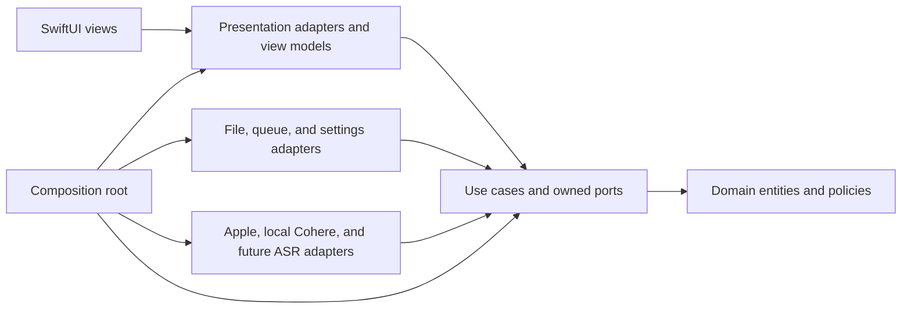
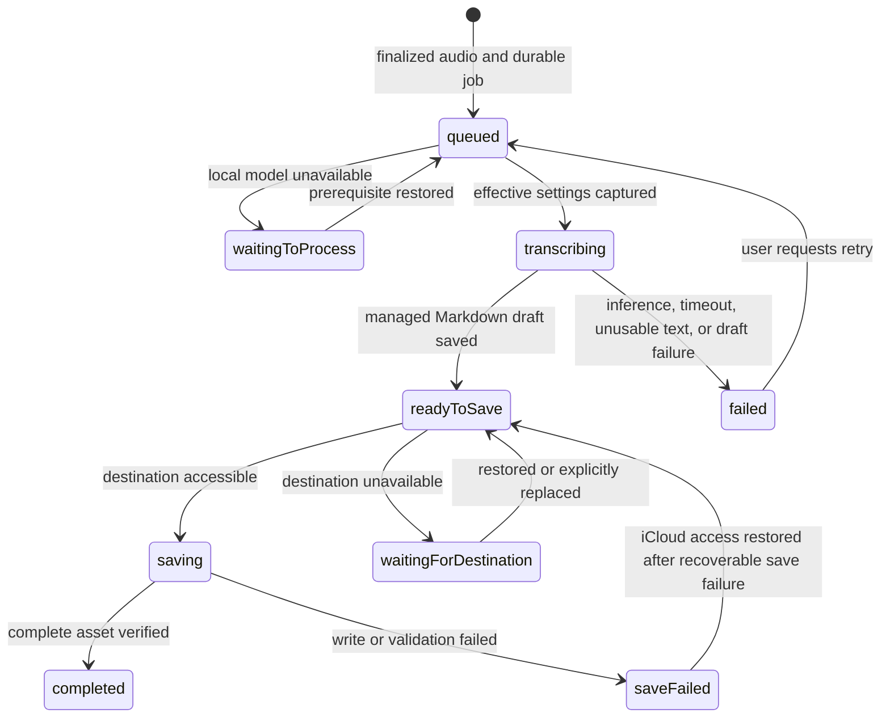

# Software architecture

Status: Proposal

This document proposes Clean Architecture boundaries, durable data flow, and recovery behavior for an iPhone app that can support multiple asset types and transcription methods. Diary Snippet is the only currently confirmed asset type; choices that still require an owner decision are called out explicitly in the context of the [confirmed product behavior](product-behavior.md) and [planned interface behavior](ux-gui.md).

## Architectural principles

1. **Source dependencies point inward.** Domain rules know nothing about use cases, UI, storage, or SDKs. Use cases depend on domain types and ports they own. Interface and infrastructure adapters implement those ports. The composition root wires concrete adapters; runtime calls may travel outward through a port, but source imports do not.
2. **Asset types are separate domain capabilities.** Shared identity, destination, timestamps, and catalog projection do not impose Diary Snippet's Markdown/audio pair on a future photo or other asset. Each kind owns its validation, payload, persistence codec, and feature use cases.
3. **Transcription methods are replaceable adapters.** Queue and diary use cases select a stable method ID through a registry and consume normalized text that becomes the managed diary body. Local model loading, audio conversion, and response parsing stay in method adapters and versioned settings; future hosted providers can add credentials and request controls without changing the core.
4. **A recording is durable before processing begins.** Audio and its queue record live in private app storage until a Diary Snippet is safely committed to the recording's selected iCloud destination. App closure, lost connectivity, and unavailable iCloud access must not erase pending work.
5. **One diary text is managed.** Transcription output initializes the Markdown body; it is not retained as a separate original. The app prefers a short, read-only Apple on-device AI title summarizing the whole body in its current language and otherwise shortens its first sentence locally with an ellipsis, including when AI generation returns an empty, failed, or wrong-language result. A body beyond one model context window is summarized in parts. Both paths have a strict maximum of 30 displayed characters, including any ellipsis; an overlong AI title is truncated locally without another model request. It saves the Markdown and audio automatically even after an AI title failure. Later edits replace only the body and regenerate the title on save; model readiness alone does not replace a saved fallback title. An empty edited body uses the title "Untitled".
6. **The selected file folder is the source of truth for finished assets.** The local queue owns unfinished work; a screen cache is only a projection of files in the currently active iCloud folder.
7. **External effects are explicit and failures are recoverable.** Microphone capture, on-device speech and model installation, location, weather, iCloud access, and notifications each have an adapter and a permission or availability boundary. Processing is fail-open across recordings: a problem with one job cannot prevent another ready job from advancing. Authorization, integrity, and input validation fail closed for the affected operation; queue progress never bypasses those checks. No Diary Snippet Markdown is published before transcription produces usable text; retries reuse durable files and avoid duplicate assets.
8. **File access does not establish content trust.** Selected iCloud folders, downloaded models, restored job records, and model output cross validation boundaries. Only registered app code grants capabilities; file metadata and generated text cannot grant access, select executable code, or authorize deletion. The [security review](security-review.md) records threats, controls, and pending implementation evidence.

## System map

Arrows show source-code dependencies, not the direction of a runtime request. A use case invokes an output port; the concrete adapter implements that inward-owned port and may call an Apple framework or remote service. The composition root is the only place that chooses concrete adapters and builds registries. A single app target can preserve these boundaries through source organization and import checks; separate targets could enforce them at compile time if a later project-structure decision approves that change.

## Clean Architecture layers and dependency rule

| Layer | Contains | May depend on | Must not import |
|---|---|---|---|
| Domain | Asset identity and kind, recording and diary-text value types, queue invariants, diary-specific rules | Swift value types and inward domain code | SwiftUI, persistence formats, provider SDKs, networking, device APIs |
| Application | Capture, process, browse, edit, and retry use cases; input/output ports; orchestration policies | Domain | SwiftUI views, `AVFoundation`, `Speech`, `URLSession`, iCloud file APIs, concrete adapter types |
| Interface adapters | View models, domain-to-screen mapping, type-specific asset codecs, provider response mapping, port implementations | Application and domain contracts | Other adapter internals through hidden side channels |
| Frameworks and composition | SwiftUI view construction, Apple APIs, network clients, file provider integration, dependency wiring | Any inward layer needed for wiring | Business rules that belong in domain or use cases |

The application owns port definitions for recording, job persistence, asset catalog, Diary Snippet storage, transcription, settings, clock, and reminders. Adapters implement them and translate platform/model objects into plain domain values. No core use case downcasts to an Apple or Cohere adapter, reads a model runtime payload, or switches on a SwiftUI screen type. Dependency injection is explicit at construction, and tests can supply in-memory adapters. These are source boundaries even if code initially lives in one Xcode target; source organization alone cannot enforce them at compile time. A future hosted method can add a credential port without changing these dependencies.

## Responsibilities and interfaces

| Boundary | Inward contract or responsibility | Outer implementation |
|---|---|---|
| Presentation | Use-case inputs and read-only screen projections | SwiftUI navigation, accessibility, edit buffers, progress and error views |
| Recording | Capture use case and `AudioCapturePort` return a finalized staging reference, duration, and capture metadata | Microphone permission, audio session, capture timer/meter, interruption handling |
| Queue | Process/retry/remove use cases own oldest-ready ordering, retry, and confirmed removal; `JobStorePort` changes each job's durable state | Private per-recording folders and one foreground worker driver |
| Transcription | `TranscriberPort` consumes a method ID, staged audio, language hint, and effective settings; returns text for the managed diary body or a typed error | Method registry and Apple, local Cohere, or later adapters |
| Diary creation and editing | Diary Snippet title policy derives a read-only title from the managed body; edit and Favorite use cases update the Markdown asset | Markdown file adapter |
| Asset browsing | `AssetCatalogPort` lists minimal type-neutral summaries from the active folder, page by page | Coordinated iCloud enumeration and type-aware summary decoders |
| Asset content | Type-specific ports own validation and edits; `DiarySnippetStorePort` commits/loads the Markdown/audio pair | Diary Snippet file codec and coordinated writer; future types get their own codec/store |
| Destination | `DestinationPort` resolves an opaque destination reference and reports access outcomes | iCloud-only picker, persistent access reference, security-scope lifetime |
| Settings and readiness | Settings/model ports provide method selection, installed-model state, and download readiness | Preferences, Apple speech assets, and a local Cohere model manager; future hosted guards are separate |
| Context and reminders | Optional recording context and reminder ports return values or typed unavailability | Location, weather, and local notification adapters |

The interfaces exchange value types, stable IDs, and typed results. They do not pass a live SwiftUI view, raw provider response, file-provider URL, or security-scoped token into core use cases. Adapters may use `AVFoundation`, `Speech`, `URLSession`, `CoreLocation`, WeatherKit, `UserNotifications`, and coordinated document APIs where suitable; exact API availability and entitlements need device verification.

Each port also enforces the [security contracts](#security-privacy-and-operating-limits) at its boundary. Destination and file adapters constrain access to validated resources; codecs return bounded typed values; the model manager returns a verified installation identity; transcription and title adapters return data with no authority to perform side effects. Use cases authorize mutations against current job, destination, and content revisions. Clean Architecture layers are source boundaries, not process sandboxes: a native model runtime shares the app's privileges and needs dependency and artifact review.

## Extending asset types

An asset has a type-neutral envelope: stable asset ID, stable kind ID, kind-specific schema version, creation and update instants, destination, and a minimal catalog summary. Each bundle must expose enough of that envelope for discovery without decoding its type-specific payload. For Diary Snippet, its Markdown front matter can carry the kind ID and envelope fields; another kind may use a different manifest. A Diary Snippet payload contains managed Markdown and audio; a future photo payload may have different files and editing actions. The shared envelope is a conceptual contract, not a requirement that every asset use Diary Snippet front matter or the same directory shape.

The application provides generic browse/open routing through an `AssetCatalogPort` and type-specific use cases for creation, validation, editing, and deletion. The iCloud adapter maps a stable kind ID and its schema version to a registered codec. The UI maps the same kind ID to a registered detail renderer and available actions. An unknown kind or newer schema remains discoverable as an unsupported catalog item with its files untouched; the app must not parse it as a Diary Snippet, silently drop it from storage, or rewrite it on scan. The exact presentation of unsupported items remains a UI decision. A legacy Diary Snippet reader displays the existing Markdown/audio pairs without the new fields as read-only entries, leaving their files untouched.

Adding a new kind should require a kind-owned domain payload and rules, use cases and ports, an iCloud codec, a summary decoder, and a presentation adapter. It should not require editing Diary Snippet's queue or file writer, or adding a global `switch` over all asset kinds in each layer. Only the composition root registers the new implementation. The registry is in-process composition, not a runtime plugin system. Photo is an example of this extension path, not an approved asset schema, feature, or workflow.

## Extending transcription methods

Use a stable `TranscriptionMethodID` rather than a closed Apple/Cohere enum in the queue and persisted jobs. A method descriptor exposes supported languages, accepted staged-audio formats, availability/readiness checks, installation requirements, and the settings that its adapter understands. A method adapter implements the inward-owned `TranscriberPort` and maps its raw output to method-neutral text plus effective provenance. Method-specific settings and provenance are versioned and namespaced so a new method's controls do not become optional fields on every existing method.

The composition root registers approved method adapters and their descriptors. Settings shows only registered, currently approved methods; the process use case asks the registry for the selected method and checks its declared prerequisites. If the method is unavailable, the user chooses among available approved methods without an automatic fallback. The queue persists a method ID and effective settings snapshot at processing start; manual retry takes a new snapshot. Unknown or removed method IDs leave jobs recoverable and visible rather than defaulting to another provider. This registry is compile-time composition, not a promise of downloadable code plugins.

Apple on-device speech and an on-device Cohere Transcribe method are the confirmed v1 adapter types. The [CohereLabs/cohere-transcribe-03-2026](https://huggingface.co/CohereLabs/cohere-transcribe-03-2026) checkpoint is the reference candidate; its iOS conversion, runtime, distribution, and device limits remain decisions before implementation. Cohere appears in Settings for installation and becomes ready for processing only after its model is installed. Hosted Qwen is a future adapter, with no v1 credential, consent, budget, or upload flow. A new method should not change queue ordering, diary title generation, or iCloud commit rules. Model loading, input conversion, and error classification remain in adapters or policies selected through ports, not scattered through SwiftUI and the queue.

## Data ownership and identity

| Datum | Durable owner | Lifetime and rule |
|---|---|---|
| Asset envelope and catalog summary | Selected iCloud folder; projected into a disposable local cache | Carries stable kind ID and schema version so browsing and routing work without assuming Diary Snippet fields. |
| Recorded audio awaiting an asset | Private app storage | Created at capture; retained until a complete destination asset is verified or the user explicitly removes it. |
| Queue job | Private queue repository | Holds stable identity, recording order, language hint, destination reference, state, attempt count, and enough information to resume safely. |
| Effective transcription settings | Queue job | Snapshotted when processing begins: method, model/conversion, and applicable controls actually used. A later Settings change does not rewrite that attempt's provenance. |
| Managed diary text | Private Markdown draft until commit; then the Markdown asset | Transcription output initializes its body. User edits replace that body; every save regenerates the read-only title. No original transcript is retained separately. Favorite changes through a separate toggle. |
| Finished audio and Markdown | Recording's selected iCloud folder | The folder selected when recording began stays attached to that job, even if the active folder later changes. Markdown front matter explicitly names the audio file and carries a schema version. |
| Active-folder selection | App settings | Controls which finished assets the app lists. Changing it does not move existing files or retarget pending recordings. |
| Optional recording context | Queue job until commit; then asset metadata | Location and weather describe recording time and never block asset creation if unavailable; omit unavailable fields. If location is available, store exact coordinates and a place name. |

Use a stable internal job ID independent of a user-editable title or folder path. Persist the recording's destination reference when capture begins and an immutable ordering key with the job. Assign the proposed asset identity before the first iCloud write and keep the job-to-asset mapping until commit and cleanup finish; a retry must use the same identity. For Diary Snippet, `created_at` is the recording-start instant and `updated_at` changes on a saved text or metadata edit, never solely on iCloud synchronization. Store instants in a form that does not depend on the current time zone; use UTC for asset file and directory names and the user's current local calendar for list grouping and displayed dates. Diary Snippet front matter records kind ID, effective transcription method/model/conversion and applicable settings, schema version, and the audio filename. Exact key names, asset ID, and filename shape still need decisions.

The catalog uses each registered kind's validator and presents a finished asset only when that kind's required files and references are valid. This avoids presenting a half-written Markdown/audio pair as a finished diary entry. The legacy Diary Snippet reader has its own completeness rule for existing pairs, so their missing new fields do not hide them; its entries expose no editing or Favorite action. The exact new-schema Diary Snippet completeness rule follows the final schema decision.

### Local durability and launch reconciliation

The proposed local staging area is file-oriented: a private folder per recording holds its audio, a small job record, and, after successful transcription, one Markdown draft. There is no second transcript file or separate text-creation job. Finish and verify each file before atomically replacing the job record that points to it. Do not advance a durable job state until its required files are readable. On launch, reconcile job records with private files before starting the worker: restore a valid earlier state, surface a recoverable capture or save failure, or identify an unreferenced private file for review. Never delete private audio merely because a queue record is missing. The exact local file format remains an implementation choice.

Completion verifies the referenced iCloud Markdown/audio pair against the private candidate and commit record, records success, and removes the private folder. Identity or file existence alone is insufficient evidence for cleanup. If the app closes between these operations, launch reconciliation checks the commit evidence and any later valid asset revision, preserving ambiguous candidates rather than overwriting external edits or creating another asset. No later iCloud outage can depend on a retained private copy.

## Recording flow

1. First launch explains microphone access and requests permission. Before the first recording, the user selects or creates an iCloud destination folder and enters recording with an en-US or ko-KR language hint. The capture use case checks current microphone authorization and the destination reference again before starting; denial leaves other app functions available and directs Record to a Settings recovery path.
2. Capture writes to a unique private file, never directly to the iCloud asset directory. The recording coordinator provides elapsed time and level-meter values to the UI without making them durable queue state.
3. On stop, finalize the audio file and durably enqueue its job before showing it as pending. The job records the capture-time destination and language hint. Recording can succeed without network access or available iCloud service.
4. At five minutes, the app stops recording and queues the finalized audio automatically. After an interruption, it also queues any playable partial recording automatically. An unplayable partial clip is retained as a failed recording with an entry-level reason and is not sent to transcription.
5. On a failed finalization or enqueue, retain any recoverable private audio and show a repairable error. Never report a recording as queued until both file and queue entry are durable.

Recording and playback share an audio-session adapter but have separate coordinators. The replay use case obtains only a committed Diary Snippet's audio through `DiarySnippetStorePort`; its screen exposes play/pause, seeking, and elapsed/total time.

## Processing and queue lifecycle

Only one worker owns a processing attempt at a time, and it runs only while the app is open. The scheduler chooses the oldest ready recording by its persisted recording order, with stable ID as a tie-breaker. Each attempt ends by durably completing, waiting, or failing its own job and releasing worker ownership; the scheduler then selects the next ready job. Waiting, failed, saving, and destination-blocked jobs are skipped when selecting transcription work. A job must not automatically reenter the ready set merely because its last attempt failed; manual retry or a changed prerequisite is required. Moving the app out of the active state stops starting new work; an in-flight operation must settle or be recoverable on relaunch. Background execution and notification delivery are not prerequisites for correctness.

This is a conceptual state machine, not a list of Swift enum cases. State changes and the files they depend on should be stored together, or replayed safely after a crash. `waitingToProcess` carries a reason such as a missing Apple speech asset or a Cohere model that is not installed or ready; `waitingForDestination` identifies an unavailable target folder. `readyToSave` retains the audio and managed Markdown draft locally so a destination outage does not force transcription again. A recoverable `saveFailed` resumes automatically when iCloud access returns, reusing those files. Other validation failures remain visible for a separate error policy. Save and recovery attempts run independently of transcription selection and have per-job settlement bounds, so one blocked destination or stalled write cannot hold another job's transcription or save. Each error path must settle the affected job and reschedule other ready work without a tight retry loop.

At processing start, resolve the current method and model choices into a snapshot. Check Apple speech or local Cohere model readiness before transcription; if unavailable, explain why, offer installation when applicable, and ask the user to choose an available approved method. If none is available, keep the job waiting. There is no automatic switch from Apple to Cohere or vice versa. Save the method's effective settings and the user's original language hint separately; model language values may differ from en-US/ko-KR.

V1 transcription failures move to a failed state with manual retry; a missing local model instead leaves the job waiting with a reason. The queue retains audio throughout. A manual transcription retry takes a fresh snapshot of current Settings and has no fixed count limit while the recording remains. The earlier three-retry policy for temporary network or server failures belongs to future hosted Qwen work.

A transcriber adapter must provide a bounded response or cancellable attempt so one hung inference cannot own the worker indefinitely. On timeout or cancellation, invalidate that attempt ID, retain its audio, record an entry-level failure, and release worker ownership only after the adapter has relinquished the underlying work. A late callback cannot advance the job. The runtime evaluation must demonstrate this behavior for both approved methods; if a candidate cannot settle a hung attempt, it does not meet the fail-open queue contract. Optional title, weather, and location failures use their approved fallback or omission rules and do not hold the worker.

After user confirmation, a remove use case stops or invalidates an in-flight attempt, durably marks the job for removal, and deletes its private audio, Markdown draft, and job record. Late inference callbacks carrying that attempt ID are ignored. The proposed per-job mutation barrier is held from the first destination write through verification and completion: if removal is accepted first, the writer cannot publish; if the writer reaches completion first, the item is no longer pending or failed and the UI reports that it was saved. A removal request arriving during that write waits for the barrier before it can be accepted. The job record identifies only that job's partial files for coordinated cleanup, without touching unrelated files. Removal of an already finished asset is a separate, undecided product action. A crash during removal resumes cleanup on launch. The exact cancellation mechanism for each local engine remains an adapter concern.

Every destination mutation, including audio writes and repair, uses this barrier so removal cannot race a pre-publication write. Retargeting increments a durable destination revision and invalidates earlier save/repair attempts under the same barrier. Every asynchronous result must match the live job ID, attempt generation, destination revision, and relevant body revision before it can mutate state. Removal tombstones remain until all affected work has relinquished file access and cleanup is durable; do not delete an open file and assume its writer has stopped. A timeout is not proof that a file operation ended. Bound coordination waits and retain a recoverable state if access cannot settle; never acknowledge removal or successful publication on that basis. The [mutation controls](#mutation-and-recovery-integrity) constrain cleanup to positively identified files.

Make each transition idempotent. The job record keeps an attempt ID, selected method ID, effective settings, and model/conversion identity before inference starts, then associates the Markdown draft with the successful attempt. A late result from an obsolete attempt cannot overwrite a newer manual retry. Advance from transcription only after that draft is durable. A recovered job checks whether a complete asset with its stable identity already exists before writing, and reuses the draft where valid. A process crash between inference output and the draft write may require another local inference run. Recovery derives truth from durable files and job state rather than trusting an in-flight marker alone. Reconcile jobs independently on launch: quarantine a malformed job record with its private files intact, surface a reason for review, and continue scanning and processing other valid jobs. A queue-wide storage failure that prevents durable state changes pauses processing and reports the problem rather than claiming a job was safely advanced.

## Asset commit and iCloud behavior

`DestinationAccess` stores a persistent reference to each selected iCloud folder and resolves it when needed. It must validate that a newly chosen folder is in iCloud, balance security-scope access, and report revocation, provider unavailability, or missing files distinctly. Selecting or creating arbitrary iCloud folders needs a device prototype. The first recording requires a folder selection. The app lists only the active folder; it does not merge old folders into the current list.

The proposed commit protocol is:

1. Keep the complete local candidate in the recording's private folder: finalized audio, one managed Markdown draft, and a job record with recording-time metadata and effective transcription provenance.
2. Resolve the job's original destination and validate its current access and revision. Under the per-job mutation barrier, coordinate file operations and write audio before publishing the Markdown entry. Use exclusive creation or a checked expected version for replacement; repeated writes use the same job-to-asset mapping and must not replace a different asset. Validate containment and file identity at the actual operation, not only when building a URL.
3. Through coordinated access, validate the Markdown, its explicit audio reference, and the expected content of both files against the private candidate's lengths and cryptographic digests. Then durably record completion evidence and immediately delete the private folder. If validation fails, keep the folder for recovery. Private digests detect mismatches; hashes supplied by external front matter are not authenticity evidence. Verification proves a complete locally readable iCloud pair; whether completion must also wait for remote upload confirmation remains open.
4. On reopen, repair incomplete sets only when the pending job's private commit record and observed destination files agree on ownership and expected versions. An identity collision or unexplained external modification enters recovery/conflict handling without overwrite or cleanup. Keep and flag unmatched incomplete files; never create a second visible asset for the same job.

The exact file layout and remaining Markdown schema are pending decisions. iCloud is not a transaction over the Markdown/audio pair, so a crash or synchronization conflict may leave partial files. The private job record maps job identity to proposed asset identity and file names for repairing a matching incomplete pair. A partial pair received on another device may have no local candidate there; preserve and flag its files, show surviving text or playable audio read-only with a missing-file reason, and offer confirmed removal. Never delete files merely because they look incomplete.

The Diary Snippet store adapter reads and edits files through coordinated access, while the catalog refreshes when iCloud changes arrive and treats local list data as disposable cache. A diary edit use case regenerates the read-only title on body save using the AI-or-fallback policy; an empty body uses "Untitled", and the editor does not expose a title field. The title, its origin, and available Apple model identity, iOS version, and prompt revision are stored in front matter; the origin and version details are not shown in asset detail. Favorite toggles separately and, like a body edit, updates `updated_at`. The edit use case retains the user's new body locally until the coordinated write and referenced pair are verified, so an unavailable destination does not erase an edit. It checks the version read by the editor before saving; a changed version enters the conflict path instead of silently overwriting it. For conflicting versions with comparable iCloud modification times, select the later complete version automatically and discard the older one. Keep each version's Markdown with its referenced audio; do not combine files from different conflicting versions. Device clock differences may make that order differ from real edit order. If times are equal or missing, keep both versions and let the user open the two versions separately and choose one. The exact conflict-version packaging and cleanup need a device prototype.

When a job finishes in a folder that is no longer active, emit a completion event naming that destination. If access to that folder is temporarily lost, continue local transcription and keep the Markdown/audio candidate in `waitingForDestination`; retry saving when access returns. If access is permanently lost, allow explicit replacement for that pending job, record the destination change durably, and then retry saving. A general active-folder change never silently redirects the job.

### Catalog consistency

The catalog lists validated summaries from the active folder and sorts them by `created_at` descending with a stable ID tie-breaker. It also exposes flagged incomplete pairs without local repair candidates as separate recovery items, outside the finished-asset results. This is an architectural proposal for deterministic on-demand paging; the exact legacy-entry identity and pagination implementation remain open. A folder change invalidates outstanding page requests and their cursors. External iCloud changes invalidate affected pages and detail snapshots, and the presentation layer deduplicates repeated observations of the same validated resource/version so an item does not appear twice while pages refresh. Different resources claiming the same asset ID remain separate ambiguous items; an external ID alone cannot hide an entry. A file that becomes unavailable or incomplete during a read is reported as temporarily unavailable or as a recovery item, never interpreted as a request to delete it. Completion into a former folder does not insert that asset into the active-folder list.

## UI and application state

The root presents the five approved tabs: Main, Benefits, Calendar, Plugins, and All. Main owns the full active-folder diary collection, loading on demand with infinite scrolling, and a floating Record entry. All shows no diary snippets for now and owns entries to Settings and separate Pending Recordings and Failed Recordings screens. Benefits, Calendar, and Plugins display explanatory empty states. Asset detail presents title and diary text first, with Favorite beside the title; metadata sits at the bottom and contains the audio replay entry. Other metadata controls remain open. View models consume navigation intents rather than embed storage assumptions.

The UI subscribes to queue and asset projections on the main actor. Queue progress is derived from durable job state, not a view-local timer; closing and reopening the app must restore the same pending/failed status. Asset list groups by local creation date and displays the saved generated title. Custom bitmap icons need accessible labels and suitable appearance/size variants. The editor holds only a body draft; its save use case derives the title and commits through `DiarySnippetStorePort` so an iCloud write failure can preserve the user's unsaved work. Favorite uses a separate toggle intent.

Notifications are an optional reminder channel for pending work after the user leaves. Schedule a local reminder for the next local day at the same local time the user left if work remains pending. Permission denial or missed delivery does not change queue state. Suppression and cancellation rules remain open; the in-app pending indicator is authoritative.

## Failure and recovery contract

| Condition | Durable state | User-visible result |
|---|---|---|
| Microphone permission denied on first launch or later | No queued job | Keep non-recording features available; Record explains how to enable permission in system Settings. |
| Unplayable interrupted recording | Retain the partial file in a failed recording entry; do not transcribe it | Show the reason beside its Failed Recordings entry. |
| Offline after recording | Audio and job remain private; processing waits if needed | Pending recording remains visible. |
| Apple speech asset or Cohere model unavailable | Job waits with reason; no transcription starts | Show readiness or download action and reason. |
| Transcription fails | Audio and job remain; failure recorded | Show a failed item with manual retry. |
| Transcription hangs or cannot finish within its bound | Invalidate the attempt and retain audio after the adapter relinquishes work | Show a failed item with a reason; continue with the next ready recording. |
| No usable words transcribed | Audio remains in failed job; no asset | Show the reason beside its Failed Recordings entry and offer manual retry. |
| Markdown draft write fails after transcription | Audio remains in the failed job; no published asset | Show the reason and offer manual retry; inference may run again because its output was not saved separately. |
| Destination access lost | Continue local transcription and retain the Markdown/audio candidate, with no automatic retargeting | Ask for restored access and automatically retry the saved draft when it returns; if permanently lost, offer explicit replacement for that job. |
| Confirmed removal of pending or failed recording | Invalidate work, then durably remove its private data and job after any in-progress write is reconciled | Entry disappears after cleanup; a late inference result cannot publish an asset. |
| Partial iCloud write with retained candidate | Job and local candidate remain until verification | Hide the incomplete set and repair it from the retained candidate on reopen. |
| Incomplete iCloud pair without local candidate | Preserve surviving files until explicit removal | Flag the pair; show available content read-only and a missing-file reason; offer confirmed removal. |
| Conflicting iCloud versions | Use iCloud modification time when values are comparable; preserve both if equal or missing | For equal or missing times, let the user open two separate versions and choose one. |
| App closes or is interrupted | Last durable state remains | Restore pending or failed status when opened. |
| One job record is malformed | Preserve its private files and isolate that record | Flag it for review; reconcile and process other valid jobs. |
| Queue store cannot durably change state | Preserve files and stop claiming progress | Show a queue-wide storage error until durable writes recover. |
| Protected private data unavailable during device lock | Preserve files and defer reads/state changes until access returns | Wait for unlock and reconcile; do not report missing or corrupt audio. |
| Model artifact fails integrity or compatibility checks | Installation remains not-ready; preserve any prior verified install without changing an attempt's selected version | Show a sanitized installation failure; no unsafe loading or automatic method switch. |
| Unsafe or malformed external asset/reference | Preserve external files and isolate the item; no unsafe read, write, or removal | Show an item-level validation reason and continue other catalog/queue work. |
| Destination content or ownership differs from commit evidence | Preserve local candidate and external files; withhold completion and cleanup | Enter recovery/conflict handling rather than overwriting or declaring the job saved. |

## Security, privacy, and operating limits

These are proposed implementation requirements for the confirmed product scope. They do not approve a runtime, schema, distribution service, or new product feature. Prioritized findings and verification evidence are tracked in the [security review](security-review.md).

### Trust boundaries and guarantees

Protect audio, diary bodies and titles, exact coordinates, place names, drafts, context/provenance, destination bookmarks, and any derived caches. Treat externally editable iCloud files, including legacy files and conflict versions, as untrusted input. A shared-folder collaborator or another authorized app may alter them. Restored local state must also be validated rather than replayed as instructions. Downloaded artifacts and all inference output are separate untrusted inputs.

The trusted computing base includes iOS, the signed app, its bundled dependencies and approved native model runtime. A source-layer boundary cannot contain a compromised in-process runtime. A compromised OS, an attacker controlling the unlocked device, or an authorized folder reader is outside the confidentiality guarantee. V1 writes ordinary Markdown/audio files to the selected folder; it does not introduce app-level encryption or authentication. iCloud Drive end-to-end protection depends on account and sharing configuration, so the app must not promise it unconditionally. See [Apple's iCloud security overview](https://support.apple.com/en-us/102651).

### File access and untrusted content

- `DestinationPort` keeps bookmarks private, resolves them afresh, validates iCloud membership through platform metadata rather than path spelling, and scopes access only around the operation. Balance every successful security-scope acquisition on all exit paths. Stale or revoked access returns a typed wait/recovery result; never search other folders or reinterpret a path to regain access. Apple's [directory-access guidance](https://developer.apple.com/documentation/uikit/providing-access-to-directories) requires coordinated I/O and allows permission revocation.
- A codec validates an audio reference as a filename or constrained relative path within that asset's permitted bundle. Reject absolute paths, URLs, parent traversal, ambiguous encodings, symbolic links, aliases, and unexpected file types. Validate each component and final resource, including after provider resolution; a string-prefix check is insufficient. Do not URL-decode a validated filename later. Recheck identity and containment during coordinated open, replace, and delete; use non-following/exclusive operations where supported. If safe containment cannot be established, preserve the input and refuse the operation. Apply these rules to legacy pairing, repair, conflict selection, and confirmed removal too.
- Parse only bounded UTF-8 text and a strict schema. Define limits for bytes, field lengths, nesting, collection size, and catalog traversal before implementation. If front matter uses YAML, reject object construction, custom tags, duplicate keys, and alias expansion; do not use a permissive deserializer. Unknown schema/kind stays unsupported and untouched. Malformed files get isolated diagnostics and cannot block the next catalog page. Validate audio format and decoded-resource bounds before playback or inference; extensions alone are not evidence.
- Serialize front matter with a typed escaping codec. Titles, body text, place names, and model output never become raw metadata fragments, filenames, or paths. Keep body delimiters distinct from the header. Render Markdown as inert text or a restricted native subset: no script/HTML execution, automatic remote images, or automatic link fetches. Explicit link opening, if later supported, needs a scheme policy and user action; document text cannot invoke app mutations. This applies equally to previews and read-only recovery views.

### Private storage and disclosure

Keep irreplaceable pending audio, drafts, edit recovery, and job records in nonpurgeable private Application Support storage, outside shared documents and caches. Conversion scratch, partial summaries, catalog caches, and temporary replacements inherit the sensitivity of their source. Set and verify Data Protection attributes on creation and atomic replacement; never silently downgrade protection after an access failure. The proposed baseline is Complete Protection for closed sensitive files. Lock loss pauses protected reads and state changes, preserves files, and resumes reconciliation after unlock instead of classifying them as missing or corrupt. Recording finalization and its journal need a device-tested protection policy; whether an already-open recording needs Protected Unless Open depends on the still-open lock/background capture decision. Apple's [Data Protection classes](https://support.apple.com/en-ca/guide/security/secb010e978a/web) distinguish these access lifetimes.

Separate backup policy from storage durability. Redownloadable models and recreatable caches should be excluded from backup. The only copy of a pending recording or unsaved edit is not a cache: retain it until verified commit or confirmed removal. Whether to exclude that irreplaceable staging from backup requires owner review of privacy versus device-loss recovery. Reapply applicable backup attributes after replacement, and do not promise that exclusion guarantees no backup copies; Apple explicitly limits that guarantee in its [backup guidance](https://developer.apple.com/documentation/foundation/optimizing-your-app-s-data-for-icloud-backup). Do not change backup attributes on user-selected finished documents as a cleanup shortcut.

Use allowlisted diagnostic fields such as operation, typed failure code, duration, and a local opaque correlation ID. Exclude audio, text, titles, exact location, prompts, URLs, bookmarks, and raw SDK errors from logs, crash annotations, analytics, and support exports. Map errors to sanitized entry-level reasons. Reminder payloads contain generic pending-work wording and an opaque route, with no diary or destination content. Cover sensitive views before app-switcher snapshots; a queued notification or old navigation route must recheck current state. No clipboard or search-index export occurs implicitly. Remove scratch and derived data when their job/attempt ends, including crash cleanup, while preserving required recovery copies. Deletion is logical cleanup of app-owned copies, not secure erasure of flash, iCloud versions, or preexisting backups.

### Network and local inference

| Adapter | Allowed outbound data | Required boundary |
|---|---|---|
| Apple speech, Cohere inference, and title generation | No app-supplied audio, diary text, or prompts to a remote inference endpoint | Require verified on-device execution and language readiness; an unavailable local path waits or uses the approved title fallback. Never fall back to server recognition. |
| Model installation | Approved artifact identifiers and download transport metadata | A distinct installer obtains model data; it receives no recording, diary, location, or destination capability. |
| Optional weather/place lookup | Only the location/time needed by the approved service | Check current authorization and app preference before the request and before accepting late results; do not send diary/audio or backfill weather. Exact service and timing remain open. |
| iCloud document storage | The confirmed Markdown/audio bundle, including permitted exact-location metadata | Write only to the recording's selected or explicitly replaced destination. Local transcription does not mean the finished asset never leaves the device. |

Keep HTTPS with standard certificate validation and App Transport Security for app-controlled network clients; do not use broad exceptions or trust-all delegates. ATS protects transport, not model provenance or destination authorization. See [Apple's secure-network guidance](https://developer.apple.com/documentation/security/preventing-insecure-network-connections). Review SDK telemetry and network behavior as part of dependency approval and verify the on-device promise with network observation, not an adapter name. Platform-managed speech/model downloads and iCloud sync remain distinct from inference uploads. V1 has no hosted credentials or Qwen upload path; the [future hosted policy](product-behavior.md#future-work-hosted-qwen-transcription) remains deferred.

Microphone permission is checked before capture and optional context permission is checked before acquisition. An app-level location preference cannot override system denial. Do not reuse cached coordinates or late lookup results after opt-out; prior saved metadata follows the existing product rules. Add no background-location capability for recording-time context. Permission and missing-context failures preserve the approved non-blocking behavior.

### Model installation integrity

The model manager downloads only app-approved artifacts, never a URL or model path supplied by a diary or job. Its trusted descriptor binds model/conversion version, runtime compatibility, artifact lengths, and cryptographic digests to an app-bundled manifest or a manifest authenticated by an app-trusted signing key. A checksum downloaded beside the model from the same untrusted location is not sufficient authentication. The actual manifest, hosting, key rotation/revocation, and update mechanism remain distribution decisions.

Download into an isolated staging directory with bounded transfer, disk-space preflight, and redirect validation against approved HTTPS distribution hosts. Verify complete bytes before extraction, compilation, or loading. If archives are used, reject traversal, links, unexpected files, and excessive expanded sizes/counts; validate contained files against the trusted manifest. Load data formats only, with no downloaded scripts, custom executable operators, or dynamic code plugins. Atomically publish an immutable installation after integrity and compatibility checks. Failed, interrupted, or tampered installs stay not-ready and never replace a valid installation. Pin each attempt to a verified installation identity; do not delete or replace files in use. Revalidate changed/corrupt installs and revoke known-bad versions; never silently substitute a different model. Native parser/runtime vulnerabilities remain a dependency risk even for authenticated model data.

### Generated text and resource bounds

Diary content is data to summarize, never trusted model instructions. Keep the app's fixed title instructions separate from transcript, body, and intermediate summaries. Give the title session no tools, network client, destination capability, or unrelated diary context. Validate its bounded plain-text result, language, and approved 30-character title policy before serialization; on unusable output, use the approved fallback. A prompt-injection attempt may degrade title quality but must not change a path, execute an action, alter the body, or expose other entries. Apple's [Foundation Models safety guidance](https://developer.apple.com/documentation/foundationmodels/improving-the-safety-of-generative-model-output) identifies unverified instruction content as a prompt-injection risk; prompting alone is not a security boundary.

Bound decoding, inference, title chunking/combination, file enumeration, and download work by bytes, memory, time, and cancellation. The five-minute capture cap does not bound externally modified audio or arbitrarily edited Markdown. Cover long bodies in bounded chunks without an unbounded recursive summarization loop; when the resource budget cannot cover the body, treat title generation as unusable and fall back without preventing save. Choose numeric limits through the schema/runtime gates. Preflight free space and reserve room for durable queue settlement; on exhaustion preserve existing recordings and refuse new unsafe work rather than evicting pending audio. Unlimited manual retries do not authorize overlapping attempts or automatic retry loops.

### Mutation and recovery integrity

Use private job-to-file ownership and commit evidence for cleanup; an external asset ID, timestamp, filename, or front-matter flag is never deletion authority. Confirmed removal of an incomplete external pair is limited to the exact validated resources shown to the user and must recheck their identities/versions. Refuse deletion if references are unsafe, files changed, or another asset shares a referenced file; never recursively remove a user-selected directory. Private job cleanup is confined to its validated private subtree. A malformed job or restored tombstone cannot supply an arbitrary deletion path.

The [commit protocol](#asset-commit-and-icloud-behavior) verifies expected contents before releasing staging. Recovery must distinguish an uncommitted partial write from a later external edit; never repair solely because IDs match. All write, repair, retarget, and removal callbacks are fenced by current revisions, including title results for body edits. Duplicate IDs in separate external resources remain separate ambiguous items until reconciled; catalog deduplication applies only to repeated observations of the same validated resource/version. A forged ID must not hide another file or authorize overwriting it.

Apply the confirmed latest-iCloud-modification-time rule only after validating complete candidate versions and their referenced audio. Timestamps express conflict order, not authenticity, and can be manipulated by an authorized writer. Keep equal/missing-time versions separate as approved; no app signature or authenticated edit history is implied. If validation or ownership is uncertain, preserve files and surface recovery while unrelated jobs continue. The commit, conflict, and deletion prototypes must demonstrate these conditions before dependent implementation is accepted.

## Verification seams

Use protocol-driven fakes for the recorder, transcriber, destination access, asset catalog, Diary Snippet store, clock, connectivity, and notification scheduler. Dependency checks should keep domain/application source free of UI, provider, and persistence imports. Contract tests should register a synthetic second asset kind and a fake third transcription method, then verify browsing, routing, settings snapshots, and queue processing without modifying Diary Snippet rules or the queue use case. This tests the extension boundaries without claiming photo or another provider is a shipped feature.

The most valuable workflow tests exercise durable boundaries: relaunch after every queue transition, changed Settings before processing starts, changed active folder after recording starts, missing or not-ready local model, manual retry, offline recovery, unavailable destination, partial asset write, and external asset edits. Add a three-job queue with a waiting oldest job, a failed or timed-out next job, and a ready newest job; verify that the newest completes, each prior job retains its files and reason, and no failed job spins. A malformed job record must not prevent reconciliation of valid jobs. A simulated queue-store write failure must preserve files without reporting false progress. Device checks must cover microphone interruptions, Apple and Cohere readiness for both languages, bounded cancellation of hung inference, five-minute Cohere inference and resource use, iCloud folder creation and revocation, coordinated file behavior, and model input compatibility. These checks are implementation evidence, not substitutes for the open product decisions.

The [adversarial verification matrix](security-review.md#adversarial-verification-matrix) adds containment, parser, model-integrity, disclosure, lock-state, and race tests with observable pass criteria. These are required evidence for the implementing milestones, not claims that this documentation review ran an app or passed a security gate.

## Decisions required before dependent implementation

| Decision | Why this architecture leaves it open |
|---|---|
| Title generation implementation details | Defines Unicode counting/truncation, partial-summary combination, and how an Apple model version is identified when exposed or documented. An unavailable model or unusable generation uses the first-sentence fallback; an empty edited body uses "Untitled". |
| Exact front-matter keys and audio path | Defines file validation and stable identity. Existing pairs remain read-only and untouched. |
| Cohere conversion/runtime, model installation, bounded cancellation, and target-phone quality, memory, battery, and latency limits | Defines the v1 local adapter, readiness flow, fail-open worker behavior, and viable model distribution. |
| Hosted Qwen model IDs, controls, budget estimate and consent restoration | Future-work cloud adapter and Settings choices; does not block v1. |
| Encoding | Defines recorder output and audio-session interactions. Unplayable interrupted clips remain in Failed Recordings. |
| Retry delay/error classification, completion-versus-removal UI, and reminder suppression | Defines state transitions and user actions. Confirmed removal of pending or failed recordings is decided; the proposed per-job barrier still needs owner review. |
| Meaning of complete iCloud bundle verification | Determines whether a coordinated local read is sufficient for staging cleanup or whether remote upload confirmation is also required. |
| Permanent access-loss detection, explicit retargeting mechanics, and user conflict-resolution UI | Defines destination recovery and conflict handling. |
| Location/weather precision and remaining detail controls | Defines metadata shape and presentation contracts. |
| Target deployment setting and usable simulator or device | Defines project configuration and executable validation. |
| Private-data protection, capture on lock, and backup/restore policy | Choose Data Protection for capture and its journal without losing interrupted recordings; decide privacy versus recovery for the only local copy of pending audio/edits. Define restore behavior for removed work, including the limits of backups predating removal. |
| Security limits and model trust mechanism | Set parser/decoder/download/inference limits, approved distribution hosts and authenticated manifests, update/revocation behavior, and runtime dependency review. Implement the security contracts without treating a proposed mechanism as an approved dependency. |

Until these are resolved, interfaces can be sketched and isolated, but the corresponding behavior must not be implemented as if a proposal were an approved rule.
