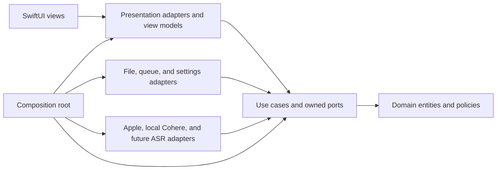
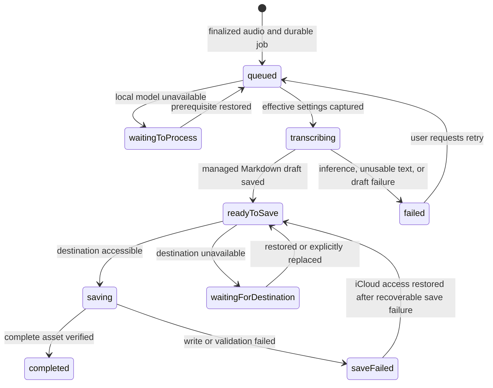

# Software architecture

Status: Proposal

This document proposes Clean Architecture boundaries, durable data flow, and recovery behavior for an iPhone app that can support multiple asset types and transcription methods. Diary Snippet is the only currently confirmed asset type; choices that still require an owner decision are called out explicitly in the context of the [confirmed product behavior](product-behavior.md) and [planned interface behavior](ux-gui.md).

## Architectural principles

1. **Source dependencies point inward.** Domain rules know nothing about use cases, UI, storage, or SDKs. Use cases depend on domain types and ports they own. Interface and infrastructure adapters implement those ports. The composition root wires concrete adapters; runtime calls may travel outward through a port, but source imports do not.
2. **Asset types are separate domain capabilities.** Shared identity, destination, timestamps, and catalog projection do not impose Diary Snippet's Markdown/audio pair on a future photo or other asset. Each kind owns its validation, payload, persistence codec, and feature use cases.
3. **Transcription methods are replaceable adapters.** Queue and diary use cases select a stable method ID through a registry and consume normalized text that becomes the managed diary body. Local model loading, audio conversion, and response parsing stay in method adapters and versioned settings; future hosted providers can add credentials and request controls without changing the core.
4. **A recording is durable before processing begins.** Audio and its queue record live in private app storage until a Diary Snippet is safely committed to the recording's selected iCloud destination. App closure, lost connectivity, and unavailable iCloud access must not erase pending work.
5. **One diary text is managed.** Transcription output initializes the Markdown body; it is not retained as a separate original. The app prefers a short, read-only Apple on-device AI title summarizing the whole body when available and otherwise shortens the body's first sentence locally with an ellipsis, including when AI generation returns an empty or failed result. Both paths have a strict maximum of 30 displayed characters, including any ellipsis. It saves the Markdown and audio automatically even after an AI title failure. Later edits replace only the body and regenerate the title on save. An empty edited body uses the title "Untitled".
6. **The selected file folder is the source of truth for finished assets.** The local queue owns unfinished work; a screen cache is only a projection of files in the currently active iCloud folder.
7. **External effects are explicit and failures are recoverable.** Microphone capture, on-device speech and model installation, location, weather, iCloud access, and notifications each have an adapter and a permission or availability boundary. No Diary Snippet Markdown is published before transcription produces usable text; retries reuse durable files and avoid duplicate assets.

## System map

Arrows show source-code dependencies, not the direction of a runtime request. A use case invokes an output port; the concrete adapter implements that inward-owned port and may call an Apple framework or remote service. The composition root is the only place that chooses concrete adapters and builds registries. A single app target can preserve these boundaries through source organization and import checks; separate targets could enforce them at compile time if a later project-structure decision approves that change.

## Clean Architecture layers and dependency rule

| Layer | Contains | May depend on | Must not import |
|---|---|---|---|
| Domain | Asset identity and kind, recording and diary-text value types, queue invariants, diary-specific rules | Swift value types and inward domain code | SwiftUI, persistence formats, provider SDKs, networking, device APIs |
| Application | Capture, process, browse, edit, and retry use cases; input/output ports; orchestration policies | Domain | SwiftUI views, `AVFoundation`, `Speech`, `URLSession`, iCloud file APIs, concrete adapter types |
| Interface adapters | View models, domain-to-screen mapping, type-specific asset codecs, provider response mapping, port implementations | Application and domain contracts | Other adapter internals through hidden side channels |
| Frameworks and composition | SwiftUI view construction, Apple APIs, network clients, file provider integration, dependency wiring | Any inward layer needed for wiring | Business rules that belong in domain or use cases |

The application owns port definitions for recording, job persistence, asset catalog, Diary Snippet storage, transcription, settings, clock, and reminders. Adapters implement them and translate platform/model objects into plain domain values. No core use case downcasts to an Apple or Cohere adapter, reads a model runtime payload, or switches on a SwiftUI screen type. Dependency injection is explicit at construction, and tests can supply in-memory adapters. These are source boundaries even if code initially lives in one Xcode target; source organization alone cannot enforce them at compile time. A future hosted method can add a credential port without changing these dependencies.

## Responsibilities and interfaces

| Boundary | Inward contract or responsibility | Outer implementation |
|---|---|---|
| Presentation | Use-case inputs and read-only screen projections | SwiftUI navigation, accessibility, edit buffers, progress and error views |
| Recording | Capture use case and `AudioCapturePort` return a finalized staging reference, duration, and capture metadata | Microphone permission, audio session, capture timer/meter, interruption handling |
| Queue | Process/retry/remove use cases own oldest-ready ordering, retry, and confirmed removal; `JobStorePort` changes each job's durable state | Private per-recording folders and one foreground worker driver |
| Transcription | `TranscriberPort` consumes a method ID, staged audio, language hint, and effective settings; returns text for the managed diary body or a typed error | Method registry and Apple, local Cohere, or later adapters |
| Diary creation and editing | Diary Snippet title policy derives a read-only title from the managed body; edit and Favorite use cases update the Markdown asset | Markdown file adapter |
| Asset browsing | `AssetCatalogPort` lists minimal type-neutral summaries from the active folder, page by page | Coordinated iCloud enumeration and type-aware summary decoders |
| Asset content | Type-specific ports own validation and edits; `DiarySnippetStorePort` commits/loads the Markdown/audio pair | Diary Snippet file codec and coordinated writer; future types get their own codec/store |
| Destination | `DestinationPort` resolves an opaque destination reference and reports access outcomes | iCloud-only picker, persistent access reference, security-scope lifetime |
| Settings and readiness | Settings/model ports provide method selection, installed-model state, and download readiness | Preferences, Apple speech assets, and a local Cohere model manager; future hosted guards are separate |
| Context and reminders | Optional recording context and reminder ports return values or typed unavailability | Location, weather, and local notification adapters |

The interfaces exchange value types, stable IDs, and typed results. They do not pass a live SwiftUI view, raw provider response, file-provider URL, or security-scoped token into core use cases. Adapters may use `AVFoundation`, `Speech`, `URLSession`, `CoreLocation`, WeatherKit, `UserNotifications`, and coordinated document APIs where suitable; exact API availability and entitlements need device verification.

## Extending asset types

An asset has a type-neutral envelope: stable asset ID, stable kind ID, kind-specific schema version, creation and update instants, destination, and a minimal catalog summary. Each bundle must expose enough of that envelope for discovery without decoding its type-specific payload. For Diary Snippet, its Markdown front matter can carry the kind ID and envelope fields; another kind may use a different manifest. A Diary Snippet payload contains managed Markdown and audio; a future photo payload may have different files and editing actions. The shared envelope is a conceptual contract, not a requirement that every asset use Diary Snippet front matter or the same directory shape.

The application provides generic browse/open routing through an `AssetCatalogPort` and type-specific use cases for creation, validation, editing, and deletion. The iCloud adapter maps a stable kind ID and its schema version to a registered codec. The UI maps the same kind ID to a registered detail renderer and available actions. An unknown kind or newer schema remains discoverable as an unsupported catalog item with its files untouched; the app must not parse it as a Diary Snippet, silently drop it from storage, or rewrite it on scan. The exact presentation of unsupported items remains a UI decision. A legacy Diary Snippet reader displays the existing Markdown/audio pairs without the new fields as read-only entries, leaving their files untouched.

Adding a new kind should require a kind-owned domain payload and rules, use cases and ports, an iCloud codec, a summary decoder, and a presentation adapter. It should not require editing Diary Snippet's queue or file writer, or adding a global `switch` over all asset kinds in each layer. Only the composition root registers the new implementation. The registry is in-process composition, not a runtime plugin system. Photo is an example of this extension path, not an approved asset schema, feature, or workflow.

## Extending transcription methods

Use a stable `TranscriptionMethodID` rather than a closed Apple/Cohere enum in the queue and persisted jobs. A method descriptor exposes supported languages, accepted staged-audio formats, availability/readiness checks, installation requirements, and the settings that its adapter understands. A method adapter implements the inward-owned `TranscriberPort` and maps its raw output to method-neutral text plus effective provenance. Method-specific settings and provenance are versioned and namespaced so a new method's controls do not become optional fields on every existing method.

The composition root registers approved method adapters and their descriptors. Settings shows only registered, currently approved methods; the process use case asks the registry for the selected method and checks its declared prerequisites. If the method is unavailable, the user chooses among available approved methods without an automatic fallback. The queue persists a method ID and effective settings snapshot at processing start; manual retry takes a new snapshot. Unknown or removed method IDs leave jobs recoverable and visible rather than defaulting to another provider. This registry is compile-time composition, not a promise of downloadable code plugins.

Apple on-device speech and an on-device Cohere Transcribe method are the confirmed v1 adapter types. The [CohereLabs/cohere-transcribe-03-2026](https://huggingface.co/CohereLabs/cohere-transcribe-03-2026) checkpoint is the reference candidate; its iOS conversion, runtime, distribution, and device limits remain decisions before implementation. Cohere appears in Settings for installation and becomes ready for processing only after its model is installed. Hosted Qwen is a future adapter, with no v1 credential, consent, budget, or upload flow. A new method should not change queue ordering, diary title generation, or iCloud commit rules. Model loading, input conversion, and error classification remain in adapters or policies selected through ports, not scattered through SwiftUI and the queue.

## Data ownership and identity

| Datum | Durable owner | Lifetime and rule |
|---|---|---|
| Asset envelope and catalog summary | Selected iCloud folder; projected into a disposable local cache | Carries stable kind ID and schema version so browsing and routing work without assuming Diary Snippet fields. |
| Recorded audio awaiting an asset | Private app storage | Created at capture; retained until a complete destination asset is verified or the user explicitly removes it. |
| Queue job | Private queue repository | Holds stable identity, recording order, language hint, destination reference, state, attempt count, and enough information to resume safely. |
| Effective transcription settings | Queue job | Snapshotted when processing begins: method, model/conversion, and applicable controls actually used. A later Settings change does not rewrite that attempt's provenance. |
| Managed diary text | Private Markdown draft until commit; then the Markdown asset | Transcription output initializes its body. User edits replace that body; every save regenerates the read-only title. No original transcript is retained separately. Favorite changes through a separate toggle. |
| Finished audio and Markdown | Recording's selected iCloud folder | The folder selected when recording began stays attached to that job, even if the active folder later changes. Markdown front matter explicitly names the audio file and carries a schema version. |
| Active-folder selection | App settings | Controls which finished assets the app lists. Changing it does not move existing files or retarget pending recordings. |
| Optional recording context | Queue job until commit; then asset metadata | Location and weather describe recording time and never block asset creation if unavailable; omit unavailable fields. If location is available, store exact coordinates and a place name. |

Use a stable internal job ID independent of a user-editable title or folder path. Persist the recording's destination reference when capture begins and an immutable ordering key with the job. Assign the proposed asset identity before the first iCloud write and keep the job-to-asset mapping until commit and cleanup finish; a retry must use the same identity. For Diary Snippet, `created_at` is the recording-start instant and `updated_at` changes on a saved text or metadata edit, never solely on iCloud synchronization. Store instants in a form that does not depend on the current time zone; use UTC for asset file and directory names and the user's current local calendar for list grouping and displayed dates. Diary Snippet front matter records kind ID, effective transcription method/model/conversion and applicable settings, schema version, and the audio filename. Exact key names, asset ID, and filename shape still need decisions.

The catalog uses each registered kind's validator and presents a finished asset only when that kind's required files and references are valid. This avoids presenting a half-written Markdown/audio pair as a finished diary entry. The legacy Diary Snippet reader has its own completeness rule for existing pairs, so their missing new fields do not hide them; its entries expose no editing or Favorite action. The exact new-schema Diary Snippet completeness rule follows the final schema decision.

### Local durability and launch reconciliation

The proposed local staging area is file-oriented: a private folder per recording holds its audio, a small job record, and, after successful transcription, one Markdown draft. There is no second transcript file or separate text-creation job. Finish and verify each file before atomically replacing the job record that points to it. Do not advance a durable job state until its required files are readable. On launch, reconcile job records with private files before starting the worker: restore a valid earlier state, surface a recoverable capture or save failure, or identify an unreferenced private file for review. Never delete private audio merely because a queue record is missing. The exact local file format remains an implementation choice.

Completion verifies the referenced iCloud Markdown/audio pair, records success, and removes the private folder. If the app closes between these operations, launch reconciliation checks the stable asset identity and finishes cleanup without creating another asset. No later iCloud outage can depend on a retained private copy.

## Recording flow

1. Before the first recording, the user selects or creates an iCloud destination folder. The user then enters recording with an en-US or ko-KR language hint. The app checks microphone permission and whether it has a destination reference.
2. Capture writes to a unique private file, never directly to the iCloud asset directory. The recording coordinator provides elapsed time and level-meter values to the UI without making them durable queue state.
3. On stop, finalize the audio file and durably enqueue its job before showing it as pending. The job records the capture-time destination and language hint. Recording can succeed without network access or available iCloud service.
4. At five minutes, the app stops recording and queues the finalized audio automatically. After an interruption, it also queues any playable partial recording automatically. An unplayable partial clip is retained as a failed recording with an entry-level reason and is not sent to transcription.
5. On a failed finalization or enqueue, retain any recoverable private audio and show a repairable error. Never report a recording as queued until both file and queue entry are durable.

Recording and playback share an audio-session adapter but have separate coordinators. The replay use case obtains only a committed Diary Snippet's audio through `DiarySnippetStorePort`; its screen exposes play/pause, seeking, and elapsed/total time.

## Processing and queue lifecycle

Only one worker processes jobs, and it runs only while the app is open. The scheduler chooses the oldest ready recording by its persisted recording order, with stable ID as a tie-breaker; a waiting job does not block newer ready work. Moving the app out of the active state stops starting new work; an in-flight operation must settle or be recoverable on relaunch. Background execution and notification delivery are not prerequisites for correctness.

This is a conceptual state machine, not a list of Swift enum cases. State changes and the files they depend on should be stored together, or replayed safely after a crash. `waitingToProcess` carries a reason such as a missing Apple speech asset or a Cohere model that is not installed or ready; `waitingForDestination` identifies an unavailable target folder. `readyToSave` retains the audio and managed Markdown draft locally so a destination outage does not force transcription again. A recoverable `saveFailed` resumes automatically when iCloud access returns, reusing those files. Other validation failures remain visible for a separate error policy; neither state should cause an unbounded retry loop.

At processing start, resolve the current method and model choices into a snapshot. Check Apple speech or local Cohere model readiness before transcription; if unavailable, explain why, offer installation when applicable, and ask the user to choose an available approved method. If none is available, keep the job waiting. There is no automatic switch from Apple to Cohere or vice versa. Save the method's effective settings and the user's original language hint separately; model language values may differ from en-US/ko-KR.

V1 transcription failures move to a failed state with manual retry; a missing local model instead leaves the job waiting with a reason. The queue retains audio throughout. A manual transcription retry takes a fresh snapshot of current Settings and has no fixed count limit while the recording remains. The earlier three-retry policy for temporary network or server failures belongs to future hosted Qwen work.

After user confirmation, a remove use case stops or invalidates an in-flight attempt, durably marks the job for removal, and deletes its private audio, Markdown draft, and job record. Late inference callbacks carrying that attempt ID are ignored. The proposed per-job commit barrier is held from publication of the Markdown entry through verification and completion: if removal is accepted first, the writer cannot publish; if the writer reaches completion first, the item is no longer pending or failed and the UI reports that it was saved. A removal request arriving during that write waits for the barrier before it can be accepted. The job record identifies only that job's partial files for coordinated cleanup, without touching unrelated files. Removal of an already finished asset is a separate, undecided product action. A crash during removal resumes cleanup on launch. The exact cancellation mechanism for each local engine remains an adapter concern.

Make each transition idempotent. The job record keeps an attempt ID, selected method ID, effective settings, and model/conversion identity before inference starts, then associates the Markdown draft with the successful attempt. A late result from an obsolete attempt cannot overwrite a newer manual retry. Advance from transcription only after that draft is durable. A recovered job checks whether a complete asset with its stable identity already exists before writing, and reuses the draft where valid. A process crash between inference output and the draft write may require another local inference run. Recovery derives truth from durable files and job state rather than trusting an in-flight marker alone.

## Asset commit and iCloud behavior

`DestinationAccess` stores a persistent reference to each selected iCloud folder and resolves it when needed. It must validate that a newly chosen folder is in iCloud, balance security-scope access, and report revocation, provider unavailability, or missing files distinctly. Selecting or creating arbitrary iCloud folders needs a device prototype. The first recording requires a folder selection. The app lists only the active folder; it does not merge old folders into the current list.

The proposed commit protocol is:

1. Keep the complete local candidate in the recording's private folder: finalized audio, one managed Markdown draft, and a job record with recording-time metadata and effective transcription provenance.
2. Resolve the job's original destination. Coordinate file operations and write audio before publishing the Markdown entry. Repeated writes use the same job-to-asset mapping and must not replace a different complete asset.
3. Validate the Markdown and its explicit audio reference through coordinated access, then mark the queue job completed and immediately delete its private folder. If validation fails, keep the folder for recovery. Verification proves a complete locally readable iCloud pair; whether completion must also wait for remote upload confirmation remains open.
4. On reopen, find incomplete sets with a matching pending job and repair them from its retained local candidate, then verify the result. Leave unmatched incomplete files untouched for a separate recovery decision. Never create a second visible asset for the same job.

The exact file layout, Markdown schema, and unmatched-orphan cleanup are pending decisions. iCloud is not a transaction over the Markdown/audio pair, so a crash or synchronization conflict may leave partial files. The private job record maps job identity to proposed asset identity and file names for repairing a matching incomplete pair. A partial pair received on another device has no local candidate there; hide it from the finished catalog and preserve its files for recovery by the originating device or a later user decision. Existing user files must not be removed merely because they look incomplete.

The Diary Snippet store adapter reads and edits files through coordinated access, while the catalog refreshes when iCloud changes arrive and treats local list data as disposable cache. A diary edit use case regenerates the read-only title on body save using the AI-or-fallback policy; an empty body uses "Untitled", and the editor does not expose a title field. Favorite toggles separately and, like a body edit, updates `updated_at`. The edit use case retains the user's new body locally until the coordinated write and referenced pair are verified, so an unavailable destination does not erase an edit. It checks the version read by the editor before saving; a changed version enters the conflict path instead of silently overwriting it. For conflicting versions with comparable iCloud modification times, select the later complete version automatically and discard the older one. Keep each version's Markdown with its referenced audio; do not combine files from different conflicting versions. Device clock differences may make that order differ from real edit order. If times are equal or missing, keep both versions and ask the user to resolve them. The exact conflict-version packaging and cleanup need a device prototype.

When a job finishes in a folder that is no longer active, emit a completion event naming that destination. If access to that folder is temporarily lost, continue local transcription and keep the Markdown/audio candidate in `waitingForDestination`; retry saving when access returns. If access is permanently lost, allow explicit replacement for that pending job, record the destination change durably, and then retry saving. A general active-folder change never silently redirects the job.

### Catalog consistency

The catalog lists only validated summaries from the active folder and sorts them by `created_at` descending with a stable ID tie-breaker. This is an architectural proposal for deterministic on-demand paging; the exact legacy-entry identity and pagination implementation remain open. A folder change invalidates outstanding page requests and their cursors. External iCloud changes invalidate affected pages and detail snapshots, and the presentation layer deduplicates by stable identity so an item does not appear twice while pages refresh. A file that becomes unavailable or incomplete during a read is reported as temporarily unavailable or withheld from finished results, never interpreted as a request to delete it. Completion into a former folder does not insert that asset into the active-folder list.

## UI and application state

The root presents the five approved tabs: Main, Benefits, Calendar, Plugins, and All. Main owns the full active-folder diary collection, loading on demand with infinite scrolling, and a floating Record entry. All shows no diary snippets for now and owns entries to Settings and separate Pending Recordings and Failed Recordings screens. Benefits, Calendar, and Plugins display explanatory empty states. Asset detail presents title and diary text first, with Favorite beside the title; metadata sits at the bottom and contains the audio replay entry. Other metadata controls remain open. View models consume navigation intents rather than embed storage assumptions.

The UI subscribes to queue and asset projections on the main actor. Queue progress is derived from durable job state, not a view-local timer; closing and reopening the app must restore the same pending/failed status. Asset list groups by local creation date and displays the saved generated title. Custom bitmap icons need accessible labels and suitable appearance/size variants. The editor holds only a body draft; its save use case derives the title and commits through `DiarySnippetStorePort` so an iCloud write failure can preserve the user's unsaved work. Favorite uses a separate toggle intent.

Notifications are an optional reminder channel for pending work after the user leaves. Schedule a local reminder for the next local day at the same local time the user left if work remains pending. Permission denial or missed delivery does not change queue state. Suppression and cancellation rules remain open; the in-app pending indicator is authoritative.

## Failure and recovery contract

| Condition | Durable state | User-visible result |
|---|---|---|
| Microphone permission denied | No queued job | Explain permission need and recovery path. |
| Unplayable interrupted recording | Retain the partial file in a failed recording entry; do not transcribe it | Show the reason beside its Failed Recordings entry. |
| Offline after recording | Audio and job remain private; processing waits if needed | Pending recording remains visible. |
| Apple speech asset or Cohere model unavailable | Job waits with reason; no transcription starts | Show readiness or download action and reason. |
| Transcription fails | Audio and job remain; failure recorded | Show a failed item with manual retry. |
| No usable words transcribed | Audio remains in failed job; no asset | Show the reason beside its Failed Recordings entry and offer manual retry. |
| Markdown draft write fails after transcription | Audio remains in the failed job; no published asset | Show the reason and offer manual retry; inference may run again because its output was not saved separately. |
| Destination access lost | Continue local transcription and retain the Markdown/audio candidate, with no automatic retargeting | Ask for restored access and automatically retry the saved draft when it returns; if permanently lost, offer explicit replacement for that job. |
| Confirmed removal of pending or failed recording | Invalidate work, then durably remove its private data and job after any in-progress write is reconciled | Entry disappears after cleanup; a late inference result cannot publish an asset. |
| Partial iCloud write | Job and local candidate remain until verification | Hide the incomplete set and repair it from the retained candidate on reopen. |
| Conflicting iCloud versions | Use iCloud modification time when values are comparable; preserve both if equal or missing | Ask the user to resolve equal or missing times. |
| App closes or is interrupted | Last durable state remains | Restore pending or failed status when opened. |

## Security, privacy, and operating limits

- Treat audio, diary text, location, and weather as sensitive. Keep private staging out of logs, diagnostics, and unneeded backups where platform behavior permits; delete the private recording folder immediately after verifying the complete iCloud pair. Recovery from later iCloud loss depends on the iCloud asset, not a retained private copy.
- V1 transcription stays on device. The Cohere model download needs an explicit install/readiness flow and storage accounting; the app must not claim offline readiness before the model is installed. Model files and caches need a deletion policy before implementation.
- Apple speech and local Cohere each pass readiness checks for the selected language. Neither is an implicit fallback for the other.
- Hosted Qwen remains future work. Its prior Keychain, consent, budget, upload, and network-retry decisions are preserved in [product behavior](product-behavior.md), but no Qwen adapter or settings are required in v1.
- A newly approved local transcription engine can implement the same service boundary; research alone does not add another user-facing method.
- Ask for optional location permission on first launch and provide a Settings control for later permission changes. Denial does not block recording. When available, store exact coordinates and a place name. Weather acquisition must be bounded and independent of asset creation success; if unavailable at recording time, omit it rather than backfilling it. Location accuracy threshold and weather timing still need decisions.
- The recording cap is five minutes; a provider's accepted file format, payload size, actual language support, latency, and price need validation on real recordings before a specific model or encoding is exposed.

## Verification seams

Use protocol-driven fakes for the recorder, transcriber, destination access, asset catalog, Diary Snippet store, clock, connectivity, and notification scheduler. Dependency checks should keep domain/application source free of UI, provider, and persistence imports. Contract tests should register a synthetic second asset kind and a fake third transcription method, then verify browsing, routing, settings snapshots, and queue processing without modifying Diary Snippet rules or the queue use case. This tests the extension boundaries without claiming photo or another provider is a shipped feature.

The most valuable workflow tests exercise durable boundaries: relaunch after every queue transition, changed Settings before processing starts, changed active folder after recording starts, missing or not-ready local model, manual retry, offline recovery, unavailable destination, partial asset write, and external asset edits. Device checks must cover microphone interruptions, Apple and Cohere readiness for both languages, five-minute Cohere inference and resource use, iCloud folder creation and revocation, coordinated file behavior, and model input compatibility. These checks are implementation evidence, not substitutes for the open product decisions.

## Decisions required before dependent implementation

| Decision | Why this architecture leaves it open |
|---|---|
| Title generation details | Defines the output validation and Unicode shortening/counting rules. An unavailable model or empty/failed generation uses the first-sentence fallback; an empty edited body uses "Untitled". |
| Exact front-matter keys, audio path, and unmatched-orphan handling | Defines file validation, stable identity, and cleanup. Existing pairs remain read-only and untouched. |
| Cohere conversion/runtime, model installation, and target-phone quality, memory, battery, and latency limits | Defines the v1 local adapter, readiness flow, and viable model distribution. |
| Hosted Qwen model IDs, controls, budget estimate and consent restoration | Future-work cloud adapter and Settings choices; does not block v1. |
| Encoding | Defines recorder output and audio-session interactions. Unplayable interrupted clips remain in Failed Recordings. |
| Retry delay/error classification, completion-versus-removal UI, and reminder suppression | Defines state transitions and user actions. Confirmed removal of pending or failed recordings is decided; the proposed per-job barrier still needs owner review. |
| Meaning of complete iCloud bundle verification | Determines whether a coordinated local read is sufficient for staging cleanup or whether remote upload confirmation is also required. |
| Permanent access-loss detection, explicit retargeting mechanics, and user conflict-resolution UI | Defines destination recovery and conflict handling. |
| Location/weather precision and remaining detail controls | Defines metadata shape and presentation contracts. |
| Target deployment setting and usable simulator or device | Defines project configuration and executable validation. |

Until these are resolved, interfaces can be sketched and isolated, but the corresponding behavior must not be implemented as if a proposal were an approved rule.
