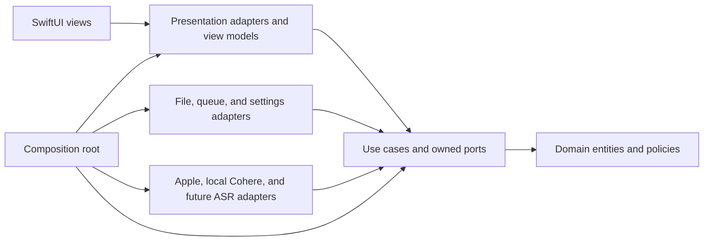
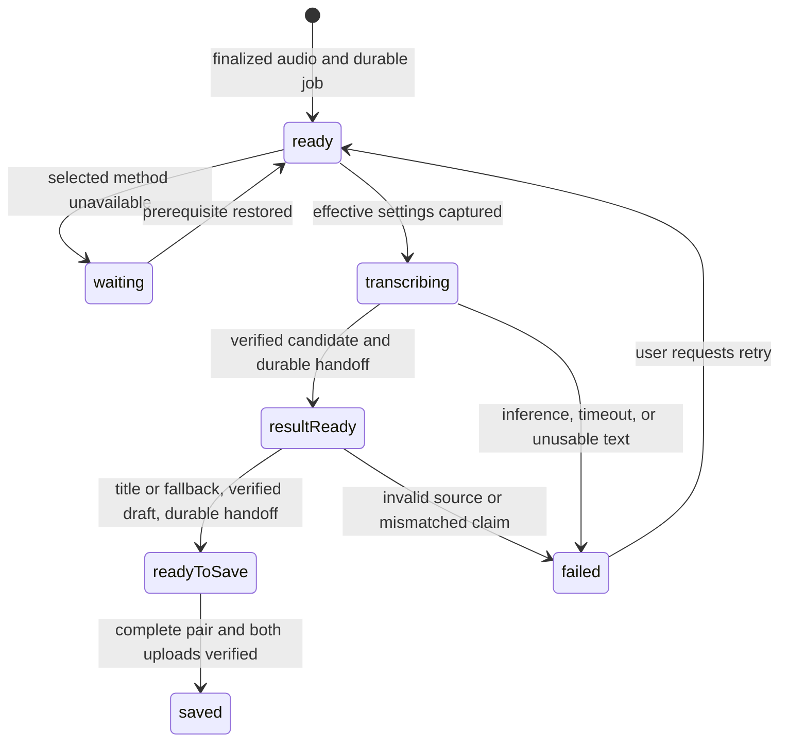

# Software architecture

Status: Approved

This document defines the approved Clean Architecture boundaries, state ownership, durable data flow, and recovery behavior for an iPhone app that can support multiple asset types and transcription methods. Diary Snippet is the only confirmed v1 asset type. Approved contracts, implemented mechanisms, and remaining platform evidence are distinguished below.

## Architectural principles

1. **Source dependencies point inward.** Domain rules know nothing about use cases, UI, storage, or SDKs. Use cases depend on domain types and ports they own. Interface and infrastructure adapters implement those ports. The composition root wires concrete adapters; runtime calls may travel outward through a port, but source imports do not.
2. **Asset types are separate domain capabilities.** Shared identity, destination, timestamps, and catalog projection do not impose Diary Snippet's Markdown/audio pair on a future photo or other asset. Each kind owns its validation, payload, persistence codec, and feature use cases.
3. **Transcription methods are replaceable adapters.** Queue and diary use cases select a stable method ID through a registry and consume normalized text that becomes the managed diary body. Local model loading, audio conversion, and response parsing stay in method adapters and versioned settings; future hosted providers can add credentials and request controls without changing the core.
4. **A recording is durable before processing begins.** Audio and its queue record live in private app storage until a Diary Snippet is safely committed to the recording's selected iCloud destination. App closure, lost connectivity, and unavailable iCloud access must not erase pending work.
5. **One diary text is managed.** Transcription output initializes the Markdown body; it is not retained as a separate original. The app prefers a short, read-only Apple on-device AI title summarizing the whole body in its current language and otherwise shortens its first sentence locally with an ellipsis, including when AI generation returns an empty, failed, or wrong-language result. A body beyond one model context window is summarized in parts; every part is considered within bounded work or the title falls back. Both paths have a strict maximum of 30 Swift extended grapheme clusters, including any ellipsis; an overlong AI title is truncated locally without another model request. It saves the Markdown and audio automatically even after an AI title failure. Later edits replace only the body and regenerate the title on save; model readiness alone does not replace a saved fallback title. An empty edited body uses the title "Untitled".
6. **The selected file folder is the source of truth for finished assets.** The local queue owns unfinished work; a screen cache is only a projection of files in the currently active iCloud folder.
7. **External effects are explicit and failures are recoverable.** Microphone capture, on-device speech and model installation, location, weather, iCloud access, and notifications each have an adapter and a permission or availability boundary. Processing is fail-open across recordings: a problem with one job cannot prevent another ready job from advancing. Authorization, integrity, and input validation fail closed for the affected operation; queue progress never bypasses those checks. No Diary Snippet Markdown is published before transcription produces usable text; retries reuse durable files and avoid duplicate assets.
8. **File access does not establish content trust.** Selected iCloud folders, downloaded models, restored job records, and model output cross validation boundaries. Only registered app code grants capabilities; file metadata and generated text cannot grant access, select executable code, or authorize deletion. The [security review](security-review.md) records threats, controls, and pending implementation evidence.

## System map

Arrows show source-code dependencies, not the direction of a runtime request. A use case invokes an output port; the concrete adapter implements that inward-owned port and may call an Apple framework or remote service. The composition root is the only place that chooses concrete adapters and builds registries. A single app target can preserve these boundaries through source organization and import checks; separate targets could enforce them at compile time if a later project-structure decision approves that change.

## Clean Architecture layers and dependency rule

| Layer | Contains | May depend on | Must not import |
|---|---|---|---|
| Domain | Asset identity and kind, recording and diary-text value types, queue invariants, diary-specific rules | Swift value types and inward domain code | SwiftUI, persistence formats, provider SDKs, networking, device APIs |
| Application | Capture, process, browse, edit, retry, removal, deletion, and maintenance use cases; input/output ports; orchestration policies | Domain | SwiftUI views, `AVFoundation`, `Speech`, `URLSession`, iCloud file APIs, concrete adapter types |
| Interface adapters | View models, domain-to-screen mapping, type-specific asset codecs, provider response mapping, port implementations | Application and domain contracts | Other adapter internals through hidden side channels |
| Frameworks and composition | SwiftUI view construction, Apple APIs, network clients, file provider integration, dependency wiring | Any inward layer needed for wiring | Business rules that belong in domain or use cases |

The application owns port definitions for recording, job persistence, asset catalog, Diary Snippet storage, transcription, settings, clock, and reminders. Adapters implement them and translate platform/model objects into plain domain values. No core use case downcasts to an Apple or Cohere adapter, reads a model runtime payload, or switches on a SwiftUI screen type. Dependency injection is explicit at construction, and tests can supply in-memory adapters. These are source boundaries even if code initially lives in one Xcode target; source organization alone cannot enforce them at compile time. A future hosted method can add a credential port without changing these dependencies.

## Responsibilities and interfaces

| Boundary | Inward contract or responsibility | Outer implementation |
|---|---|---|
| Presentation | Use-case inputs and read-only screen projections | SwiftUI navigation, accessibility, edit buffers, progress and error views |
| Recording | Capture use case and `AudioCapturePort` return a finalized staging reference, duration, and capture metadata | Microphone permission, audio session, capture timer/meter, interruption handling |
| Queue | Process/retry/remove use cases own oldest-ready ordering, retry, and confirmed removal; `JobStorePort` changes each job's durable state | Private per-recording folders and one foreground worker driver |
| Transcription | `TranscriberPort` consumes a method ID, staged audio, language hint, and effective settings; returns text for the managed diary body or a typed error | Method registry and Apple, local Cohere, or later adapters |
| Diary creation and editing | Shared `DiaryTitlePolicy` derives a read-only title; `DiaryEditStorePort` / `DiaryEditCoordinator` accept durable body or desired Favorite revisions independently of recording jobs | Protected edit journal and version-checked Markdown replacement |
| Asset browsing | `AssetCatalogPort` lists minimal type-neutral summaries from the active folder, page by page | Coordinated iCloud enumeration and type-aware summary decoders |
| Asset content | Type-specific ports own validation; `DiaryPairStorePort` commits new pairs, `DiaryEditStorePort` edits committed pairs, and `DiaryReplayPort` leases verified audio | Diary Snippet codec, coordinated writers and private replay cache; future types register their own adapters |
| Diary deletion | `DiaryDeletionPort` accepts a current catalog handle; edit reservation, creation settlement, and replay settlement guard admission | Exact-pair coordinated deletion with resource/version checks, including eligible legacy pairs |
| Purge maintenance | `PurgePort` owns explicit scope, durable intent, retry, and completion; admission checks actual owners | Confined staging traversal or active-folder-content traversal under a restart barrier |
| Audio-session ownership | `AudioSessionOwnership` gives capture priority through reservation and current-owner tokens | Shared `AppleAudioSessionConfiguration` used by capture and replay |
| Destination | `DestinationPort` resolves an opaque destination reference and reports access outcomes | iCloud-only picker, persistent access reference, security-scope lifetime |
| Settings and readiness | Settings/model ports provide method selection, installed-model state, and download readiness | Preferences, Apple speech assets, and a local Cohere model manager; future hosted guards are separate |
| Context and reminders | Optional recording context and reminder ports return values or typed unavailability | Location, weather, and local notification adapters |

The interfaces exchange value types, stable IDs, and typed results. They do not pass a live SwiftUI view, raw provider response, file-provider URL, or security-scoped token into core use cases. Adapters may use `AVFoundation`, `Speech`, `URLSession`, `CoreLocation`, WeatherKit, `UserNotifications`, and coordinated document APIs where suitable; exact API availability and entitlements need device verification.

Each port also enforces the [security contracts](#security-privacy-and-operating-limits) at its boundary. Destination and file adapters constrain access to validated resources; codecs return bounded typed values; the model manager returns a verified installation identity; transcription and title adapters return data with no authority to perform side effects. Use cases authorize mutations against current job, destination, and content revisions. Clean Architecture layers are source boundaries, not process sandboxes: a native model runtime shares the app's privileges and needs dependency and artifact review.

## Extending asset types

An asset has a type-neutral envelope: stable asset ID, stable kind ID, kind-specific schema version, creation and update instants, destination, and a minimal catalog summary. Each bundle must expose enough of that envelope for discovery without decoding its type-specific payload. A new Diary Snippet uses a random UUID v4 serialized as lowercase canonical hyphenated text and kind `ndm.diary-snippet`; another kind may use a different manifest. A Diary Snippet payload contains managed Markdown and audio. The shared envelope is a conceptual contract, not a requirement that every asset use Diary Snippet front matter or the same directory shape.

The application provides generic browse/open routing through an `AssetCatalogPort` and type-specific use cases for creation, validation, editing, and deletion. The iCloud adapter maps a stable kind ID and its schema version to a registered codec. The UI maps the same kind ID to a registered detail renderer and available actions. An unknown kind, newer schema, unknown method, or unknown title origin remains untouched and appears read-only in Incomplete Diary Snippets with an unsupported-format reason. A legacy Diary Snippet reader leaves existing files untouched: one safe plausible audio sibling permits a read-only Main entry, while zero or multiple plausible siblings produce an explained read-only recovery entry.

Adding a new kind should require a kind-owned domain payload and rules, use cases and ports, an iCloud codec, a summary decoder, and a presentation adapter. It should not require editing Diary Snippet's queue or file writer, or adding a global `switch` over all asset kinds in each layer. Only the composition root registers the new implementation. The registry is in-process composition, not a runtime plugin system. Photo is an example of this extension path, not an approved asset schema, feature, or workflow.

## Extending transcription methods

Use a stable `TranscriptionMethodID` rather than a closed Apple/Cohere enum in the queue and persisted jobs. A method descriptor exposes supported languages, accepted staged-audio formats, availability/readiness checks, installation requirements, and the settings that its adapter understands. A method adapter implements the inward-owned `TranscriberPort` and maps its raw output to method-neutral text plus effective provenance. Method-specific settings and provenance are versioned and namespaced so a new method's controls do not become optional fields on every existing method.

The composition root registers approved method adapters and their descriptors. Settings shows only registered, currently approved methods; the process use case asks the registry for the selected method and checks its declared prerequisites. If the method is unavailable, the user chooses among available approved methods without an automatic fallback. The queue persists a method ID and effective settings snapshot at processing start; manual retry takes a new snapshot. Unknown or removed method IDs leave jobs recoverable and visible rather than defaulting to another provider. This registry is compile-time composition, not a promise of downloadable code plugins.

Apple on-device speech and an on-device Cohere Transcribe method are the confirmed v1 adapter types. P1-M6 selected the runtime-publisher `cohere-transcribe-03-2026-Q4_K_M.gguf` with `transcribe.cpp` and Metal as the P1-M12 Cohere direction. Its adapter requires explicit `en` or `ko`, does not fall back to CPU automatically, rejects truncated output, and uses silence-aware chunks no longer than 45 seconds until longer input is proven complete on the target phone. Cohere appears in Settings for installation and becomes ready for processing only after its model is installed. Hosted Qwen is a future adapter, with no v1 credential, consent, budget, or upload flow. A new method should not change queue ordering, diary title generation, or iCloud commit rules. Model loading, input conversion, and error classification remain in adapters or policies selected through ports, not scattered through SwiftUI and the queue. See the [P1-M6 results](phase-1/milestone-06-cohere-runtime-trial-results.md) for the evidence and limits.

## Data ownership and identity

| Datum | Owner | Lifetime and rule |
|---|---|---|
| Asset envelope and catalog summary | Selected iCloud folder; projected into a disposable local cache | Carries stable kind ID and schema version so browsing and routing work without assuming Diary Snippet fields. |
| Recorded audio awaiting an asset | Private app storage | Created at capture; retained until the complete destination pair and both uploads verify, or confirmed removal/purge completes. |
| Queue job | Private queue repository | Holds stable identity, recording order, language hint, destination reference, state, attempt count, and enough information to resume safely. |
| Effective transcription settings | Queue job | Snapshotted when processing begins: method, model/conversion, and applicable controls actually used. A later Settings change does not rewrite that attempt's provenance. |
| Managed diary text | Private Markdown draft until commit; then the Markdown asset | Transcription output initializes its body. User body saves regenerate the read-only title. No original transcript is retained separately. Favorite changes through a separate toggle without title generation. |
| Submitted edit | Independent protected private edit journal until verified publication and retirement | Submission ID binds the accepted body/Favorite revision, source pair, candidate, and publication evidence; no recording job is created. |
| Live title work | Shared `DiaryTitlePolicy`; transient, never persisted | One operation ID retains its original owner until the call settles, even after a fallback result has been returned and saved. |
| Finished audio and Markdown | Recording's selected iCloud folder | The folder selected when recording began stays attached to that job, even if the active folder later changes. Markdown front matter explicitly names the audio file and carries a schema version. |
| Active-folder selection | App settings | Controls which finished assets the app lists. Changing it does not move existing files or retarget pending recordings. |
| Optional recording context | Queue job until commit; then asset metadata | Location and weather describe recording start and never block asset creation if unavailable; omit unavailable fields. Keep exact returned coordinates when place lookup fails. |

Use a stable internal job ID independent of a user-editable title or folder path. Persist the recording's destination reference when capture begins and an immutable ordering key with the job. Assign the random UUID v4 asset identity before the first iCloud write and keep the job-to-asset mapping until commit and cleanup finish; a retry uses the same identity. Serialize IDs as lowercase canonical hyphenated text and instants as RFC 3339 UTC at whole-second precision with `Z`. For Diary Snippet, `created_at` is recording start and `updated_at` changes on a saved text or metadata edit, never solely on iCloud synchronization. Preserve the UTC `year/month/day` layout; use `YYYY-MM-DD_HH-mm-ss-<uuid>.md`, the sibling `YYYY-MM-DD_HH-mm-ss-<uuid>.assets`, and `<uuid>.m4a`. Use the user's current local calendar for list grouping and display. The complete flat-key schema and serialization contract is in the [P1-M5 decision record](phase-1/milestone-05-decisions-architecture.md#diary-snippet-schema-contract).

The catalog uses each registered kind's validator and presents a finished asset only when its required fields, files, and references are valid. This avoids presenting a half-written Markdown/audio pair as finished. A malformed known-v1 asset without a repair copy becomes a preserved read-only recovery item. Legacy entries expose no editing or Favorite action and use their separate safe-pairing rule; the explicit [Diary Snippet deletion](#committed-diary-snippet-deletion) action can remove an eligible verified legacy pair without rewriting it.

Catalog refresh is generation-fenced but an internal supersession is not destination failure. If an explicit post-save refresh or current file-presenter callback arrives during coordinated catalog work, the replacement traversal waits for that work to relinquish its access loan and then restarts. A callback is bound to the presenter instance that emitted it, so a removed presenter's late callback cannot invalidate the replacement session. Only current bookmark, identity, security-scope, or provider failure projects `Folder Unavailable`.

### Local durability and launch reconciliation

Local staging is file-oriented: private capture storage holds finalized audio, a receipt and destination snapshot, a temporary verified transcription candidate, and then one managed Markdown draft with its binding evidence. The queue repository owns the durable job record. The candidate is a recovery handoff, not a separately retained original transcript or a second text-creation job; discard it only after the managed draft and queue transition verify. Finish and verify each file before atomically replacing the job record that points to it. Do not advance a durable job state until its required files are readable. On launch, reconcile job records with private files before starting work: reuse a verified candidate or draft, surface a recoverable capture or save failure, or identify an unreferenced private file for review. Never delete private audio merely because a queue record is missing. See the [M13 ordering contract](phase-1/milestone-13-diary-drafts-titles-architecture.md#durable-ordering-and-recovery).

Completion verifies the referenced iCloud Markdown/audio pair against the private candidate and commit record, records success, and removes the private folder. Identity or file existence alone is insufficient evidence for cleanup. If the app closes between these operations, launch reconciliation checks the commit evidence and any later valid asset revision, preserving ambiguous candidates rather than overwriting external edits or creating another asset. No later iCloud outage can depend on a retained private copy.

## Settings entry presentation

All's root list owns the single top-trailing Settings toolbar button and retains its four recording/recovery destinations. The button uses `InterfaceIcon(.settings)` and calls `AppModel.openAppSettings()`; the existing `showSettings` binding presents Settings after the action settles. This preserves Task 14's navigation boundary so entry cannot activate the destination's folder-selection row. The toolbar is scoped to All's root rather than its child screens, and no storage or processing use case changes. See [M20 Task 6](phase-1/milestone-20-enhancements-fixes-refactoring-architecture.md#task-6-all-screen-settings-control-relocation) for layout, accessibility, and acceptance evidence.

## Recording flow

1. First launch explains microphone access and requests permission. Before the first recording, the user selects or creates an iCloud destination folder and enters recording with an en-US or ko-KR language hint. The capture use case checks current microphone authorization and the destination reference again before starting; denial leaves other app functions available and directs Record to a Settings recovery path.
2. Capture writes to a unique private file, never directly to the iCloud asset directory. The recording coordinator provides elapsed time and level-meter values to the UI without making them durable queue state.
3. On stop, finalize the audio file and durably enqueue its job before showing it as pending. The job records the capture-time destination and language hint. Recording can succeed without network access or available iCloud service.
4. At five minutes, the app stops recording and queues the finalized audio automatically. After an interruption, it also queues any playable partial recording automatically. An unplayable partial clip is retained as a failed recording with an entry-level reason and is not sent to transcription.
5. On a failed finalization or enqueue, retain any recoverable private audio and show a repairable error. Never report a recording as queued until both file and queue entry are durable.

Capture inspection and Cohere conversion both decode the entire AAC source. AVFoundation's compressed reader may report a nominal frame length that includes codec priming and then signal a clean audio-file EOF before that nominal count. EOF after decoded progress is successful completion; zero decoded frames or any non-EOF decode error remains unreadable. The capture receipt still requires mono AAC, playable positive duration, byte and duration bounds, and full closed-file protection. Cohere independently keeps its verified source lease, rejects identity/size mutation, and rechecks the source after inference.

Capture settlement applies and verifies closed-file protection before inspection. Later receipt validation verifies those existing attributes without writing attributes again. Successful full-decode inspections are reused in memory only while device/inode/size and nanosecond modification/change timestamps match; changed files are decoded again and identity is checked across decoding. Playability and duration derive from decoded frames without preparing a playback session. Receipt, snapshot, protection, and transcription lease/fingerprint checks remain independent. This removes repeated main-thread audio decoding and audio-session preparation during recovery-list refreshes; see [M20 Task 18](phase-1/milestone-20-enhancements-fixes-refactoring-overview.md#task-18-app-becomes-slow-with-multiple-pending-recordings). Reapplying backup exclusion or protection during a receipt read changes the file's change timestamp and invalidates another active audio lease, even when its bytes are unchanged. The [M20 Task 7 regression](phase-1/milestone-20-enhancements-fixes-refactoring-overview.md#task-7-cohere-recording-reported-unreadable-on-iphone-17-pro-max) proves repeated receipt reads and fingerprints preserve an active lease; same-size source mutation remains rejected. Exact target-iPhone confirmation remains open.

Cohere authorizes Metal using the actual model device's inspected kind and exact equality with the requested Metal device, before inference and after each chunk. The pinned runtime reports a backend name such as `MTL0`; that display name is not the semantic device kind. Requiring the literal backend name `metal` rejected an otherwise compatible model on the target phone. Missing inspection, another device, or a non-Metal kind still fails closed. See [M20's runtime evidence and settings comparison](phase-1/milestone-20-enhancements-fixes-refactoring-architecture.md#trial-versus-production-settings-review).

Recording and playback share an audio-session owner but have separate coordinators. The replay use case obtains only a freshly validated committed Diary Snippet's audio through `DiaryReplayPort`; its screen exposes play/pause, seeking, and elapsed/total time.

## State ownership and transitions

State has four distinct meanings. Durable records determine what can resume after a crash; live owners determine which resources are still in use; transient phases describe current work; presentation state records navigation and unconfirmed user intent. These values can advance at different times. A single global `processing` or `deleting` flag cannot safely replace them.

| State | Authoritative owner | Persistence and interpretation |
|---|---|---|
| Recording checkpoint | `ProcessingQueueCoordinator` / queue repository | `QueueJobState`, attempt and revisions, candidate/draft bindings, commit evidence, and removal markers survive relaunch. The state alone does not prove file validity or owner settlement. |
| Submitted edit checkpoint | `DiaryEditCoordinator` / edit journal | `accepted`, `ready`, `published`, `completed`, or `recovery` belongs to a submission, independent of recording jobs. Candidate and source-version evidence determine safe continuation. |
| Title operation | Shared `DiaryTitlePolicy` | Transient `workSnapshot`: nil, `generating`, or `settling`. Correlation identifies the original recording attempt or edit submission; it grants no file capability. |
| Resource ownership | Capture, transcription, adoption, edit, replay, and commit owners | Live reservations/tasks/accessors remain owned until settlement. Cancellation, a returned fallback, scene departure, and a displayed completion do not prove idle. |
| Destructive operation | Queue removal marker, edit deletion reservation, or purge journal | Pending removal and purge have durable recovery intent. Detail deletion has a live reservation and exact-resource checks, with no durable automatic deletion retry. |
| Screen and confirmation | Presentation models | Catalog handles, editor buffers, armed inline confirmation, progress, and reasons project current owner state. An old handle or confirmation cannot authorize a new mutation after invalidation. |

Authorize a transition in its owning use case, validate evidence in the implementing port, and publish the screen projection afterward. Every asynchronous mutation must recheck its operation identity and relevant versions after suspension: recording work uses job/attempt and destination/body revisions; edits use submission and expected pair versions; deletion uses the confirmed catalog handle and fresh resource versions; purge uses its durable scope/destination binding. Correlation IDs and UI flags never replace those checks.

On relaunch, reconcile durable records and files before admitting new work. Rebuild transient phases from current owners; never restore a timer, task, or armed confirmation as proof that work is active or authorized. The lifecycle examples below describe existing contracts, not a new shared persisted state machine.

## Processing and queue lifecycle

One transcription worker owns an inference attempt at a time. Draft adoption/title generation and iCloud commit have separate coordinators and can progress independently of that worker. New work starts only while the app is active. The transcription scheduler chooses the oldest ready recording by its persisted recording order, with stable ID as a tie-breaker. Successful inference publishes and reopens a verified private candidate before persisting `resultReady` and releasing the worker. Waiting or failed jobs and jobs already in the draft/save stages are skipped when selecting transcription work. A failed attempt requires manual retry; a waiting prerequisite can be reconsidered when it changes. Moving the app out of the active state stops starting new work; an in-flight operation must settle or be recoverable on relaunch. Background execution and notification delivery are not prerequisites for correctness.

All states shown are implemented `QueueJobState` cases. Title generation is live work within `resultReady`, detailed in the [title lifecycle](#title-generation-and-resource-settlement). Review/quarantine and removal branches are omitted from this processing diagram: the queue also persists `reviewRequired`, `cancelling`, and `removing`. State changes and their required files must be committed in order or safely replayed after a crash.

| Durable checkpoint | Owner and work represented |
|---|---|
| `ready`, `waiting`, `transcribing` | `ProcessingQueueCoordinator` owns transcription selection, readiness reasons, attempt identity, and acknowledged settlement. |
| `resultReady` | A verified transcription candidate is available, or a matching draft can be recovered. `DiaryDraftAdoptionCoordinator` reuses that draft or runs the title policy, writes the managed draft/binding, and reopens them before advancing. |
| `readyToSave` | The verified local Markdown/audio candidate remains available. `DiaryCommitCoordinator` owns publication/version checkpoints, destination or upload waits, recovery reasons, and upload proof through the job's commit record. `saving`, `waitingForDestination`, and `saveFailed` are conceptual phases, not separate queue enum cases. |
| `saved` | The complete destination pair and both uploads have verified. Durable cleanup/notice bookkeeping permits interrupted private-staging cleanup to resume. |
| `failed` | Retain audio and an entry-level reason. Manual Retry creates a fresh attempt with current Settings; automatic scheduling does not retry it. |
| `reviewRequired` | Quarantine restored work until explicit Resume or Remove. Neither a verified old draft nor installed-model readiness bypasses review. |
| `cancelling`, `removing` | Removal intent is durable. In-flight transcription/save ownership must settle before owned private files and the job are removed; see [pending-recording removal](#pending-recording-removal). |

A destination outage never forces retranscription or blocks local title/draft creation. A recoverable save wait resumes using the same draft when access returns; validation or ownership ambiguity stays visible for recovery. Save and recovery attempts run independently of transcription selection and retain their own ownership until settlement, so blocked destinations do not occupy the transcription worker. Each error path must preserve the affected job and reschedule other ready work without a tight retry loop. See [M13](phase-1/milestone-13-diary-drafts-titles-architecture.md) and [M14](phase-1/milestone-14-icloud-commit-reconciliation-architecture.md) for the detailed ordering and recovery contracts.

`DiarySaveScheduler` retries ordinary `readyToSave` upload, destination, and protected-data waits while active, with delays of 2, 5, 15, 30, then 60 seconds. Every attempt reacquires the commit owner and fresh pair/upload proof; waiting retains staging and releases settled provider work. Timers stop on inactivity, maintenance, removal, or queue pause and resume from durable jobs on activation. Active accessors retain ownership until settlement, even across reactivation. Failed/review/conflict work does not enter a timed retry loop; manual Retry remains available. No new persisted state or suspended-app execution guarantee is introduced. See [M21 Task 4](phase-1/milestone-21-architecture-gui-enhancement-architecture.md#task-4-automatic-icloud-verification-retries).

Title/draft adoption reuses a verified matching draft or checks the candidate, obtains a title, publishes the draft and binding, and reopens them before advancing. On reopen, reuse a verified draft; otherwise rebuild it from the verified candidate with the same reserved asset ID. Model unavailability or title failure uses fallback, with no durable `generatingTitle` or title-failure queue state.

Current Main notices count only `transcribing` as active transcription; `resultReady` remains in the pending count, with no dedicated title-progress label. [M21's remaining lifecycle proposal](phase-1/milestone-21-architecture-gui-enhancement-architecture.md#recommended-enhancement-separate-checkpoints-phases-and-ownership) covers broader phase aggregation. The implemented title snapshot does not change notice behavior or add persisted states.

At processing start, resolve the current method and model choices into a snapshot. Check Apple speech or local Cohere model readiness before transcription; if unavailable, explain why, offer installation when applicable, and ask the user to choose an available approved method. If none is available, keep the job waiting. There is no automatic switch from Apple to Cohere or vice versa. Save the method's effective settings and the user's original language hint separately; model language values may differ from en-US/ko-KR.

V1 transcription failures move to a failed state with manual retry; a missing local model instead leaves the job waiting with a reason. The queue retains audio throughout. A manual transcription retry takes a fresh snapshot of current Settings and has no fixed count limit while the recording remains. The earlier three-retry policy for temporary network or server failures belongs to future hosted Qwen work.

A transcriber adapter must provide a bounded response or cancellable attempt so one hung inference cannot own the worker indefinitely. On timeout or cancellation, invalidate that attempt ID, retain its audio, record an entry-level failure, and release worker ownership only after the adapter has relinquished the underlying work. A late callback cannot advance the job. The runtime evaluation must demonstrate this behavior for both approved methods; if a candidate cannot settle a hung attempt, it does not meet the fail-open queue contract. Optional title, weather, and location failures use their approved fallback or omission rules and do not hold the worker.

Confirmed pending-recording removal invalidates the attempt and uses durable `cancelling`/`removing` markers. It is separate from deleting a committed diary; the [removal and deletion contracts](#removal-and-deletion) define settlement, save races, and scope. Every destination mutation, including audio writes and repair, must honor the current job claim and coordinated resource versions. Retargeting increments a durable destination revision and invalidates earlier save/repair attempts. A timeout is not proof that a file operation ended; preserve recoverable state until access settles.

Make each transition idempotent. The job record keeps an attempt ID, selected method ID, effective settings, and model/conversion identity before inference starts, then binds the candidate and Markdown draft to that successful attempt. A late result from an obsolete attempt cannot overwrite a newer manual retry. Advance from transcription only after the candidate is verified and its `resultReady` handoff is durable; advance to `readyToSave` only after the managed draft and binding verify. A recovered job checks whether a complete asset with its stable identity already exists before writing, and reuses the draft where valid. A crash before candidate publication may require another local inference run; a crash after a verified candidate handoff can resume draft adoption without retranscribing. Recovery derives truth from durable files and job state rather than trusting an in-flight marker alone. Reconcile jobs independently on launch: quarantine a malformed job record with its private files intact, surface a reason for review, and continue scanning and processing other valid jobs. A queue-wide storage failure that prevents durable state changes pauses processing and reports the problem rather than claiming a job was safely advanced.

## Title generation and resource settlement

Recording drafts and submitted body edits share one `DiaryTitlePolicy`. It returns the approved title and origin within the 30-second budget, using AI or first-sentence fallback; an empty edited body yields "Untitled". The body's current language drives generation, while the recording language metadata stays unchanged. Favorite bypasses title generation. Whole-body coverage, output validation, and grapheme/token limits are defined in the [title contract](product-behavior.md#transcription) and [generated-text bounds](#generated-text-and-resource-bounds).

```mermaid
stateDiagram-v2
    [*] --> idle
    idle --> generating: title request owns a new operation
    generating --> idle: computation returns AI or fallback
    generating --> settling: deadline returns fallback and requests cancellation
    settling --> settling: another request uses fallback; original owner retained
    settling --> idle: cancelled computation actually returns
```

This diagram describes `workSnapshot`, not queue or edit-journal states. `idle` means nil. `generating` includes availability/language checks and may return fallback without invoking the model. A request made while any title operation is held returns fallback without creating or replacing a snapshot. `onWorkChange` reports changes; `hasActiveWork` derives from the same held operation. Recording owners carry job/attempt and destination/body revisions; edit owners carry submission ID. Direct policy callers may omit correlation. See [M21 Task 2a](phase-1/milestone-21-architecture-gui-enhancement-architecture.md#delivered-task-2a-shared-title-work-snapshot) for the implemented API and tests.

| Event | Durable content/checkpoint | Live ownership and allowed next work |
|---|---|---|
| AI or fallback returns normally | Adoption verifies its draft before `readyToSave`; a body edit finalizes its accepted candidate before `ready`. | Title computation has settled; the caller still owns its remaining draft/edit work. |
| Deadline returns fallback | The same draft/edit path can advance using that fallback. | The original title operation remains `settling` until its computation returns. Transcription and commit retain independent progress; later title requests use fallback. |
| Job removed or claim changes while awaiting title | Current-job/revision checks reject publication for the obsolete recording claim. Accepted edits retain their independent journal identity. | Invalidate the caller's mutation authority without pretending the model or file accessor has settled. |
| Model returns after deadline | The already-returned fallback cannot be replaced by the late output. | Clear only the original held operation when it settles; a competing fallback request never becomes its owner. |
| Relaunch | Reconcile recording candidate/draft or edit journal and reuse verified finalized content. | No old live model task survives process termination. Start fresh work only if durable evidence requires it; model readiness alone never regenerates a saved fallback. |

For example, recording A can reach `readyToSave` or `saved` with fallback while A's title snapshot still says `settling`. Recording B can then use fallback and save without taking over A's title identity. Both adoption and edit `hasActiveWork` include the shared title owner. Exact-pair deletion admission and purge admission must consult those owners; a job's `saved` checkpoint or a screen with no spinner does not establish that title resources are idle.

## Asset commit and iCloud behavior

`DestinationAccess` stores a persistent reference to each selected iCloud folder and resolves it when needed. It must validate that a newly chosen folder is in iCloud, balance security-scope access, and report revocation, provider unavailability, or missing files distinctly. Selecting or creating arbitrary iCloud folders needs a device prototype. The first recording requires a folder selection. The app lists only the active folder; it does not merge old folders into the current list.

The commit protocol is:

1. Keep the complete local candidate in the recording's private folder: finalized audio, one managed Markdown draft, and a job record with recording-time metadata and effective transcription provenance.
2. Resolve the job's original destination and validate its current access and revision. Under the per-job mutation barrier, coordinate file operations and write audio before publishing the Markdown entry. Use exclusive creation or a checked expected version for replacement; repeated writes use the same job-to-asset mapping and must not replace a different asset. Validate containment and file identity at the actual operation, not only when building a URL.
3. Through coordinated access, validate the Markdown, its explicit audio reference, and the expected content of both files against the private candidate's lengths and cryptographic digests. Also wait until both files report successful iCloud upload. Then durably record completion evidence and immediately delete the private folder. If local or upload validation fails or cannot be observed, keep the folder for recovery. Private digests detect mismatches; hashes supplied by external front matter are not authenticity evidence. A device prototype must establish whether upload status is observable for files in a user-picked iCloud Drive folder; neither local readability nor reported upload proves receipt on another device.
4. On reopen, repair incomplete sets only when the pending job's private commit record and observed destination files agree on ownership and expected versions. An identity collision or unexplained external modification enters recovery/conflict handling without overwrite or cleanup. Keep and flag unmatched incomplete files; never create a second visible asset for the same job.

The [P1-M5 schema contract](phase-1/milestone-05-decisions-architecture.md#diary-snippet-schema-contract) defines the file layout and Markdown fields. iCloud is not a transaction over the pair, so a crash or synchronization conflict may leave partial files. The private job record maps job identity to proposed asset identity and file names for repairing a matching incomplete pair. A partial pair received on another device may have no local candidate there; preserve and flag its files, show surviving text or playable audio read-only with a missing-file reason, and offer confirmed removal. Never delete files merely because they look incomplete.

Committed-asset editing uses `DiaryEditStorePort` and an independent protected, backup-excluded journal rather than a recording `QueueJob`. A stable submission ID reconciles lost acceptance replies; acceptance requires the candidate, original destination binding and exact local audio snapshot to be durable. Body Save uses the same title-policy owner as recording drafts; an empty body uses "Untitled" and the editor has no title field. Favorite submits a desired Boolean, preserves title/body/provenance and skips title work. An already-equal verified value performs no write. Effective revisions get a canonical `updated_at` later than the source, stable across retries; it never orders conflicts.

The adapter revalidates the complete pair and replaces only Markdown against both expected source versions. Private write evidence, exact-version upload reports for both files, and final unchanged-pair verification precede cleanup. A separate completed retirement receipt makes interrupted private cleanup resumable without republishing. A completed cleanup error requests receipt rediscovery rather than checkpointing an already moved journal; full file-version and owned-directory checks remain required. The catalog observes the new version rather than assuming the write succeeded. Changed external content preserves the candidate and a separate complete external snapshot through `DiaryEditRecoveryPort`. For comparable iCloud modification times, select the later complete version; equal/missing/cross-ordered times remain separate for choice. An unpublished candidate has no provider modification time. Publish and verify the chosen pair before removing obsolete versions; M17 owns that choice/removal UI. See the [M16 implementation and evidence limits](phase-1/milestone-16-diary-editing-favorite-audio-replay-architecture.md#implemented-mechanisms-and-evidence-limits); real-provider mechanics remain device gates.

Replay exchanges a fresh catalog handle for a bounded protected audio lease, validates the full source pair, and keeps platform players behind `DiaryReplayPort`. Its private cache is disposable; it grants no repair authority. Capture and replay share token-based session ownership, with capture reservation before waiting for replay to settle. Background/detail/scope departure stops playback, and reentry requires explicit Play. Edit/title/file/replay owners participate in M20 maintenance admission; its restart barrier precedes edit/cache reconciliation.

When a job finishes in a folder that is no longer active, show a nonblocking in-app completion banner naming that destination. If access to that folder is temporarily lost, continue local transcription and draft creation; a verified draft stays `readyToSave` with a destination-wait reason until saving can retry. `waitingForDestination` describes that conceptual phase, not a persisted queue case. Ordinary provider/network failures remain temporary. Only after the user confirms removal of the folder or revocation of access may the app offer explicit replacement for that pending job; record the destination change durably, then retry saving. A general active-folder change never silently redirects the job.

### Catalog consistency

The catalog lists validated summaries from the active folder and sorts them by `created_at` descending with a stable ID tie-breaker, loading 50 candidates per page without a total cap. It exposes incomplete, malformed, unsupported, and ambiguous legacy resources as separate read-only recovery items. Legacy items use an ephemeral path-based identity and are never rewritten; eligible complete legacy pairs may be explicitly deleted. A folder change invalidates outstanding page requests and cursors. External changes invalidate affected pages and snapshots, and the presentation layer deduplicates repeated observations of the same validated resource/version. Different resources claiming the same asset ID remain separate ambiguous items; an external ID cannot hide an entry. A file that becomes unavailable or incomplete during a read is reported as unavailable or recovery, never as a deletion request. Completion into a former folder does not enter the active list.

## Removal and deletion

| Operation | Authority and scope | Settlement/recovery rule |
|---|---|---|
| Remove Recording | Current inline confirmation for a pending/failed job; validated private audio, candidate/draft, and queue record | Persist invalidation/removal intent, wait for relevant accessors, then clean owned files. Resume interrupted cleanup on launch. Preserve an already verified completed asset. |
| Delete Diary Snippet | Current detail confirmation and exact catalog/resource binding; verified Markdown/audio pair, including eligible legacy pairs | Reserve against edits, settle replay, require creation cleanup, then coordinate exact-file removal. A failed or partial deletion needs fresh confirmation/recovery; no automatic destructive retry. |
| Remove incomplete/obsolete version | Recovery-specific confirmation or the approved automatic later-version rule; exact validated resources | Preserve survivors or alternatives until chosen-pair verification and required upload evidence permit cleanup. M17 owns complete recovery interfaces. |
| Purge Active Folder Contents / Purge Internal Staging | Separate scope-specific confirmation plus durable purge intent | Admit only after actual owners are idle; retain a restart barrier after interruption and resume deletion only on explicit reconfirmed retry. See [purge maintenance](#explicit-purge-maintenance). |

Deletion authority never comes from a title, front-matter ID, path spelling, missing file, or presentation count. The [mutation controls](#mutation-and-recovery-integrity) apply to each scope. Active-folder purge is the explicitly confirmed exception to exact-pair scope: it removes all contents of the bound folder, including unrelated files, while preserving the folder itself.

### Pending-recording removal

The screen first arms inline Remove Recording / Cancel for the current entry. Unconfirmed intent changes no job or file. Confirmation invalidates the attempt generation; active transcription is cancelled, and an active save is fenced from advancing its stale claim. The implemented queue persists `cancelling` while transcription or save access remains held, otherwise `removing` before private cleanup. Cancelling is an unsettled ownership condition, not a successful-removal acknowledgement. On actual settlement the queue finishes private cleanup and removes the job; launch reconciliation resumes persisted removal work. A failed durable write must preserve files and report the queue storage problem.

Removal during title generation changes the current job so adoption's post-title check cannot publish a draft. The model can still hold its copied body until settlement; its result carries no filesystem capability. Do not confuse this invalidation with an immediate return of shared title resources. Private file cleanup must still respect any actual file accessor, and purge remains blocked by unsettled title ownership.

Save races have two outcomes under the approved contract: if complete-pair/upload verification and durable `saved` win before confirmation, preserve the asset and explain completion; if removal wins first, cancel the unverified save and reject its subsequent progress. `DiaryCommitCoordinator` holds per-job active ownership until its accessors return, and checks the current expected job/commit after each suspension. The queue waits for its settlement before private cleanup. Coordinated destination writes must revalidate claims and exact resources at the mutation boundary. This is implemented through owner tracking, revision checks, and coordinated I/O, not a single global deletion flag or a timeout-based unlock. Never reinterpret pending-recording removal as permission to delete an already committed diary.

### Committed Diary Snippet deletion

[M20 Task 21](phase-1/milestone-20-enhancements-fixes-refactoring-architecture.md#task-21-delete-a-diary-snippet-from-detail) implements full-width Delete Diary Snippet below Metadata, with inline Delete Diary Snippet / Cancel. The following stages describe existing control flow; they are not new queue enum cases or a persisted deletion journal.

| Stage | Guard and effect |
|---|---|
| Confirmation armed | Bind intent to the visible catalog handle. Cancel, detail/handle/scope departure, editor/Favorite action, or scene inactivity clears unconfirmed intent. |
| Confirmation consumed | Clear the armed handle before asynchronous work so duplicate taps cannot delete twice. `DiaryEditCoordinator.beginDeletion()` requires active, reconciled, unsuspended edit state, no active work (including shared title work), and no pending, isolated, uncertain, or undiscovered edit state. |
| Reservation held | Block new edit submissions/sessions, stop the target's replay and wait for its lease to settle, then recheck the visible-action generation before calling the deletion port. Keep the reservation until the port returns, including on failure. Maintenance sees this reservation as active work. |
| Pair admitted | `AppleDiaryDeletionService` exchanges the handle for fresh destination/resource evidence, checking complete discovery and duplicate claims. Matching creation jobs must be `saved` with `commitCleanupDone == true`, and their capture workspaces must be absent. Unreadable state fails closed. Unrelated recordings retain normal scheduling. |
| Coordinated removal | Revalidate root attachment, both exact versions, audio digest/reference, supported schema or eligible legacy pairing, and unresolved conflicts inside coordination. Unlink audio first, then Markdown with descriptor-relative no-follow checks. Remove the sibling assets directory only if empty; preserve extra files, ancestor directories, other diaries, Settings, and models. |
| Settlement | Successful local deletion refreshes the catalog and returns to Main. Busy, changed, unavailable, or unsafe outcomes show typed inline reasons and require a new confirmation; no success is inferred from hiding the detail view. |

The pair is not a filesystem transaction. If audio removal succeeds but Markdown removal fails, report incomplete deletion and preserve the surviving text for Incomplete Diary Snippets. A process exit mid-deletion similarly leaves surviving resources for discovery; there is no persisted intent that silently retries detail deletion at launch. M17 retains the complete recovery/removal flow. Once a coordinated delete has started, clearing navigation/confirmation cannot undo it or release the reservation early. Local completion does not prove iCloud propagation to another device.

## Explicit purge maintenance

[P1-M20 Task 9](phase-1/milestone-20-enhancements-fixes-refactoring-architecture.md#task-9-danger-zone-purge-actions-in-settings) adds an application-owned `PurgePort`. `DangerZoneModel` consumes single-use confirmation IDs and admits maintenance only when actual capture entry, recorder, inference, title adoption and save/conflict claims are idle. Queue/adoption/commit maintenance fences prevent new claims; generation cancellation rejects late readiness results. AppModel checks the purge journal before capture recovery or queue activation on every foreground entry. Deactivation alone never proves work has relinquished its resources. A title timeout also leaves the model owner busy until its cancelled call settles, even after fallback draft publication.

`ApplePurgeService` owns an explicit staging allowlist and a protected, backup-excluded intent outside those roots. The four roots are Captures (audio, receipts, destination snapshots, candidates and drafts), ProcessingQueue, ConflictSnapshots and PrivateWorkspaces. PrivateWorkspaces includes the independent DiaryEdits journal/retirement data and disposable DiaryReplay cache; unfinished edit artifacts block folder purge, while empty edit/replay namespaces do not. It preserves roots retained by live adapters and does not delete model/Settings/Keychain data or unrelated temporary files. Folder deletion additionally requires staging to finish; only validated completed queue history may remain and is preserved. Admission checks inspect bounded, stable, nonlinked records on a utility task and reject all unfinished or unrecognized contents. Folder deletion binds the committed destination ID and root resource identity, borrows balanced active-destination access, and uses bounded file coordination. `PurgeFileTree` streams descriptor-relative non-following traversal with bounded depth, identity/attachment rechecks, final-empty verification and sanitized counts. Links are unlinked without following targets.

A partial failure retains the journal and maintenance fence. Reopening reads the intent without automatically repeating deletion; only reconfirmed retry of the same transaction can resume. A malformed or protected journal fails closed. Journal deletion is the final commit point permitting reconciliation and new work. Success reflects the coordinated local traversal; other iCloud clients may later add content. Physical provider/lock/VoiceOver evidence remains in the Task 9 checklist.

## UI and application state

M20's folder-selection presentation prepares the scoped URL during the picker callback and stages only its typed outcome. Picker results and SwiftUI dismissal can arrive in either order: dismissal alone retains the current request, and the disclosure or error is published only after both events arrive. Explicit picker cancellation, a newer selection, scene departure, and identity changes invalidate old requests; duplicate results cannot commit again. An active destination is published only after explicit required disclosure and the existing validated persistence transaction commit. Sanitized notice-level folder events contain stages and the disclosure-required Boolean, without URLs, names, bookmarks, or identity data. See [Task 5's ordering repair](phase-1/milestone-20-enhancements-fixes-refactoring-overview.md#task-5-settings-still-shows-no-folder-selected-after-open).

The private Settings repository rereads the bounded current record for each update, treats only a missing file as new settings, and retains unreadable/corrupt bytes rather than overwriting them with defaults. Atomic protected writes create the private directory as needed. Activation reloads persisted method selection and monotonically merges recovered onboarding progress. See the [M20 persistence task and evidence](phase-1/milestone-20-enhancements-fixes-refactoring-overview.md#task-1-folder-selection-and-persistent-settings).

The root presents Main, Benefits, Calendar, Plugins, and All. Main owns the active-folder collection and floating Record entry. All owns Settings plus Pending Recordings, Failed Recordings, Incomplete Diary Snippets, and Conflicting Versions. Asset detail presents title and body first, Favorite beside title, and bottom Metadata with replay and approved recording/context fields. View models consume navigation intents rather than storage assumptions.

The UI subscribes to queue and asset projections on the main actor. Queue progress derives from durable state, not a view-local timer. The asset list groups by local creation date and displays the saved title. Use the approved monochrome template icon variants, sizes, targets, labels, and state/value semantics. The root-presented editor holds only a body buffer, protects dirty dismissal and covers its content while inactive. Save submits through `DiaryEditCoordinator`; Favorite sends a separate desired-state intent. Replay controls are bound to the visible handle and expose continuous touch seeking plus 15-second accessibility adjustment.

Notifications are optional. When first needed, request permission and schedule `You have pending diary work.` for the next local day at the same wall-clock time the user left. Recompute on reopen with the current timezone and next valid DST time; cancel when work clears. Denial or missed delivery does not change queue state, and the in-app indicator remains authoritative.

## Failure and recovery contract

| Condition | Durable state | User-visible result |
|---|---|---|
| Microphone permission denied on first launch or later | No queued job | Keep non-recording features available; Record explains how to enable permission in system Settings. |
| Unplayable interrupted recording | Retain the partial file in a failed recording entry; do not transcribe it | Show the reason beside its Failed Recordings entry. |
| Offline after recording | Audio and job remain private; processing waits if needed | Pending recording remains visible. |
| Apple speech asset or Cohere model unavailable | Job waits with reason; no transcription starts | Show readiness or download action and reason. |
| Transcription fails | Audio and job remain; failure recorded | Show a failed item with manual retry. |
| Transcription hangs or cannot finish within its bound | Invalidate the attempt and retain audio after the adapter relinquishes work | Show a failed item with a reason; continue with the next ready recording. |
| No usable words transcribed | Audio remains in failed job; no asset | Show the reason beside its Failed Recordings entry and offer manual retry. |
| Title model unavailable, unusable, or timed out | Use the approved fallback in the managed draft; a cancelled model retains ownership until settlement | Continue draft/save work without a title-failure state or late replacement of the saved fallback. |
| Markdown draft publication or queue transition fails after candidate handoff | Retain audio and the verified candidate or matching verified draft; pause/defer adoption when storage is unavailable | Show pending-work attention and reconcile retained evidence when access returns; a valid candidate handoff avoids retranscription. |
| Destination access lost | Continue local transcription and retain the Markdown/audio candidate, with no automatic retargeting | Ask for restored access and automatically retry the saved draft when it returns; if permanently lost, offer explicit replacement for that job. |
| Confirmed removal of pending or failed recording | Invalidate work and retain cancellation/removal markers until relevant accessors settle and private cleanup completes | Show Cancelling while unsettled; preserve an already verified saved asset and explain completion. |
| Committed diary deletion blocked by title, edit, replay, or creation ownership | Preserve the pair; withhold deletion until admission/settlement checks pass | Show a typed reason; require fresh confirmation after a failed attempt. |
| Only part of a committed diary pair deleted | Preserve surviving files; no automatic destructive retry | Report incomplete deletion and rediscover surviving content in Incomplete Diary Snippets. |
| Purge interrupted or its journal unavailable | Retain durable intent/maintenance barrier; block new recording and processing | Reconcile the intent and require explicit reconfirmed retry before further deletion. |
| Partial iCloud write with retained candidate | Job and local candidate remain until verification | Hide the incomplete set and repair it from the retained candidate on reopen. |
| Incomplete iCloud pair without local candidate | Preserve surviving files until explicit removal | Flag the pair; show available content read-only and a missing-file reason; offer confirmed removal. |
| Conflicting iCloud versions | Use iCloud modification time when values are comparable; preserve both if equal or missing | For equal or missing times, let the user open two separate versions and choose one. |
| App closes or is interrupted | Last durable state remains | Restore pending or failed status when opened. |
| One job record is malformed | Preserve its private files and isolate that record | Flag it for review; reconcile and process other valid jobs. |
| Queue store cannot durably change state | Preserve files and stop claiming progress | Show a queue-wide storage error until durable writes recover. |
| Protected private data unavailable during device lock | Preserve files and defer reads/state changes until access returns | Wait for unlock and reconcile; do not report missing or corrupt audio. |
| Model artifact fails integrity or compatibility checks | Installation remains not-ready; preserve any prior verified install without changing an attempt's selected version | Show a sanitized installation failure; no unsafe loading or automatic method switch. |
| Unsafe or malformed external asset/reference | Preserve external files and isolate the item; no unsafe read, write, or removal | Show an item-level validation reason and continue other catalog/queue work. |
| Destination content or ownership differs from commit evidence | Preserve local candidate and external files; withhold completion and cleanup | Enter recovery/conflict handling rather than overwriting or declaring the job saved. |

## Security, privacy, and operating limits

These are approved implementation requirements for the confirmed product scope, including the P1-M6 Cohere direction. Prioritized findings and verification evidence are tracked in the [security review](security-review.md).

### Trust boundaries and guarantees

Protect audio, diary bodies and titles, exact coordinates, place names, drafts, context/provenance, destination bookmarks, and any derived caches. Treat externally editable iCloud files, including legacy files and conflict versions, as untrusted input. A shared-folder collaborator or another authorized app may alter them. Restored local state must also be validated rather than replayed as instructions. Downloaded artifacts and all inference output are separate untrusted inputs.

The trusted computing base includes iOS, the signed app, its bundled dependencies and approved native model runtime. A source-layer boundary cannot contain a compromised in-process runtime. A compromised OS, an attacker controlling the unlocked device, or an authorized folder reader is outside the confidentiality guarantee. V1 writes ordinary Markdown/audio files to the selected folder; it does not introduce app-level encryption or authentication. iCloud Drive end-to-end protection depends on account and sharing configuration, so the app must not promise it unconditionally. See [Apple's iCloud security overview](https://support.apple.com/en-us/102651).

### File access and untrusted content

- `DestinationPort` keeps bookmarks private, resolves them afresh, validates iCloud membership through platform metadata rather than path spelling, and scopes access only around the operation. Balance every successful security-scope acquisition on all exit paths. Stale or revoked access returns a typed wait/recovery result; never search other folders or reinterpret a path to regain access. Apple's [directory-access guidance](https://developer.apple.com/documentation/uikit/providing-access-to-directories) requires coordinated I/O and allows permission revocation.
- A codec validates an audio reference as a filename or constrained relative path within that asset's permitted bundle. Reject absolute paths, URLs, parent traversal, ambiguous encodings, symbolic links, aliases, and unexpected file types. Validate each component and final resource, including after provider resolution; a string-prefix check is insufficient. Do not URL-decode a validated filename later. Recheck identity and containment during coordinated open, replace, and delete; use non-following/exclusive operations where supported. If safe containment cannot be established, preserve the input and refuse the operation. Apply these rules to legacy pairing, repair, conflict selection, and confirmed removal too.
- Parse only bounded UTF-8 text and the strict flat-scalar schema. Limits are 64 KiB front matter, 1 MiB body, 64 MiB audio, 64 keys, 8 KiB per scalar, 301 seconds for new-schema audio, and 50 catalog candidates per page. Reject object construction, custom tags, duplicate keys, aliases, and nesting. Unknown schema/kind/method/title origin stays unsupported and untouched. Malformed files get isolated diagnostics and cannot block the next page. Stream legacy audio only up to 60 minutes and 64 MiB. Validate audio format and decoded bounds before playback or inference; extensions alone are not evidence.
- Serialize front matter with a typed escaping codec. Titles, body text, place names, and model output never become raw metadata fragments, filenames, or paths. Keep body delimiters distinct from the header. Render Markdown as inert text or a restricted native subset: no script/HTML execution, automatic remote images, or automatic link fetches. Explicit link opening, if later supported, needs a scheme policy and user action; document text cannot invoke app mutations. This applies equally to previews and read-only recovery views.

### Private storage and disclosure

Keep irreplaceable pending audio, drafts, edit recovery, and job records in nonpurgeable private Application Support storage, outside shared documents and caches. Conversion scratch, partial summaries, catalog caches, and temporary replacements inherit the sensitivity of their source. Set and verify Data Protection attributes on creation and atomic replacement; never silently downgrade protection after an access failure. The proposed baseline is Complete Protection for closed sensitive files. The owner requires capture to continue while the iPhone is locked and, when capture ends while locked, requires immediate audio finalization and durable queue-journal settlement. Device tests must choose protection for the open audio file, finalization, and journal so this can complete without exposing closed drafts or misclassifying protected files as missing. Other protected reads and state changes that cannot proceed while locked wait for unlock and reconciliation. Apple's [Data Protection classes](https://support.apple.com/en-ca/guide/security/secb010e978a/web) distinguish these access lifetimes.

Separate backup policy from storage durability. Exclude pending audio and unsaved diary drafts from device backup, accepting that phone loss can lose the only copy. Redownloadable models and recreatable caches are excluded too. Keep pending work in nonpurgeable private storage until verified commit or confirmed removal; backup exclusion does not make it disposable. Apply the exclusion to replacement files and recovery copies. Do not promise that exclusion removes earlier backup copies. Store a random installation ID in Keychain with `ThisDeviceOnly`; jobs whose recorded installation differs after restore are quarantined in Pending Recordings with a review-required state and Resume/Remove actions. Resume snapshots current Settings into a fresh attempt. Do not change backup attributes on user-selected finished documents.

Use allowlisted diagnostic fields such as operation, typed failure code, duration, and a local opaque correlation ID. Exclude audio, text, titles, exact location, prompts, URLs, bookmarks, and raw SDK errors from logs, crash annotations, analytics, and support exports. Map errors to sanitized entry-level reasons. Reminder payloads contain generic pending-work wording and an opaque route, with no diary or destination content. Cover sensitive views before app-switcher snapshots; a queued notification or old navigation route must recheck current state. No clipboard or search-index export occurs implicitly. Remove scratch and derived data when their job/attempt ends, including crash cleanup, while preserving required recovery copies. Deletion is logical cleanup of app-owned copies, not secure erasure of flash, iCloud versions, or preexisting backups.

### Network and local inference

| Adapter | Allowed outbound data | Required boundary |
|---|---|---|
| Apple speech, Cohere inference, and title generation | No app-supplied audio, diary text, or prompts to a remote inference endpoint | Require verified on-device execution and language readiness; an unavailable local path waits or uses the approved title fallback. Never fall back to server recognition. |
| Model installation | Approved artifact identifiers and download transport metadata | A distinct installer obtains model data; it receives no recording, diary, location, or destination capability. |
| Optional weather/place lookup | Only the approved location and recording-start time | Check authorization and preference before the request and before accepting results; accept only before initial commit, use the approved five-minute/500 m and 60-minute windows, and never send diary/audio or backfill weather. |
| iCloud document storage | The confirmed Markdown/audio bundle, including permitted exact-location metadata | Write only to the recording's selected or explicitly replaced destination. Local transcription does not mean the finished asset never leaves the device. |

Keep HTTPS with standard certificate validation and App Transport Security for app-controlled network clients; do not use broad exceptions or trust-all delegates. ATS protects transport, not model provenance or destination authorization. See [Apple's secure-network guidance](https://developer.apple.com/documentation/security/preventing-insecure-network-connections). Review SDK telemetry and network behavior as part of dependency approval and verify the on-device promise with network observation, not an adapter name. Platform-managed speech/model downloads and iCloud sync remain distinct from inference uploads. V1 has no hosted credentials or Qwen upload path; the [future hosted policy](product-behavior.md#future-work-hosted-qwen-transcription) remains deferred.

Microphone permission is checked before capture and optional context permission is checked before acquisition. An app-level location preference cannot override system denial. Do not reuse cached coordinates or late lookup results after opt-out; prior saved metadata follows the existing product rules. Add no background-location capability for recording-time context. Permission and missing-context failures preserve the approved non-blocking behavior.

### Model installation integrity

The model manager downloads only app-approved artifacts, never a URL or model path supplied by a diary or job. Approved URLs, versions, lengths, and cryptographic digests are pinned in an app-bundled manifest; adding or revoking approval requires an app update. Its trusted descriptor also binds conversion version and runtime compatibility. A checksum downloaded beside the model from the same untrusted location is not authentication. Use HTTPS, follow at most three redirects among allowlisted hosts, validate expanded size, and require 1 GiB free before installation. P1-M12 must bind the selected P1-M6 runtime and Q4_K_M artifact to this policy with real, non-`unknown` provenance.

Download into an isolated staging directory with bounded transfer, disk-space preflight, and redirect validation against approved HTTPS distribution hosts. Verify complete bytes before extraction, compilation, or loading. If archives are used, reject traversal, links, unexpected files, and excessive expanded sizes/counts; validate contained files against the trusted manifest. Load data formats only, with no downloaded scripts, custom executable operators, or dynamic code plugins. Atomically publish an immutable installation after integrity and compatibility checks. Failed, interrupted, or tampered installs stay not-ready and never replace a valid installation. Pin each attempt to a verified installation identity; do not delete or replace files in use. Revalidate changed/corrupt installs and revoke known-bad versions; never silently substitute a different model. Native parser/runtime vulnerabilities remain a dependency risk even for authenticated model data.

### Generated text and resource bounds

Diary content is data to summarize, never trusted model instructions. Keep the app's fixed title instructions separate from transcript, body, and intermediate summaries. Give the title session no tools, network client, destination capability, or unrelated diary context. Validate its bounded plain-text result, language, and approved 30-character title policy before serialization; on unusable output, use the approved fallback. A prompt-injection attempt may degrade title quality but must not change a path, execute an action, alter the body, or expose other entries. Apple's [Foundation Models safety guidance](https://developer.apple.com/documentation/foundationmodels/improving-the-safety-of-generative-model-output) identifies unverified instruction content as a prompt-injection risk; prompting alone is not a security boundary.

Bound decoding, inference, title work, enumeration, and downloads by bytes, time, and cancellation. A nonsettling local inference attempt has a ten-minute hard cutoff and must relinquish work before the queue advances. Title generation uses at most eight 2,000-token chunks, two passes, 80-grapheme intermediate summaries, 128 intermediate and 64 final output tokens, and 30 seconds total; failure to cover the body uses the fallback. Reserve 100 MiB before recording. There is no fixed policy cap on installed model/cache size, collection size, or pending-job count, but installation shows download size and preflights the required 1 GiB. On exhaustion preserve existing work and refuse unsafe new work. Unlimited manual retries do not authorize overlapping attempts or automatic inference loops. Ordinary save-verification retries use the bounded backoff described above.

### Mutation and recovery integrity

Use private job-to-file ownership and commit evidence for cleanup; an external asset ID, timestamp, filename, or front-matter flag is never deletion authority. Confirmed deletion of a complete or incomplete external pair is limited to the exact validated resources shown to the user and must recheck their identities/versions. Refuse pair deletion if references are unsafe, files changed, or another asset shares a referenced file; pair deletion never recursively removes a user-selected directory. Only the separately confirmed [active-folder purge](#explicit-purge-maintenance) authorizes recursive removal of its bound folder contents. Private job cleanup is confined to its validated private subtree. A malformed job or restored tombstone cannot supply an arbitrary deletion path.

The [commit protocol](#asset-commit-and-icloud-behavior) verifies expected contents before releasing staging. Recovery must distinguish an uncommitted partial write from a later external edit; never repair solely because IDs match. All write, repair, retarget, and removal callbacks are fenced by current revisions, including title results for body edits. Duplicate IDs in separate external resources remain separate ambiguous items until reconciled; catalog deduplication applies only to repeated observations of the same validated resource/version. A forged ID must not hide another file or authorize overwriting it.

Apply the confirmed latest-iCloud-modification-time rule only after validating complete candidate versions and their referenced audio. Timestamps express conflict order, not authenticity, and can be manipulated by an authorized writer. Keep equal/missing-time versions separate as approved; no app signature or authenticated edit history is implied. If validation or ownership is uncertain, preserve files and surface recovery while unrelated jobs continue. The commit, conflict, and deletion prototypes must demonstrate these conditions before dependent implementation is accepted.

## Verification seams

Use protocol-driven fakes for the recorder, transcriber, destination access, asset catalog, Diary Snippet store, clock, connectivity, and notification scheduler. Dependency checks should keep domain/application source free of UI, provider, and persistence imports. Contract tests should register a synthetic second asset kind and a fake third transcription method, then verify browsing, routing, settings snapshots, and queue processing without modifying Diary Snippet rules or the queue use case. This tests the extension boundaries without claiming photo or another provider is a shipped feature.

The most valuable workflow tests exercise durable boundaries: relaunch after every queue transition, changed Settings before processing starts, changed active folder after recording starts, missing or not-ready local model, manual retry, offline recovery, unavailable destination, partial asset write, and external asset edits. Add a three-job queue with a waiting oldest job, a failed or timed-out next job, and a ready newest job; verify that the newest completes, each prior job retains its files and reason, and no failed job spins. A malformed job record must not prevent reconciliation of valid jobs. A simulated queue-store write failure must preserve files without reporting false progress. Device checks must cover microphone interruptions, Apple readiness for both languages, bounded cancellation of hung inference, iCloud folder creation and revocation, coordinated file behavior, and model input compatibility. P1-M6 supplied short English/Korean Q4_K_M and Q5_K_M target-phone latency and footprint observations; it did not establish five-minute quality, energy, cancellation settlement, or reference-scored accuracy. P1-M12 and P1-M19 retain those production evidence duties. These checks are implementation evidence for the approved contracts.

The [adversarial verification matrix](security-review.md#adversarial-verification-matrix) adds containment, parser, model-integrity, disclosure, lock-state, and race tests with observable pass criteria. These are required evidence for the implementing milestones, not claims that this documentation review ran an app or passed a security gate.

### State and deletion verification matrix

The following existing seams make the state contracts reviewable. Source references identify coverage to maintain, not new test or device-pass claims. M21's [review evidence](phase-1/milestone-21-architecture-gui-enhancement-architecture.md#task-2b-state-and-deletion-documentation-review) records validation for this documentation change.

| Scenario and required invariant | Existing test seam |
|---|---|
| Deadline returns fallback while the original title owner stays busy; competing requests do not replace it; late output cannot rewrite the title | `DiaryTitlePolicyTests`, `DiaryDraftAdoptionTests` |
| Candidate/draft handoff survives restart and a removal marker fences a late title result | `DiaryDraftAdoptionTests`, `ProcessingQueueTests` |
| Body edit has stable submission identity, regenerates title, and survives uncertain acceptance; Favorite preserves title | `DiaryEditTests` |
| Pending removal during transcription/save waits for accessors and survives failed removal writes | `ProcessingQueueTests`, `RecordingRemovalPresentationTests` |
| Detail confirmation is current and single-use, replay settles, retained/uncertain edits and title ownership block admission | `DiaryDeletionTests`, `DiaryDeletionPresentationTests`, shared edit/title ownership checks |
| Exact selected pair only, including eligible legacy; changed/symlinked files are preserved; creation cleanup required; partial deletion retains text | `DiaryDeletionStorageTests` |
| Purge requires idle owners and a durable restart barrier; scope exclusions and completed history survive | `PurgeTests`, `PurgeCompletedHistoryTests`, `DiaryPurgeNamespaceTests` |

Target-iPhone/native-model settlement, real-provider coordination/upload/version behavior, iCloud deletion propagation, lock/protection, and assistive-technology evidence remain with M12–M20 and M19 as applicable. Documentation and simulator checks do not close those obligations.

## Remaining implementation evidence

P1-M5 and P1-M6 leave no current v1 owner decision open. P1-M8 must validate iCloud-only folder identity and bookmarks; P1-M9 must validate locked/background capture and Data Protection; P1-M11 must validate Apple English/Korean system-asset readiness, production AAC compatibility, offline inference, durable result handoff, and cancellation relinquishment; P1-M12 must integrate the selected Cohere direction and verify manifest provenance, bounded chunking, seam completeness, and cancellation; P1-M14 must validate coordinated writes, upload observation, and conflict cleanup; P1-M17 must validate recovery interfaces; and P1-M19 must run the adversarial matrix and complete-experience device evidence. Hosted Qwen remains future work.
