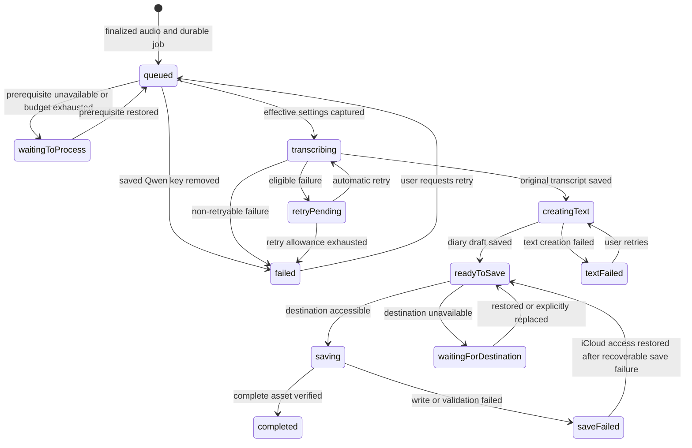

# Software architecture

Status: Proposal

This document proposes Clean Architecture boundaries, durable data flow, and recovery behavior for an iPhone app that can support multiple asset types and transcription methods. Diary Snippet is the only currently confirmed asset type; choices that still require an owner decision are called out explicitly in the context of the [confirmed product behavior](product-behavior.md) and [planned interface behavior](ux-gui.md).

## Architectural principles

1. **Source dependencies point inward.** Domain rules know nothing about use cases, UI, storage, or SDKs. Use cases depend on domain types and ports they own. Interface and infrastructure adapters implement those ports. The composition root wires concrete adapters; runtime calls may travel outward through a port, but source imports do not.
2. **Asset types are separate domain capabilities.** Shared identity, destination, timestamps, and catalog projection do not impose Diary Snippet's Markdown/audio/transcript bundle on a future photo or other asset. Each kind owns its validation, payload, persistence codec, and feature use cases.
3. **Transcription methods are replaceable adapters.** Queue and diary use cases select a stable method ID through a registry and consume a normalized transcript. Provider request shapes, model controls, credentials, and response parsing stay in method adapters and versioned settings.
4. **A recording is durable before processing begins.** Audio and its queue record live in private app storage until a Diary Snippet is safely committed to the recording's selected iCloud destination. App closure, lost connectivity, and unavailable iCloud access must not erase pending work.
5. **The original transcript and editable diary text are distinct.** Transcription returns machine output without diary polishing. Text creation shortens the transcript's first sentence locally for the title and puts an unchanged transcript copy below it; the app then saves automatically. Later edits change only the body and regenerate the read-only title from its first sentence on save. An empty edited body uses the read-only title "Untitled".
6. **The selected file folder is the source of truth for finished assets.** The local queue owns unfinished work; a screen cache is only a projection of files in the currently active iCloud folder.
7. **External effects are explicit and failures are recoverable.** Microphone capture, on-device speech, cloud upload, location, weather, iCloud access, and notifications each have an adapter and a permission or availability boundary. No Diary Snippet Markdown is published before transcription and text creation succeed; retries reuse durable inputs and avoid duplicate assets.

## System map

Arrows show source-code dependencies, not the direction of a runtime request. A use case invokes an output port; the concrete adapter implements that inward-owned port and may call an Apple framework or remote service. The composition root is the only place that chooses concrete adapters and builds registries. A single app target can preserve these boundaries through source organization and import checks; separate targets could enforce them at compile time if a later project-structure decision approves that change.

## Clean Architecture layers and dependency rule

| Layer | Contains | May depend on | Must not import |
|---|---|---|---|
| Domain | Asset identity and kind, recording and transcript value types, queue invariants, diary-specific rules | Swift value types and inward domain code | SwiftUI, persistence formats, provider SDKs, networking, device APIs |
| Application | Capture, process, browse, edit, and retry use cases; input/output ports; orchestration policies | Domain | SwiftUI views, `AVFoundation`, `Speech`, `URLSession`, iCloud file APIs, concrete adapter types |
| Interface adapters | View models, domain-to-screen mapping, type-specific asset codecs, provider response mapping, port implementations | Application and domain contracts | Other adapter internals through hidden side channels |
| Frameworks and composition | SwiftUI view construction, Apple APIs, network clients, file provider integration, dependency wiring | Any inward layer needed for wiring | Business rules that belong in domain or use cases |

The application owns port definitions for recording, job persistence, asset catalog, Diary Snippet storage, transcription, settings, credentials, clock, and reminders. Adapters implement them and translate platform/provider objects into plain domain values. No core use case downcasts to an Apple or Qwen adapter, reads a provider JSON payload, or switches on a SwiftUI screen type. Dependency injection is explicit at construction, and tests can supply in-memory adapters. These are module boundaries even if code initially lives in one Xcode target.

## Responsibilities and interfaces

| Boundary | Inward contract or responsibility | Outer implementation |
|---|---|---|
| Presentation | Use-case inputs and read-only screen projections | SwiftUI navigation, accessibility, edit buffers, progress and error views |
| Recording | Capture use case and `AudioCapturePort` return a finalized staging reference, duration, and capture metadata | Microphone permission, audio session, capture timer/meter, interruption handling |
| Queue | Process/retry use cases own oldest-first ordering and retry policy; `JobStorePort` atomically changes durable state | Private queue repository and one foreground worker driver |
| Transcription | `TranscriberPort` consumes a method ID, staged audio, language hint, and effective settings; returns normalized original transcript or typed error | Method registry and Apple, Qwen, or later provider adapters |
| Diary creation and editing | Diary Snippet domain title policy and use cases copy the normalized transcript into an editable body, derive a read-only title from its first sentence, and toggle Favorite | Markdown file adapter |
| Asset browsing | `AssetCatalogPort` lists minimal type-neutral summaries from the active folder, page by page | Coordinated iCloud enumeration and type-aware summary decoders |
| Asset content | Type-specific ports own validation and edits; `DiarySnippetStorePort` commits/loads the three-file diary bundle | Diary Snippet file codec and coordinated writer; future types get their own codec/store |
| Destination | `DestinationPort` resolves an opaque destination reference and reports access outcomes | iCloud-only picker, persistent access reference, security-scope lifetime |
| Settings and authorization | Settings/secret ports provide method selection, consent, credential reference, and app-local budget result | Preferences, Keychain, provider-specific guards, and usage ledger |
| Context and reminders | Optional recording context and reminder ports return values or typed unavailability | Location, weather, and local notification adapters |

The interfaces exchange value types, stable IDs, and typed results. They do not pass a live SwiftUI view, raw provider response, file-provider URL, or security-scoped token into core use cases. Adapters may use `AVFoundation`, `Speech`, `URLSession`, `CoreLocation`, WeatherKit, `UserNotifications`, and coordinated document APIs where suitable; exact API availability and entitlements need device verification.

## Extending asset types

An asset has a type-neutral envelope: stable asset ID, stable kind ID, kind-specific schema version, creation and update instants, destination, and a minimal catalog summary. Each bundle must expose enough of that envelope for discovery without decoding its type-specific payload. For Diary Snippet, its Markdown front matter can carry the kind ID and envelope fields; another kind may use a different manifest. A Diary Snippet payload contains editable Markdown, audio, and the preserved transcript; a future photo payload may have different files and editing actions. The shared envelope is a conceptual contract, not a requirement that every asset use Diary Snippet front matter or the same directory shape.

The application provides generic browse/open routing through an `AssetCatalogPort` and type-specific use cases for creation, validation, editing, and deletion. The iCloud adapter maps a stable kind ID and its schema version to a registered codec. The UI maps the same kind ID to a registered detail renderer and available actions. An unknown kind or newer schema remains discoverable as an unsupported catalog item with its files untouched; the app must not parse it as a Diary Snippet, silently drop it from storage, or rewrite it on scan. The exact presentation of unsupported items remains a UI decision. A legacy Diary Snippet reader displays the existing Markdown/audio pairs without the new fields or transcript sidecar as read-only entries, leaving their files untouched.

Adding a new kind should require a kind-owned domain payload and rules, use cases and ports, an iCloud codec, a summary decoder, and a presentation adapter. It should not require editing Diary Snippet's queue, text creator, or file writer, or adding a global `switch` over all asset kinds in each layer. Only the composition root registers the new implementation. The registry is in-process composition, not a runtime plugin system. Photo is an example of this extension path, not an approved asset schema, feature, or workflow.

## Extending transcription methods

Use a stable `TranscriptionMethodID` rather than a closed Apple/Qwen enum in the queue and persisted jobs. A method descriptor exposes supported languages, accepted staged-audio formats, availability/readiness checks, whether network or consent is required, and the settings that its adapter understands. A method adapter implements the inward-owned `TranscriberPort` and maps its raw output to a provider-neutral original transcript plus effective provenance. Method-specific settings and provenance are versioned and namespaced so a new provider's controls do not become optional fields on every existing method.

The composition root registers approved method adapters and their descriptors. Settings shows only registered, currently approved methods; the process use case asks the registry for the selected method and checks its declared prerequisites. If the method is unavailable, the user chooses among available approved methods without an automatic fallback. The queue persists a method ID and effective settings snapshot at processing start; manual retry takes a new snapshot. Unknown or removed method IDs leave jobs recoverable and visible rather than defaulting to another provider. This registry is compile-time composition, not a promise of downloadable code plugins.

Apple on-device speech and hosted Qwen are the currently confirmed adapters. Additional local or hosted methods can implement the same port after product and dependency decisions. A new method should not change queue ordering, diary title generation, iCloud commit rules, or the transcript sidecar format. Provider-specific credentials, budgets, upload consent, input conversion, and error classification remain in adapters or policies selected through ports, not scattered through SwiftUI and the queue.

## Data ownership and identity

| Datum | Durable owner | Lifetime and rule |
|---|---|---|
| Asset envelope and catalog summary | Selected iCloud folder; projected into a disposable local cache | Carries stable kind ID and schema version so browsing and routing work without assuming Diary Snippet fields. |
| Recorded audio awaiting an asset | Private app storage | Created at capture; retained until a complete destination asset is verified or the user explicitly removes it. |
| Queue job | Private queue repository | Holds stable identity, recording order, language hint, destination reference, state, attempt count, and enough information to resume safely. |
| Effective transcription settings | Queue job | Snapshotted when processing begins: method and, for Qwen, model, region, context, and supported controls actually used. A later Settings change does not rewrite that attempt's provenance. |
| Original transcript | Private queue until commit; then a plain UTF-8 asset sidecar | Preserve machine output even if text creation or destination writing fails. Markdown front matter explicitly names the sidecar; exact filename and path remain open. |
| Diary text | Private draft until commit; then the Markdown asset | A locally shortened first-sentence title supplies the read-only first line; the remaining initial body copies the transcript unchanged. On body save, regenerate the title. Favorite changes through a separate toggle. |
| Finished audio, transcript, and Markdown | Recording's selected iCloud folder | The folder selected when recording began stays attached to that job, even if the active folder later changes. Markdown front matter explicitly names audio and transcript files and carries a schema version. |
| Active-folder selection | App settings | Controls which finished assets the app lists. Changing it does not move existing files or retarget pending recordings. |
| Optional recording context | Queue job until commit; then asset metadata | Location and weather describe recording time and never block asset creation if unavailable; omit unavailable fields. If location is available, store exact coordinates and a place name. |

Use a stable internal job ID independent of a user-editable title or folder path. Persist the recording's destination reference when capture begins and an immutable ordering key with the job. For Diary Snippet, `created_at` is the recording-start instant and `updated_at` changes on a saved text or metadata edit, never solely on iCloud synchronization. Store instants in a form that does not depend on the current time zone; use UTC for asset file and directory names and the user's current local calendar for list grouping and displayed dates. Diary Snippet front matter records kind ID, effective transcription method/model/region/context where applicable, schema version, and file references. Exact key names, asset ID, and filename shape still need decisions.

The catalog uses each registered kind's validator and presents a finished asset only when that kind's required files and references are valid. This avoids presenting a half-written Markdown/audio pair as a finished diary entry. The legacy Diary Snippet reader has its own completeness rule for existing pairs, so their missing sidecar or new fields do not hide them; its entries expose no editing or Favorite action. The exact new-schema Diary Snippet completeness rule follows the final schema decision.

## Recording flow

1. Before the first recording, the user selects or creates an iCloud destination folder. The user then enters recording with an en-US or ko-KR language hint. The app checks microphone permission and whether it has a destination reference.
2. Capture writes to a unique private file, never directly to the iCloud asset directory. The recording coordinator provides elapsed time and level-meter values to the UI without making them durable queue state.
3. On stop, finalize the audio file and durably enqueue its job before showing it as pending. The job records the capture-time destination and language hint. Recording can succeed without network access or available iCloud service.
4. At five minutes, the app stops recording and queues the finalized audio automatically. After an interruption, it also queues any playable partial recording automatically. An unplayable partial clip is retained as a failed recording with an entry-level reason and is not sent to transcription.
5. On a failed finalization or enqueue, retain any recoverable private audio and show a repairable error. Never report a recording as queued until both file and queue entry are durable.

Recording and playback share an audio-session adapter but have separate coordinators. The replay use case obtains only a committed Diary Snippet's audio through `DiarySnippetStorePort`; its screen exposes play/pause, seeking, and elapsed/total time.

## Processing and queue lifecycle

Only one worker processes jobs, and it runs only while the app is open. The queue chooses the oldest eligible recording by its persisted recording order, with stable ID as a tie-breaker. Moving the app out of the active state stops starting new work; an in-flight operation must settle or be recoverable on relaunch. Background execution and notification delivery are not prerequisites for correctness.

This is a conceptual state machine. State changes and the data they depend on should be stored together, or replayed safely after a crash. `waitingToProcess` carries a reason such as offline connectivity, missing Apple model, missing Qwen consent/credential, or exhausted app-local budget; `waitingForDestination` identifies an unavailable target folder. `readyToSave` retains the audio, transcript, and diary draft locally so a destination outage does not force transcription again. `textFailed` retains audio and transcript for a user-initiated retry. A recoverable `saveFailed` resumes automatically when iCloud access returns, reusing the saved candidate without repeating transcription or text creation. Other validation failures remain visible for a separate error policy; neither state should cause an unbounded retry loop.

At processing start, resolve the current method and Qwen choices into a snapshot. Check Apple readiness before starting on-device transcription; if unavailable, explain why and ask the user to choose an available approved method. If none is available, keep the job waiting. Check the saved Qwen upload consent and credential before transmitting audio. There is no automatic switch from Apple to Qwen. Save the provider's effective settings and the user's original language hint separately; provider language values may differ from en-US/ko-KR.

After an initial transcription failure caused by a temporary network or server problem, the approved limit is three additional automatic attempts. Other transcription failures move directly to a failed state with manual retry. The queue retains audio throughout. A manual transcription retry takes a fresh snapshot of current Settings and has no fixed count limit while the recording remains; consent and budget checks still apply. Retry delay, precise transient error classification, and cancellation still need decisions. A diary-text failure retains the transcript, publishes no Markdown, and waits for manual retry.

Make each transition idempotent. A recovered job should check whether a complete asset with its stable identity already exists before writing, and should reuse saved transcript/draft data where valid. A process crash between a provider response and its durable save may require another provider call; the UI must not claim exactly-once cloud billing. The queue may remember an in-flight marker, but recovery must derive truth from durable files and job state rather than trusting that marker alone.

## Asset commit and iCloud behavior

`DestinationAccess` stores a persistent reference to each selected iCloud folder and resolves it when needed. It must validate that a newly chosen folder is in iCloud, balance security-scope access, and report revocation, provider unavailability, or missing files distinctly. Selecting or creating arbitrary iCloud folders needs a device prototype. The first recording requires a folder selection. The app lists only the active folder; it does not merge old folders into the current list.

The proposed commit protocol is:

1. Keep a complete local candidate: finalized audio, original transcript, diary text, recording-time metadata, and effective transcription provenance.
2. Resolve the job's original destination. Coordinate file operations and stage the non-Markdown files before publishing the Markdown entry.
3. Validate the resulting set, then mark the queue job completed and immediately delete its private local recording and draft. If validation fails, keep the job and its private files for recovery.
4. On reopen, find incomplete sets with a matching pending job and repair them from its retained local candidate, then verify the result. Leave unmatched incomplete files untouched for a separate recovery decision. Never create a second visible asset for the same job.

The exact file layout, write order, sidecar schema, and unmatched-orphan cleanup are pending decisions. iCloud is not a transaction over several files, so a crash or synchronization conflict may leave partial files. The repository needs a recovery journal or equivalent durable mapping from job identity to proposed asset identity to repair the matching incomplete set safely. Existing user files must not be removed merely because they look incomplete.

The Diary Snippet store adapter reads and edits files through coordinated access, while the catalog refreshes when iCloud changes arrive and treats local list data as disposable cache. A diary edit use case regenerates the first-line title on body save; an empty body uses "Untitled", and the editor does not expose a title field. Favorite toggles separately and, like a body edit, updates `updated_at`. Original transcript and audio remain separate. For conflicting versions with comparable iCloud modification times, select the later version automatically and discard the older one. Device clock differences may make that order differ from real edit order. If times are equal or missing, keep both versions and ask the user to resolve them.

When a job finishes in a folder that is no longer active, emit a completion event naming that destination. If access to that folder is lost, keep the result in `waitingForDestination` and ask the user to restore access. If access is permanently lost, allow explicit replacement for that pending job, record the destination change durably, and then retry saving. A general active-folder change never silently redirects the job.

## UI and application state

The root presents the five approved tabs: Main, Benefits, Calendar, Plugins, and All. Main owns the full active-folder diary collection, loading on demand with infinite scrolling, and a floating Record entry. All shows no diary snippets for now and owns entries to Settings and separate Pending Recordings and Failed Recordings screens. Benefits, Calendar, and Plugins display explanatory empty states. Asset detail presents title and diary text first, with Favorite beside the title; metadata sits at the bottom and contains the audio replay entry. Other metadata controls remain open. View models consume navigation intents rather than embed storage assumptions.

The UI subscribes to queue and asset projections on the main actor. Queue progress is derived from durable job state, not a view-local timer; closing and reopening the app must restore the same pending/failed status. Asset list groups by local creation date and derives the displayed title from the first diary-text line. Custom bitmap icons need accessible labels and suitable appearance/size variants. The editor holds only a body draft; its save use case derives the title and commits through `DiarySnippetStorePort` so an iCloud write failure can preserve the user's unsaved work. Favorite uses a separate toggle intent.

Notifications are an optional reminder channel for pending work after the user leaves. Schedule a local reminder for the next local day at the same local time the user left if work remains pending. Permission denial or missed delivery does not change queue state. Suppression and cancellation rules remain open; the in-app pending indicator is authoritative.

## Failure and recovery contract

| Condition | Durable state | User-visible result |
|---|---|---|
| Microphone permission denied | No queued job | Explain permission need and recovery path. |
| Unplayable interrupted recording | Retain the partial file in a failed recording entry; do not transcribe it | Show the reason beside its Failed Recordings entry. |
| Offline after recording | Audio and job remain private; processing waits if needed | Pending recording remains visible. |
| Apple model unavailable | Job waits with reason; no Qwen upload | Show readiness or download action and reason. |
| Qwen consent or credential missing before processing | Job waits; no upload | Show the required Settings action. |
| Saved Qwen key removed or consent revoked | Pending Qwen jobs fail immediately; recordings remain | Offer manual retry after the user chooses current Settings. |
| Transcription fails | Audio and job remain; attempts recorded | Automatic retries within the approved count, then failed item with manual retry. |
| No usable words transcribed | Audio remains in failed job; no asset | Show the reason beside its Failed Recordings entry and offer manual retry. |
| Diary-text creation fails | Audio and original transcript remain; no Markdown | Show a pending item with manual retry. |
| Destination access lost | Complete local candidate remains; no automatic retargeting | Ask for restored access and automatically retry the saved draft when it returns; if permanently lost, offer explicit replacement for that job. |
| Partial iCloud write | Job and local candidate remain until verification | Hide the incomplete set and repair it from the retained candidate on reopen. |
| Conflicting iCloud versions | Use iCloud modification time when values are comparable; preserve both if equal or missing | Ask the user to resolve equal or missing times. |
| App closes or is interrupted | Last durable state remains | Restore pending or failed status when opened. |

## Security, privacy, and operating limits

- Treat audio, transcripts, diary text, location, and weather as sensitive. Keep private staging out of logs, diagnostics, and unneeded backups where platform behavior permits; delete the local recording and draft immediately after verifying the complete iCloud bundle. Recovery from later iCloud loss depends on the iCloud asset, not a retained private copy.
- Keep the Qwen API key in Keychain until the user removes it. Read it only at the point of an authorized request and never record it in a queue job, asset, or log. Revoking upload consent deletes the key. Key removal immediately fails pending Qwen jobs but retains their audio; later manual retry can use new Settings. The provider upload deletion policy still needs a decision.
- Track this app's estimated Qwen usage against a user-set monthly budget, resetting at the start of the user's local calendar month. Before each cloud request, block it if its estimated cost would exceed the remaining budget. This guardrail cannot guarantee the provider's actual bill; estimate details remain open.
- A Qwen adapter sends audio only after the saved upload consent is checked. Region and endpoint must match the effective snapshot. Provider responses must be normalized to the original transcript type and stripped of credentials before diagnostics.
- Apple on-device transcription must pass readiness checks for the selected language. It is an explicit method, not an implicit fallback from Qwen or vice versa.
- A newly approved local transcription engine can implement the same service boundary; research alone does not add another user-facing method.
- Ask for optional location permission on first launch and provide a Settings control for later permission changes. Denial does not block recording. When available, store exact coordinates and a place name. Weather acquisition must be bounded and independent of asset creation success; if unavailable at recording time, omit it rather than backfilling it. Location accuracy threshold and weather timing still need decisions.
- The recording cap is five minutes; a provider's accepted file format, payload size, actual language support, latency, and price need validation on real recordings before a specific model or encoding is exposed.

## Verification seams

Use protocol-driven fakes for the recorder, transcriber, text creator, destination access, asset catalog, Diary Snippet store, clock, connectivity, and notification scheduler. Dependency checks should keep domain/application source free of UI, provider, and persistence imports. Contract tests should register a synthetic second asset kind and a fake third transcription method, then verify browsing, routing, settings snapshots, and queue processing without modifying Diary Snippet rules or the queue use case. This tests the extension boundaries without claiming photo or another provider is a shipped feature.

The most valuable workflow tests exercise durable boundaries: relaunch after every queue transition, four total attempts after an initial eligible transcription failure, changed Settings before processing starts, changed active folder after recording starts, missing consent, offline recovery, unavailable destination, partial asset write, and external asset edits. Device checks must cover microphone interruptions, Apple model readiness for both languages, iCloud folder creation and revocation, coordinated file behavior, and real provider input compatibility. These checks are implementation evidence, not substitutes for the open product decisions.

## Decisions required before dependent implementation

| Decision | Why this architecture leaves it open |
|---|---|
| Title-length/shortening behavior | Defines the remaining `DiaryTextCreator` edge cases. An empty edited body uses "Untitled". |
| Exact front-matter keys, sidecar path, and unmatched-orphan handling | Defines file validation, stable identity, and cleanup. Existing pairs remain read-only and untouched. |
| Qwen model IDs, controls, quality/cost thresholds, budget estimate and consent restoration | Defines available Settings choices and the cloud adapter's request contract. |
| Encoding | Defines recorder output and audio-session interactions. Unplayable interrupted clips remain in Failed Recordings. |
| Retry delay/error classification, cancellation, and reminder suppression | Defines state transitions and user actions. |
| Permanent access-loss detection, explicit retargeting mechanics, and user conflict-resolution UI | Defines destination recovery and conflict handling. |
| Location/weather precision and remaining detail controls | Defines metadata shape and presentation contracts. |
| Target deployment setting and usable simulator or device | Defines project configuration and executable validation. |

Until these are resolved, interfaces can be sketched and isolated, but the corresponding behavior must not be implemented as if a proposal were an approved rule.
