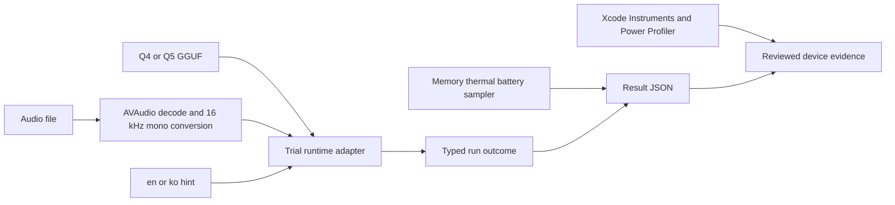

# P1-M6: Cohere runtime trial approach

Status: Done

Keep the trial disposable and physically separate from the production target,
while producing enough structured evidence to make the later runtime decision.

## Review findings applied to the plan

The earlier research gives a useful candidate matrix but is not yet an
implementation plan. This milestone closes four gaps:

1. **Isolation:** a trial dependency must not become an accidental production
   dependency. The harness has its own XcodeGen spec and generated project.
2. **Reproducibility:** every result identifies the app build, runtime release,
   model filename and SHA-256, audio SHA-256 and duration, language hint, device,
   OS, backend, and cold/warm classification.
3. **Completeness:** cancellation, input limits, output truncation, and partial
   output are explicit outcomes. Only an untruncated successful run is eligible
   for quality scoring.
4. **Comparable measurements:** the UI captures cheap in-process observations;
   Instruments and Power Profiler provide authoritative peak-memory and energy
   evidence using a written device protocol.

## Trial layout

```text
Trials/CohereRuntimeTrial/
  project.yml                 isolated XcodeGen project
  Sources/                    UI, audio, runtime, measurement, and export code
  Tests/                      model-free policy and serialization tests
  Vendor/                     ignored verified XCFramework after setup
scripts/
  setup-cohere-trial.sh       pinned download and SHA-256 verification
docs/phase-1/
  milestone-06-...            scope, approach, protocol, evidence checklist
```

The production `project.yml`, app target, tests, and source tree do not reference
the trial. Repository validation therefore continues to test the production app
independently.

## Dependency and artifact boundary

Use the official `transcribe.cpp` v0.2.4 release XCFramework, not a third-party
SwiftPM mirror. Pin its release URL and published SHA-256 in the setup script,
verify the archive before extracting it, and keep the archive and extracted
framework ignored. Record the runtime version, commit, and verified release
artifact SHA-256 in every result.

The trial imports the XCFramework's `CTranscribe` module through a small Swift
adapter. No runtime symbol or model-specific status escapes that adapter. Keep
the upstream MIT license and third-party notices beside the trial instructions.
This is approval only to evaluate that pinned artifact; a production dependency
still needs owner review after device results.

The Q4_K_M and Q5_K_M GGUFs remain Git LFS research inputs. The app selects them
through a security-scoped Files URL and records their hashes. It does not copy a
model into the app bundle or imply a download/distribution design.

## Data flow



Audio conversion and inference run off the main actor. A single trial run owns
one model and session. The UI prevents overlapping runs. Cancellation propagates
through hashing and conversion and then to the runtime cancellation token; the UI
remains in a cancelling state until work returns. The model and security-scoped
URLs are released after each run. `warmReload` therefore measures a second load
in the same process with OS/runtime caches warm, not resident model reuse.

Before enabling Transcribe, the app hashes both selected files, identifies the
Q4_K_M or Q5_K_M candidate from its filename, verifies the model against its
repository Git LFS SHA-256, and reads audio duration. At run start it checks file
name, size, and modification time against that inspection and rejects changed
inputs. It does not rehash the multi-gigabyte model immediately before inference,
which would add heat and distort the device measurement. Exported timing keeps
preflight inspection separate from run-time input verification.

## Result contract

Use a versioned `TrialResult` encoded as readable JSON. Required fields are:

- schema version, result ID, UTC start/end timestamps, and trial build revision;
- device model identifier, OS version, runtime version/commit/artifact SHA-256,
  and requested/actual backend;
- model filename, byte count, quantization label, and SHA-256;
- audio filename, byte count, SHA-256, source duration, converted sample count,
  and explicit language hint;
- run class (`coldLaunch`, `warmReload`, `backToBack`, or `cancellationProbe`);
- outcome and stable error code, transcript, truncation/partial flags, elapsed
  load/conversion/inference/total durations;
- a diagnostic trail covering runtime identity, backend initialization, device
  discovery, model inspection, capabilities, session creation, and inference;
- phase-tagged available-process-memory and physical-footprint samples, model
  input/cancellation capabilities, screen brightness, network condition,
  optional ambient temperature, thermal state, and initial/final battery state.

Hash the files incrementally so the trial does not allocate another model-sized
buffer. Result files may contain private text and stay in the app's protected
Documents area until the tester explicitly exports or deletes them.

## Physical-device protocol

Use one consented English set and one consented Korean set, each with a
30-second and five-minute diary-like recording and a reviewed reference text.
Keep screen brightness, Low Power Mode, charge band, network state, and ambient
conditions consistent. For each Q4/Q5 and language/duration combination:

1. Relaunch and run once for cold-load evidence.
2. Run the same clip again without relaunch for warm-reload evidence.
3. Run two five-minute clips back to back and record thermal escalation.
4. Start a five-minute run, cancel after a fixed interval, and verify settlement.
5. Export JSON, capture Instruments peak footprint/jetsam evidence, and record a
   Power Profiler trace.

Normalize English for WER and Korean for CER with one documented script or manual
procedure. Inspect punctuation, numeral handling, silence hallucination, code
switching, seams, omissions, repetition, and whether any output was capped.

## Decision boundary

The trial first establishes whether each configuration completes safely and
produces trustworthy measurements. The owner then sets acceptable quality,
latency, storage, memory, energy, and thermal limits using the measured range.
No configuration passes merely because it builds or returns text. Production
approval must also resolve model hosting, authenticated manifests, revocation,
installation readiness, deletion, license notices, and bounded inference.
