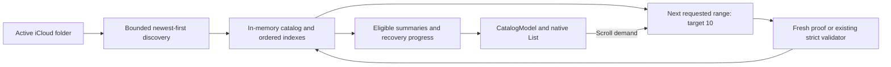

# P1-M21: Architecture enhancement and GUI enhancement approach

Status: Active

Record the delivered shared title-work reporting and plan further architecture and owner-requested GUI enhancements within the existing application boundaries. The initial architecture review distinguishes persisted recovery checkpoints, transient title/draft work, and resource ownership that may outlive a visible result.

## Current-code review, 2026-11-03

| Evidence | Current behavior | Documentation or design implication |
|---|---|---|
| [`ProcessingQueue.swift`](../../NarihitosDiary/Application/ProcessingQueue.swift), `QueueJobState` and `settle` | Successful inference publishes and verifies a private candidate, then persists `resultReady` and releases the transcription worker. | The old diagram's direct `transcribing` → `readyToSave` transition omitted a durable recovery checkpoint. |
| [`DiaryDraftAdoptionCoordinator.swift`](../../NarihitosDiary/Application/DiaryDraftAdoptionCoordinator.swift), `adopt` and `finish` | A separate task reserves/reuses the asset ID, obtains a title, publishes and verifies the draft, then persists `readyToSave`. During title generation the durable state remains `resultReady`. | Title generation exists as transient work; there is no durable `generatingTitle` enum case. Draft verification is the next checkpoint. |
| [`DiaryTitlePolicy.swift`](../../NarihitosDiary/Application/DiaryTitlePolicy.swift), `title` and `TitleDeadlineGate` | A 30-second deadline returns fallback and cancels the model task. `hasActiveWork` remains true until that task returns; subsequent title requests use fallback while it is unsettled. | A title result and idle resource ownership are different facts. Do not infer idle from timeout, fallback publication, or coordinator deactivation. |
| [`DiaryCommit.swift`](../../NarihitosDiary/Application/DiaryCommit.swift) | Publication, destination/upload waits, file-version checkpoints, and recovery are represented by the commit record and reason while the job remains `readyToSave`; verified completion sets `saved`. | The old diagram's `saving`, `waitingForDestination`, and `saveFailed` were conceptual phases, not current queue enum cases. Show that mapping explicitly. |
| [`AppModel.swift`](../../NarihitosDiary/Presentation/AppModel.swift), `updateMainNotices` | Only `transcribing` contributes to the processing notice; `resultReady` contributes to the pending count. | Current GUI has no distinct title-generation progress. A new owner request is needed to choose its presentation and exact copy. |
| [`DiaryDraftAdoptionTests.swift`](../../NarihitosDiaryTests/DiaryDraftAdoptionTests.swift), [`DiaryTitlePolicyTests.swift`](../../NarihitosDiaryTests/DiaryTitlePolicyTests.swift) | Existing tests describe candidate/draft restart, removal fencing, title deadlines, and held model ownership. | Reuse these seams for future regressions; source inspection is not a new test pass. |

The previous lifecycle section was directionally correct about fallback and independent progress, but incomplete about the M11/M13 handoff and M20 settlement safeguards. The [updated architecture section](../architecture.md#processing-and-queue-lifecycle) describes existing behavior. The broader projection below remains proposed work; the delivered title-only subset is recorded separately.

## Affected boundaries

| Boundary | M21 responsibility |
|---|---|
| SwiftUI views and presentation models | Implement only supplied GUI requests. Consume typed stage information if a request needs it; preserve navigation, inline removal confirmation, and existing accessibility semantics. |
| `ProcessingQueueCoordinator` | Remain the durable transcription scheduler. Keep selected-method snapshots, candidate verification, oldest-ready ordering, and acknowledged cancellation. |
| `DiaryDraftAdoptionCoordinator` / `DiaryTitlePolicy` | Own candidate adoption and bounded title work independently of transcription. Report transient work and unsettled model ownership accurately if the projection is selected. |
| `DiaryCommitCoordinator` | Keep publication/version/upload proof and cleanup authority. A screen stage or timeout does not substitute for its evidence. |
| `AppModel` / composition root | Compose read-only lifecycle snapshots and owner events. Avoid duplicating transition logic in screen counts or making presentation the authority for maintenance admission. |

No new module, target, dependency, or broad coordinator rewrite is needed for this plan.

## Recommended enhancement: separate checkpoints, phases, and ownership

Task 2a implements the title-only subset below. Broader checkpoint/adoption/commit aggregation remains proposed; assess it against concrete reporting needs before extending the snapshot. Prefer extending current projections over introducing a second scheduler. Proposed identifiers are illustrative and are not implemented APIs or approved user-facing labels.

1. **Durable checkpoint:** retain `QueueJobState` and the verified candidate/draft/commit evidence used on restart. `resultReady` already gives title/draft work a recovery point; adding durable `generatingTitle`, `titleFailed`, or `titleTimedOut` states is unnecessary for current fallback behavior.
2. **Transient per-job phase:** if needed, expose candidate/draft checking, title generation, draft verification, and commit/upload wait through owner-supplied typed values. Bind updates to the job/attempt and relevant revisions; the durable `resultReady` value alone cannot prove that a title request is currently running. Reconstruct transient phases from live owners after launch rather than persisting them.
3. **Resource ownership:** report unsettled transcription, title, and commit work separately from a job's displayed phase. A timed-out title call may still own the model after its job advances to `readyToSave` or finishes saving. Keep its identity until settlement; do not attach its busy state to a later job that merely uses fallback. Existing maintenance admission must continue checking actual owners.

Use bounded snapshots and callbacks on actual changes, including the final settlement after a fallback. Reject obsolete attempt/body/destination events, clear completed transient phases, and avoid polling files or decoding audio merely to update a progress indicator. No diary body, generated title, coordinate, bookmark, or path belongs in lifecycle diagnostics. A read-only snapshot never authorizes deletion or publication.

Record the selected narrow implementation, or a justified no-change outcome, in the overview before changing code. Keep GUI labels and placement reserved for the owner's concrete request. If code inspection reveals a required product or mechanism change beyond approved outcomes, resolve that decision before implementation.

## Delivered Task 2a: shared title-work snapshot

The selected 2026-11-04 implementation extends the existing shared owner rather than introducing a scheduler. `DiaryTitleWorkSnapshot` is an immutable application value with one random operation ID, optional `DiaryTitleWorkOwner`, and `generating` or `settling` phase. `DiaryTitlePolicy.workSnapshot` is externally read-only, and `onWorkChange` emits the current value only on changes, including nil at final settlement. `hasActiveWork` derives from the same owned operation.

`DiaryDraftAdoptionCoordinator` supplies recording job ID, attempt ID/generation, destination revision, and body revision after its existing current-job check. `DiaryEditCoordinator` supplies the accepted submission ID; each revision already has its own immutable journal identity. Direct policy calls can omit correlation. No body, title, coordinates, bookmark, filename, or destination capability enters the snapshot. No observer can authorize publication or removal.

Normal completion reports generating → idle. A deadline reports generating → settling while returning fallback; a competing request returns fallback without emitting events or taking over the original operation's identity. The late model return reports idle and cannot replace the returned title. A subsequent request starts with a new operation ID. The deadline gate reports whether it actually resolved the continuation, preventing an expired/cancelled timer from inventing settling after completion.

The projection deliberately stops at the shared title owner. Candidate and draft verification still belong to adoption; commit and upload proof still belong to commit records. No queue state, persisted schema, scheduler, maintenance admission rule, or GUI copy changes. M17–M19 have no delivered outcomes to consume yet under the revised order, and their recovery/context/adversarial work remains assigned there.

Focused evidence lives in `DiaryTitlePolicyTests.completedTitleReportsGeneratingThenIdle` and the two directions of `timeoutKeepsOriginalOwnerUntilSettlement`. Existing adoption timeout/maintenance and edit acceptance/navigation regressions now assert the production callers' owner bindings and final idle state. The full gate also covers existing candidate/draft restart, removal fencing, commit/upload, and edit/replay maintenance scenarios. Simulator results do not close native model, real-provider, or physical-device evidence.

## Task 3: iCloud identity decoding class restriction

`AppleDestinationPlatform.identitiesMatch` previously supplied `[NSObject.self]` to both secure unarchive calls. That admits every Objective-C subclass and produces the owner's runtime warning. The replacement obtains a fresh `FileManager.ubiquityIdentityToken`, then uses its public `classForKeyedArchiver` (falling back to `classForCoder`) as the sole allowed class. This supports Foundation class clusters without naming private implementation classes or deriving identity from reflection. Missing identity requires restoration; an `NSObject` coding class or a class without secure-coding support fails closed. Stored bytes never select the allowed class.

Both archived snapshots still decode and compare with `isEqual`, preserving existing account-change and transaction checks. Archive bytes, persistence formats, bounds, bookmark ownership, and folder contents are unchanged. Existing non-secure archives remain readable when their encoded objects support secure decoding; the adapter does not disable secure decoding to silence diagnostics. A changed platform coding representation may fail closed and require access restoration rather than broaden the allowance.

`UbiquityIdentityDecodingTests` exercises the actual adapter through an injected `FileManager` with synthetic tokens: existing archive round trips, account mismatch, unexpected roots in either argument, malformed/truncated archives, absent identity, rejected `NSObject` coding metadata, and secure custom tokens with allowed/rejected nested values. The focused run passes all 44 tests across that suite, `DestinationTransactionTests`, and `FirstLaunchAndDestinationTests` on iPhone 18 Pro / iOS 27.0. The overview records the final gate. These synthetic tokens do not establish the current iPhone token's restart round trip or prove all framework-originated warnings absent; M8-D04 and the owner's physical-device console/relaunch verification remain open.

## Task 4: automatic iCloud verification retries

The source defect is the old `AppModel.saveAttempted` foreground-session latch. `AppleDiaryPairStore.observeUploads` obtains one bounded observation of each file; an upload not yet reported successful returns no proof. `DiaryCommitCoordinator` correctly retains `readyToSave`, the intent and staging with an upload-wait reason. However, `pumpSaves` excludes the already-attempted job until manual Retry or app activation clears the latch. No timer or provider event makes it eligible when upload finishes. This explains the reported manual-retry recovery without implying a failed transcription or a new durable queue state.

Before repair, the delayed-upload regression against an extracted copy of that scheduling loop failed: the job remained `readyToSave`, only one upload check ran, no delay was scheduled, and no cleanup occurred; the other 13 commit tests passed. With `DiarySaveScheduler`, the same regression passes. Its strengthened final version initially supplies only Markdown proof, then supplies both on a synthetic retry deadline, and asserts durable completion, one saved callback, and exactly one cleanup. This establishes the scheduling defect; the owner's actual provider upload timing remains a target-phone observation.

`DiarySaveScheduler` now owns transient save tasks and retry timers, independently of transcription. It calls the existing commit coordinator for each attempt, so each retry rereads the verified draft and exact pair, separately obtains both upload proofs, and performs the final unchanged check. No timer, network signal, prior report, or visible file substitutes for proof. Ordinary upload, destination, and protected-data waits receive 2, 5, 15, 30, then at most one retry per 60 seconds while active. Failed/review jobs and conflict-resolution records do not receive these timed retries. Manual Retry bypasses a pending delay. Independent jobs can advance while another waits.

An active task remains owned until the commit accessor settles, including cancellation, inactivity, and reactivation; queued tasks recheck enabled state and their exact job snapshot before starting. Timer tokens and current job equality reject cancelled or superseded wakes; changed attempt/destination/body revisions cannot be acknowledged by an earlier attempt. Removal cancels its timer after recording the removal intent. Queue pause or unreadable storage stops scheduling; maintenance and scene inactivity cancel timers without treating in-flight I/O as settled. Foreground/relaunch reconstructs scheduling from durable `readyToSave` records. Timer waits grant no file-mutation authority and do not count as active provider work for maintenance admission; retained staging still blocks folder purge through the existing independent admission check.

No `BGTaskScheduler` registration, background entitlement, or durable format change is needed for the approved app-open processing contract. iCloud may upload independently while the app is suspended; verification resumes when the app becomes active. This implementation does not claim execution while suspended or force-quit. The existing Pending reason and Retry Verification action stay available; the existing saved callback refreshes Main only after durable completion.

Focused evidence: 39 tests pass across `DiarySaveSchedulerTests`, `DiaryCommitTests`, and `AppleDiaryPairStoreTests` on iPhone 18 Pro / iOS 27.0. Deterministic clock tests cover backoff, transient wait types, independent jobs, immediate manual retry, stale timers, removal/revision changes, and actual ownership through suspension; existing adapter tests cover metadata changes, pair replacement, exact-file adoption, and upload proof. The overview records the final gate and remaining physical-iCloud evidence.

## Title lifecycle and M16 compatibility

The implemented recording path is:

`transcribing` → verified private candidate / `resultReady` → title policy and draft verification → `readyToSave` → verified iCloud pair and both uploads / `saved`.

During `resultReady`, adoption can reuse an already verified draft without running the title model. Otherwise the title policy chooses AI or local fallback. A deadline fences late output and lets the draft use fallback; the cancelled model remains owned until it settles. Later jobs can use fallback without starting overlapping title inference. Model readiness alone never rewrites a saved title.

M16 precedes M21 and reuses the existing title policy through its independent submitted-edit journal. The 2026-11-04 order places M21 immediately after M16; reconcile reporting with M16's delivered interfaces while its evidence remains open. An edit is not a recording job; do not manufacture `resultReady` queue entries to report title work. Preserve M16's body-revision fencing, stable submitted candidate, separate Favorite path, and resource/version ownership.

## Task 2b: State and deletion documentation review

The owner requested a software architecture review on 2026-11-04, emphasizing state, title generation, and deletion. This review updates the architectural description against existing contracts and source. It adds no runtime behavior, queue/edit schema, global state machine, or automatic destructive retry.

| Finding | Source/contract evidence | Documentation repair |
|---|---|---|
| The processing diagram mixed durable queue cases with nested transient title/adoption phases. | [`QueueJobState`](../../NarihitosDiary/Application/ProcessingQueue.swift), [`DiaryDraftAdoptionCoordinator`](../../NarihitosDiary/Application/DiaryDraftAdoptionCoordinator.swift), and [`DiaryEditStage`](../../NarihitosDiary/Application/DiaryEdit.swift) | Add a state-ownership table, keep the queue diagram durable-only, and describe the independent edit journal and live title state separately. |
| A title result can precede model settlement, including after saving; later fallback callers must not inherit the held owner. | [`DiaryTitlePolicy`](../../NarihitosDiary/Application/DiaryTitlePolicy.swift), adoption/edit `hasActiveWork`, and Task 2a tests | Add a title-owner transition diagram and result/checkpoint/ownership table; document operation correlation, late-result fencing, fallback progress, deletion admission, and purge admission. |
| The architecture said finished-asset removal was outside v1 despite implemented owner-approved detail deletion. | [M20 Task 21](milestone-20-enhancements-fixes-refactoring-architecture.md#task-21-delete-a-diary-snippet-from-detail), [`DiaryActionsModel`](../../NarihitosDiary/Presentation/DiaryActionsModel.swift), [`DiaryDeletionPort`](../../NarihitosDiary/Application/DiaryDeletion.swift), [`AppleDiaryDeletionService`](../../NarihitosDiary/Adapters/AppleDiaryDeletionService.swift) | Separate pending-recording removal, committed-pair deletion, recovery cleanup, and purge. Record confirmation consumption, edit reservation, replay settlement, creation cleanup, exact-file checks, partial failure, and absence of automatic detail-deletion retry. |
| Removal was described as waiting for one barrier spanning publication through completion, obscuring confirmation that invalidates an unverified save. | [`ProcessingQueueCoordinator.remove`](../../NarihitosDiary/Application/ProcessingQueue.swift), [`DiaryCommitCoordinator`](../../NarihitosDiary/Application/DiaryCommit.swift), and [approved save/removal behavior](../product-behavior.md#transcription) | Describe current owner tracking, durable cancelling/removing markers, post-suspension claim checks, and coordinated mutations. Preserve the approved already-verified completion versus removal-first outcomes and outstanding provider race evidence. |
| A later paragraph called `waitingForDestination` a queue state, and legacy/purge wording obscured explicit deletion scopes. | `QueueJobState`, commit wait reasons, M20 Tasks 9/21, [`ApplePurgeService`](../../NarihitosDiary/Adapters/ApplePurgeService.swift) | Correct destination waiting to `readyToSave` plus reason; clarify eligible legacy deletion and the separately confirmed folder-content purge exception. |

The [architecture verification matrix](../architecture.md#state-and-deletion-verification-matrix) points to existing title, adoption, edit, removal, deletion, and purge test seams. Source review is distinct from execution evidence. README and GUI behavior need no change because this task corrects architecture documentation only. M17 recovery screens and earlier physical-device/provider obligations remain open.

Validation results are recorded in the [Task 2b checklist](milestone-21-architecture-gui-enhancement-overview.md#task-2b-acceptance-checklist).

## Implementation and evidence sequence

1. Read the M20 and implemented M16 outcomes and recheck this source inventory; add each supplied GUI request and its completion criteria to the overview.
2. Select the narrow lifecycle reporting change if justified. Keep durable storage and recovery semantics intact; add focused regressions only for changed behavior or identified gaps.
3. Verify restart before/after candidate publication, draft publication, and queue replacement; title fallback and held cancellation; late callbacks after removal/supersession; maintenance busy/idle; and independent transcription/commit progress as applicable to the change.
4. Implement the requested screens using existing view models and inward-owned ports. Capture synthetic before/after evidence and perform the relevant accessibility and target-phone checks without accessing real diary contents.
5. Update affected docs and run the standard lint/full simulator gate. Record failures and unperformed phone checks without closing earlier milestones' open evidence.

## Task 1 request 1: Diary Snippet detail layout

The owner requested full-width Edit Diary, the existing Delete Diary Snippet action immediately below it, and Metadata below Audio on 2026-11-04. `DiaryCatalogDetailView` keeps the body and action stack together, gives Edit Diary the existing centered headline/52-point full-width label treatment with a prominent style, and renders replay or Audio Unavailable in a separate section above read-only Metadata. Preserve the existing action identifiers, model eligibility, inline warning/Cancel, accessibility focus, and navigation/scene/version cancellation hooks. Legacy detail still omits editing and Favorite. No persistence, coordinator, or replay mechanism changes are needed.

Use the existing `DiaryPresentationTests` and `DiaryDeletionPresentationTests` synthetic hosted layouts and activation checks for editor, Favorite, replay, legacy, inline confirmation, and scene cancellation, plus the full required simulator gate. Review generated screenshots for layout; record physical interaction and untested configurations separately in the [request checklist](milestone-21-architecture-gui-enhancement-overview.md#request-1-diary-snippet-detail-action-and-metadata-layout).

## Task 7: Upcoming-task plan review findings

Review, 2026-11-04. The [overview's remaining-work table](milestone-21-architecture-gui-enhancement-overview.md#remaining-work-and-proposed-order) separates unfinished acceptance from unselected implementation. The following findings refine Task 6 without changing current contracts or claiming new execution evidence.

| Planning gap | Current source / contract evidence | Plan correction |
|---|---|---|
| Partial pages can stall a 10-row demand even though automatic empty-page discovery works. | [`CatalogModel.loadMore`](../../NarihitosDiary/Presentation/CatalogModel.swift) automatically continues only while `summaries.isEmpty`; [`CatalogCollectionView`](../../NarihitosDiary/Presentation/CatalogViews.swift) uses a footer task keyed by page revision. | Track unmet visible demand independently of row presence, coalesce repeated viewport events, and verify 3 → 10 → 20 rows without a footer-driven drain. |
| A slice target is not an accessor deadline, and one candidate can contain many sibling slices. | [`FileCatalogWorker.page`](../../NarihitosDiary/Adapters/FileCatalogWorker.swift) checks its deadline after a read; [`DiaryCatalogHandler.legacySibling`](../../NarihitosDiary/Adapters/DiaryCatalogLegacyReader.swift) loops over 50-entry slices until end/ambiguity. | Budget discovery and classification together; make long nested metadata work resumable and keep provider/decoder budgets separate. Cancellation retains ownership until actual settlement. |
| Per-kind newest-first traversal alone does not establish global order. | [`CatalogAssetRegistry`](../../NarihitosDiary/Adapters/CatalogAssetRegistry.swift) supports multiple handlers; [M15 ordering](milestone-15-main-collection-diary-detail-architecture.md#ordering-and-continuation) merges kinds and mixed-precision instants. | Merge upper bounds across handlers; an unbounded handler needs completed discovery before early global publication. Compare full traversal with a strict oracle. |
| Early rows cannot inherit the old full-index mutation prerequisite automatically. | `FileCatalogWorker.actionResource` rejects an incomplete index and checks all discovered stable-ID claims; [`AppleAssetCatalog.actionBinding`](../../NarihitosDiary/Adapters/AppleAssetCatalog.swift) then fences scope/generation. | Retain complete-index admission in the first delivery and finish metadata on demand. Separate action latency from row latency; targeted replacement requires equivalent duplicate coverage. |
| Reopening by asset ID and warming across teardown need stronger identity/lifetime conditions. | `CatalogModel.accept` pages until `reopenAssetID` appears; its reset/stop discard the session. `AppleAssetCatalog` discards the worker on invalidation and retains its busy barrier until settlement. | Use a scope-fenced exact-resource handoff, preserve clearing refresh initially, and benchmark warm live-scope reuse separately from new-session rebuild. |
| Progress, retryable failure and end are insufficiently distinguished for demand fill/cache reuse. | [`CatalogPage`](../../NarihitosDiary/Application/AssetCatalog.swift) carries continuation/discovery but no typed wait; retryability belongs to `CatalogIssue`. | Define progress/wait/resource retry semantics before coding; cache only completed positive proofs, preserve failed observations, and prevent immediate retries from spinning to fill demand. |
| A bounded proof cache does not bound the whole catalog. | Worker observations/indexes and `CatalogCollection` retain per-resource state; [M15](milestone-15-main-collection-diary-detail-architecture.md#bounded-io-and-session-lifetime) permits discarding a session under memory pressure. | Measure all retained structures, test rebuild with continued browsing, and keep cache eviction separate from source removal/traversal end. |

The review leaves broader Task 2 aggregation unselected until a concrete consumer exists. Open GUI, physical identity-token, and automatic iCloud verification evidence retain their current owners. This is a planning correction, not evidence that those runtime scenarios now pass.

## Task 6: Main catalog performance proposal

Proposal, 2026-11-04. The owner requested investigation and planning for faster Diary Snippet loading, suggested the latest 10 entries followed by infinite scroll, and added an in-memory database/cache as a candidate. Recommend a rebuildable, indexed memory catalog, populated through newest-first discovery and queried in increments of 10. This section proposes mechanisms; it does not amend the approved [M15 collection contract](milestone-15-main-collection-diary-detail-architecture.md#candidate-discovery-and-paging) or select implementation.

### What the current source establishes

| Source | Current behavior | Likely cost or constraint |
|---|---|---|
| [`CatalogDirectoryIndex`](../../NarihitosDiary/Adapters/CatalogAssetRegistry.swift), `advance` | Traverses all recognized directories in slices of 50 visits. | Work is bounded per slice, but discovery still covers the entire folder before any row can appear. |
| [`FileCatalogWorker`](../../NarihitosDiary/Adapters/FileCatalogWorker.swift), `page` / `discover` / `prepareOrdering` | Returns progress-only pages until the index is complete, then sorts all candidates. Classification visits up to 50 candidates, checking a two-second slice deadline after each read. | Changing 50 to 10 in classification alone cannot improve the discovery barrier. The two-second check does not bound a single coordinated read. |
| [`DiaryCatalogHandler`](../../NarihitosDiary/Adapters/DiaryCatalogHandler.swift), [`DiaryCatalogReadPlan`](../../NarihitosDiary/Adapters/DiaryCatalogReadPlan.swift), [`CatalogAudioInspector`](../../NarihitosDiary/Adapters/CatalogAudioInspector.swift) | Coordinates exact Markdown/audio resources, decodes bounded Markdown, fully decodes audio, hashes its bytes, and verifies bindings. Detail calls the handler again. Content coordination has a 120-second attempt timeout. | A row can require an iCloud content fetch and complete audio inspection before presentation; detail repeats expensive validation. Actual contribution to latency needs measurement. |
| [`CatalogModel`](../../NarihitosDiary/Presentation/CatalogModel.swift) | Automatically advances progress-only pages while no summaries exist. Refresh clears the collection/session. Reopening a mutated item can keep loading pages until its asset ID reappears. | Discovery slices add scheduling delay; invalidations repeat traversal. An old-entry edit can drive substantial classification unrelated to the viewport. |
| [`CatalogCollectionView`](../../NarihitosDiary/Presentation/CatalogViews.swift) | Already uses a native `List` and footer task to request continuation. | Infinite scroll exists. Test how footer realization drives demand; a mounted footer task must not repeatedly drain the catalog without scrolling. |
| `FileCatalogWorker.actionResource` | Requires a complete discovery index and checks unique current-schema identity claims before actions. | Removing the startup full scan requires an explicit replacement for this mutation prerequisite. |

These are source findings, not a measured root cause on the owner's phone. Measure first-row latency, first-10 latency, metadata visits, content bytes/download waits, decode/hash time, detail-open latency, refresh frequency, cache hit/miss, and peak memory separately. An in-memory store already has useful precursors in the worker's candidate/observation dictionaries and `CatalogCollection`; simply moving those dictionaries into another object will not remove the expensive work.

### Alternatives and recommendation

| Approach | Benefit | Limit / recommendation |
|---|---|---|
| Only reduce classification to 10 | Less content validation before a page returns. | Small first step; still scans the whole folder and repeats detail inspection. |
| Newest-first discovery frontier | Avoids visiting older day subtrees before the first requested range is established. | Recommended for cold startup. Requires complete relevant sibling enumeration and a generic-handler fallback. |
| Indexed in-memory catalog with validation cache | Reuses ordering, classification, and summary projections for scrolling and same-scope navigation; supports targeted updates. | Recommended core architecture. Empty after process death; freshness proof still costs I/O. |
| Display metadata before audio validation | Can avoid audio download/decode on the first display. | Potentially largest cold-content gain, but changes which items qualify for Main. Requires an explicit product decision and checking-state design. Keep separate from the recommended contract-preserving work. |
| Persistent local index/cache | Can improve process-relaunch discovery and provide a remembered projection. | Later measured follow-up. Adds protected persistence, rebuild/corruption handling, cache-versioning and maintenance integration; cached records still do not prove current source validity. |
| `NSMetadataQuery` discovery | Potential provider metadata/change hints. | Investigate only if ordered traversal remains dominant; selected-folder coverage, ordering, and completeness must be demonstrated on the target provider. Not the sole authority. |
| Make a database the authoritative diary store | Could replace filesystem browsing with indexed queries. | A separate storage/sync architecture decision with migration costs; unnecessary for this proposal. |

Apple documents initial gathering followed by live updates for [`NSMetadataQuery`](https://developer.apple.com/documentation/foundation/nsmetadataquery), and describes its iCloud use in [Synchronizing documents in the iCloud environment](https://developer.apple.com/documentation/uikit/synchronizing-documents-in-the-icloud-environment). Those APIs do not establish this app's arbitrary selected-folder coverage or a complete newest-10 frontier; that limitation is an inference to verify in a spike. Continue using [coordinated file access](https://developer.apple.com/documentation/foundation/nsfilecoordinator) for source reads and mutations.

### Proposed ownership and data flow

Keep the existing Clean Architecture direction. Application owns page policy, typed results, continuation semantics, and the catalog port. Adapter code owns provider traversal, source/version observations, and the private in-memory indexes. Presentation consumes summaries and demand state; it neither queries filesystem paths nor grants validation or mutation authority. The existing port may remain externally compatible initially; new internal type names below are illustrative.

Use one actor-owned `CatalogMemoryStore` as the adapter's disposable read model. Avoid separate caches that disagree about ordering, resource identity, or validation. Start with Swift dictionaries and incrementally maintained ordered date buckets, behind a small storage interface. This supplies database-style indexed queries without selecting a new dependency or build integration. If profiling demonstrates that index maintenance dominates, compare a true in-memory database engine in a separate spike before selecting it. The important change is incremental population and reuse, not SQL syntax.

| Store/index | Contents and purpose |
|---|---|
| Resource records | Adapter-private confined resource keys, kind, candidate instant, source observations, and candidate/validated/retryable/recovery status. Markdown and its assets directory coalesce into one candidate. |
| Timeline index | Recording instant descending, stable asset/catalog ID ascending, then opaque resource order ascending. Query the next range without sorting the whole collection on every page. |
| Identity claims | Asset ID to a set of distinct resources; never a unique-ID map that overwrites an existing diary. Claims discovered later can remove earlier rows into duplicate recovery. |
| Coverage/frontier | Which directory siblings and ordered ranges have been completely enumerated; a separate traversal-complete flag. Ten records in memory does not prove they are the newest ten. |
| Validation cache | Summary, typed inspection result, observed source/content proof, and validator version. Retain no full diary bodies or decoded audio. Body payloads belong to the currently open detail. |
| Snapshot revision | Scope and ordering generation used by continuation. A cached record has no reusable edit, replay, or deletion capability. |

Do not store recording jobs, drafts, commit truth, or an independent saved state here. Files remain authoritative and the entire store can be discarded. Initially keep it scoped to the current accessible foreground folder/account. Navigation may retain metadata/projections after access settles, but creates no right to retain security scope or reuse a session handle. Scene inactivity, account/folder change, maintenance, or memory-pressure teardown invalidates live handles and clears sensitive reusable state; reentry revalidates and rebuilds. Relaunch starts cold. A later persistent cache is a distinct proposal.

### Paging and ordered discovery

1. Propose `initialVisibleTarget = 10` and `incrementalVisibleTarget = 10`. Keep a requested visible count separate from the per-request work budget. Each request spends at most 50 candidate visits across discovery and classification combined; do not give each phase its own allowance of 50. Count unrelated directory entries against a separate named enumeration budget, and make nested legacy-sibling scans resumable rather than hiding unlimited metadata work inside one candidate. Return partial rows promptly when a work budget ends, then continue unmet visible demand even when some summaries already exist. Recovery or unavailable items consume work, not successful-row demand. If a later duplicate removes a visible row, refill only the outstanding demand.
2. Enumerate necessary root/year/month siblings using bounded metadata work, visit newest valid UTC date branches first, and fully enumerate a relevant day before declaring its newest range. Normalize current and fractional-second legacy instants and use the existing tie-break rules. Do not sort raw filenames or trust provider enumeration order. A huge single-day directory still needs substantial metadata discovery; document this worst case rather than promising constant startup cost.
3. A handler must provide a proven upper bound for unexplored ranges before it can participate in early ordered publication. Current Diary layouts can use date buckets because acceptance checks parent/layout agreement; an unknown-date candidate may be deferred from timeline validation only when it is proven ineligible for Main. Unknown-date, unsafe, malformed, and orphan candidates remain discoverable for recovery. Merge the next-range frontier across every registered handler. If any handler cannot bound its unseen timestamps, complete that handler's discovery before claiming the global newest range; do not publish Diary rows ahead of potentially newer second-kind rows. Preserve the synthetic second-kind contract.
4. Use an opaque cursor over the store's scope, snapshot revision, frontier, and last composite ordering key. Do not expose URLs, array offsets, or persistent session UUIDs. A new ordering generation invalidates old continuation; resume through a refreshed snapshot and scroll anchor rather than silently skipping insertions ahead of the cursor. Repeated requests cannot run the same cursor concurrently.
5. Advance while Main has unmet demand. After satisfying the first 10, request the next 10 near the visible end using a stable row/viewport signal; coalesce repeated appearances into one request. A mounted footer or repeated last-row appearance cannot increment demand again without a new viewport/continuation event. Provide an accessible way to request the next range when touch scrolling or view realization does not trigger it; retain existing approved labels unless a concrete GUI request selects new copy. The footer displays progress/retry but does not create an unbounded automatic chain. No speculative audio prefetch initially. Stop page demand on navigation away/inactivity; an open detail may finish its own checked access. Retain at most one unsettled catalog provider operation across page, detail, lookup, and action binding.
6. An all-recovery folder continues bounded discovery while visible until real completion or a typed wait; zero rows is not an empty-folder proof. Recovery counts remain counts of observed resources. Later scrolling/recovery requests can visit older ranges; do not eagerly decode all old audio to complete an index or enable pagination. There is no total collection cap. Keep traversal completion separate from temporary unavailability: reaching the end does not silently discard observed retryable items.

Define page progress explicitly in application values before implementation; the current `CatalogPage` has no typed wait or resource-retry continuation. A progress result must advance traversal/classification state, not merely mint a different cursor token. A resource-level unavailable result records recovery and allows other candidates to progress. Retry that resource through a bounded explicit retry/invalidation path; do not immediately retry it to fill the same 10-row demand. A session-level provider or protected-data wait suspends automatic fill until the relevant event or explicit Retry. Distinguish wait, exhausted traversal, and a stale snapshot; preserve the existing bounded changed-page restart behavior and prevent invalidation bursts from resetting an endless retry cycle.

The current two-second classification deadline is checked after a candidate returns; it is a scheduling yield target, not a two-second page-latency guarantee. Keep provider attempt, decoder, enumeration and UI scheduling budgets distinct. Returning a timeout/cancellation cannot start another operation until the accessor settles. If a valid long legacy decode needs resumable work, preserve the accepted duration/size limits and exact final proof. Report a stalled accessor as unavailable while unrelated recording/queue/UI work continues.

### Cache correctness, detail, and actions

Use separate rules for an indexed candidate, an observed validated summary, and a freshly authorized action. Cache validity cannot be inferred from a TTL, matching filename/size/mtime, missed presenter callbacks, or a previously saved asset ID. Start with conservative invalidation on provider changes; localize only when exact affected resources can be proved. Coalesce notification bursts with a bounded delay so changes cannot indefinitely starve refresh. Foreground access revalidation remains a backstop.

For strict validation reuse, the safe starting design is fresh coordinated Markdown/audio content fingerprints and source/conflict/binding checks, followed by reuse of a prior decode result only when the exact bytes, applicable validator limits/version, and all pair/legacy-sibling conditions match. Hashing identical content can avoid a repeated full audio decode, but still requires reading bytes and may trigger an iCloud download. Benchmark it. A miss, uncertain identity, changed reference, altered legacy sibling set, conflict, or schema/validator change takes the existing strict path. We do not yet have evidence for skipping those content reads using provider metadata alone.

For unchanged records within a live session, reuse the ordered index and already observed row projections; opening detail and actions still reacquire current proof as required. Detail may decode Markdown to obtain its body while reusing an exactly proven audio inspection. Prioritize a user-requested detail over another page once current access settles. A cancelled operation still owns access until settlement; cache eviction cannot release its loan early.

`actionResource` currently requires `index.complete`. The first delivery retains that gate: an early row's edit/Favorite/delete/replay action may finish global metadata discovery in bounded slices before receiving its fresh binding. It must not classify every diary's audio. A later targeted claim-scan replacement is a separate verified optimization, with equivalent complete duplicate-claim coverage rather than an ID-only filename lookup. Retain the current unique-claim, whole-pair/version, replay-lease, edit-journal, confirmation, maintenance, and upload checks. Metadata hints do not create write authority. A duplicate first observed later still invalidates earlier summaries/details. Recheck request generation/selection after discovery settles; an old inline confirmation or action reservation cannot be transferred to a replacement handle. Measure action latency separately from initial rows so faster Main does not hide an action regression.

After editing an older entry, locate/revalidate that exact resource independently of the newest-page query, or preserve a checked detail handoff. Do not drain every intervening summary page solely to reopen it. Use a scope-fenced resource locator plus the expected asset/version relationship, not asset ID alone; the same ID can name an ambiguous duplicate or exist in another selected folder. A missing or ambiguous resource ends in the existing typed outcome. On refresh, preserve a visual anchor only within the same allowed scope, separate from the session-bound action handle. Keep the current clearing refresh for the first delivery; any future retained stale rows must be visibly stale and unable to act until revalidated, and new stale-state UX needs explicit selection before implementation. Warm index/proof reuse therefore applies only within an allowed live scope; do not promise a navigation or foreground cache hit after required teardown.

Cache only completed positive inspection proofs for reuse. Retryable failures, cancellation, partial decoding, and a pending content download are not successful validation entries; negative observations need the same invalidation/retry semantics as uncached recovery. Bound reusable validation entries by a measured memory/entry budget and evict least-recently-used proofs first. Never treat eviction as source deletion, end of traversal, or an arbitrary cap on the browsable diary collection. Directory/timeline indexes and displayed summaries can grow with traversal; measure them separately from the validation cache, including retained observations, cursors and callback tasks. Memory pressure can invalidate the entire disposable session after access settles; test scrolling/reopening beyond the old loaded range after rebuild. No disk cache, diary body logging, or decoded-audio cache is part of this first design.

### Staged implementation and evidence

| Stage | Deliverable | Evidence before proceeding |
|---|---|---|
| 0. Baseline and design selection | Redacted timings/counters on current code; record the chosen subset and budgets in the overview before coding. | Compare identical fixtures and device/cache states. Select numerical latency/memory targets from measurements. Deferred-validation UX or new dependencies require their own owner decision. Stop or revise the proposal if measured cost does not justify it. |
| 1. Demand-driven pages | Target 10, progress-aware fill, viewport/accessibility continuation, one unsettled operation, no footer-driven drain. Keep full discovery initially. | Deterministic work/read counts; a 3-row partial page followed by recovery/progress pages still fills demand; repeated footer/row appearances stop at 10; next demand fills to 20. Test retry, end, navigation/inactivity and held cancellation. No cold discovery improvement is claimed yet. |
| 2. Memory catalog and frontier | Incremental ordered read model, newest-first Diary discovery, cross-handler frontier, snapshot cursors, exact-resource lookup and complete-index action admission. | Shuffled enumeration, fractional/equal instants, many date folders, huge single-day and legacy-sibling directories, unbounded second-kind timestamps, orphans/unknown dates, later duplicate, insertion/removal at cursor, edit/reopen and fresh action fences. No older content reads when proven unnecessary. |
| 3. Reusable validation | Exact-content audio-inspection reuse, conservative invalidation, positive-proof cache budget and lifecycle teardown. Add only if decode cost justifies hashing/reuse. | Cache hit versus changed bytes/reference/conflict/sibling set, same-size replacement with restored mtime, retryable failures recovering, cache eviction, stale callbacks, account/folder switch, protected-data loss, foreground, maintenance and unsettled cancellation. Compare I/O and decode cost, not just hit rate. |
| 4. Device acceptance | Compare first-row/first-10, next-page, detail, repeated Main visits and post-edit/save refresh against baseline. | Redacted iPhone timings, responsiveness/memory under recording/transcription, actual iCloud download/offline behavior, stable scroll/navigation, Dynamic Type and VoiceOver. Run lint and the full required simulator gate for the delivered code. |

Benchmark distributions of 10, 100, 1,000, and 10,000 synthetic entries spread across days, plus a very large single-day folder and recovery-heavy/mixed current/legacy folders. Generate fixtures; never copy real diary bodies into tests. Include accepted long legacy audio to reveal cold validation costs. Record source revision, device/OS, build configuration, fixture seed/layout, run count, and whether process/index/proof caches and iCloud files were warm, locally present, evicted, or offline. A process restart does not evict provider content. Separate small metadata-only discovery scale fixtures from a declared playable-audio validation corpus so the benchmark does not accidentally require thousands of long audio files. Compare baseline/final using the same corpus and state; record download wait and accessor settlement independently. Set repeat counts and reported percentiles before the comparison; label small-sample tails rather than implying a reliable p95 from a few runs.

Measure first row, first 10, next 10, detail, first action binding, old-entry edit/reopen, repeated Main visits, and post-save refresh. Capture directory/candidate visits, Markdown/audio bytes read, hash/decode counts/time, invalidation/restart counts and peak/retained memory by catalog component. Record median and tail latency; no unconditional subsecond claim can include unavailable cloud content or an arbitrarily large day directory. Run the same scenarios during recording/transcription with synthetic data and report any responsiveness or memory regression. Instrumentation uses aggregate timings/counts only, with no diary content, path, title, bookmark, or coordinate logging.

Structural acceptance is testable before selecting hardware timing targets: older subtree content reads are zero before the first range when the frontier proves they are unnecessary; an all-valid no-scroll fixture stops at 10 summaries; each request remains bounded by 50 combined candidate visits; every continuation advances or waits explicitly; there is at most one unsettled catalog operation; all entries remain eventually reachable. Compare the final merged projection after complete traversal of a fixed mixed fixture with a complete strict-validation oracle: no missing/extra rows, stable ordering, all recovery observations preserved, and duplicate removal even across page boundaries. Existing [`FileCatalogWorkerTests`](../../NarihitosDiaryTests/FileCatalogWorkerTests.swift), [`CatalogPolicyTests`](../../NarihitosDiaryTests/CatalogPolicyTests.swift), [`CatalogModelTests`](../../NarihitosDiaryTests/CatalogModelTests.swift), [`DiaryCatalogHandlerTests`](../../NarihitosDiaryTests/DiaryCatalogHandlerTests.swift), [`DiaryCatalogMutationTests`](../../NarihitosDiaryTests/DiaryCatalogMutationTests.swift), and [`AppleAssetCatalogTests`](../../NarihitosDiaryTests/AppleAssetCatalogTests.swift) provide the regression seams. Run affected checks during each stage and the full required gate once at the end of each delivered code change; do not defer correctness checks until phone benchmarking.

### Decisions before implementation

Recommend selecting the strict-Main path, a dependency-free indexed memory store, and 10-entry demand increments. The number 10 is a load policy, not a collection limit or a replacement for the 50-visit safety bound. This preserves current eligibility at the cost of cold audio validation/download latency. Showing unverified titles, retaining stale rows with new UX, persisting the index across launches, adding a database engine/build integration, or replacing filesystem authority needs a separate concrete decision. This planning task does not approve those changes or close any existing runtime/device evidence.
